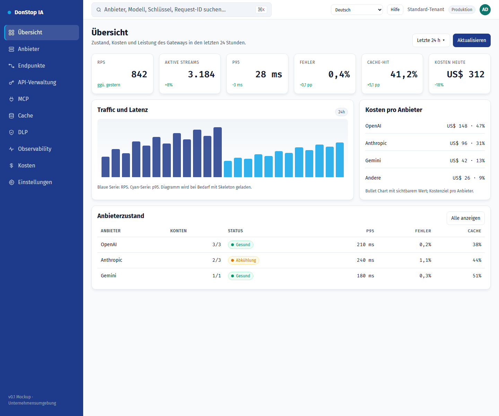

# DonStop IA

**Sprachen:** [English](README.md) · [Português (Portugal)](README.pt-PT.md) · [Português (Brasil)](README.pt-BR.md) · [Español](README.es.md) · [Français](README.fr.md) · **[Deutsch](README.de.md)**

> Wenn eine Übersetzung fehlt oder veraltet ist, gilt Englisch als Fallback: [README.md](README.md).

DonStop IA ist ein selbst gehostetes Unternehmens-KI-Gateway. Es bietet eine OpenAI-kompatible API, routet Anfragen mit Failover über Anbieter und mehrere Konten, cached exakte und semantische Antworten, leitet Upstream-Traffic über Webshare-Proxys, wendet DLP-Richtlinien an und verfolgt Kontingente, Kosten und Observability. Das Design behält `tenant_id` von Anfang an bei, damit ein Single-Tenant-P0 zu Multi-Tenancy weiterentwickelt werden kann.



*Prototyp der Admin-Konsole — Dashboard*

## Projektstatus

Dieses Repository enthält derzeit die **Architektur, die Produktdokumentation, das Design System und einen statischen, funktionsfähigen Prototyp der Admin-Konsole**. Die Go-Data-Plane, die Next.js-Admin-Anwendung, die Datenbank und das Produktions-Deployment sind spezifiziert, aber **noch nicht implementiert**. Der Prototyp verarbeitet keinen echten `/v1`-Traffic.

| Bereich | Status |
|---|---|
| Produkt-/Architekturdokumentation (`docs/`) | Ausgearbeitet und versioniert |
| Design System und Mockups (`design-system/`) | Verfügbar |
| Prototyp der Admin-Konsole | Statische, funktionsfähige Konsole mit i18n, Onboarding, Einstellungen, MCP und Hilfe-Links |
| Go-Gateway (`gateway/`) | Geplant |
| Next.js-Admin (Anwendung `admin/`) | Geplant; `admin/` enthält derzeit die gemeinsame Prototyp-Runtime und Validierung |
| Docker-Swarm-Deployment (`deploy/`) | Geplant |

## Inhalt dieses Repositories

| Pfad | Zweck |
|---|---|
| [`docs/`](docs/README.md) | PRD, DER, UML, Stack-Analyse, ADRs, Roadmap, Backlog, Architektur und Referenzen |
| [`design-system/`](design-system/MASTER.md) | Design-Tokens, Seitenspezifikationen und navigierbarer Konsolen-Mockup |
| [`design-system/mockups/console.html`](design-system/mockups/console.html) | Funktionsfähiger Prototyp der Admin-Konsole |
| [`admin/`](admin/README.md) | i18n-Runtime, Locale-Kataloge, Präferenzlogik, Hilfe-Links und Validierung |
| [`docs/user-guide/`](docs/user-guide/README.md) | Versioniertes Benutzerhandbuch in sechs Sprachen mit Screenshots |
| [`scripts/`](scripts/) | Generierung des Benutzerhandbuchs und Screenshot-Erfassung |

## Voraussetzungen

Erforderlich für das aktuelle Repository:

- **Git**
- **Node.js 22+** (Tests, Lint und Build nutzen nur Node-Bordmittel)
- **Python 3** (statischer HTTP-Server für die Konsole)
- **Google Chrome** (optional; nur zum erneuten Erfassen der Handbuch-Screenshots)

Geplanter Stack, **nicht erforderlich**, bis Gateway und Next.js-Admin implementiert sind:

- Go 1.24+
- PostgreSQL 17 + PgBouncer
- Redis 8 (oder Valkey 8)
- Qdrant
- NATS JetStream
- Docker Swarm

Kubernetes wird von diesem Projekt nicht unterstützt.

## Installation

1. Repository klonen:

```bash
git clone https://github.com/alltomatos/dontstop.git
cd dontstop
```

2. Lokalen HTTP-Server aus dem Repository-Stamm starten:

```bash
python -m http.server 8765 --bind 127.0.0.1
```

3. Konsole öffnen:

```text
http://127.0.0.1:8765/design-system/mockups/console.html
```

4. Gemeinsame Runtime und Handbuch validieren:

```bash
cd admin
npm test
npm run lint
npm run build
```

`npm install` ist nicht erforderlich: Das Admin-Paket hat keine externen Abhängigkeiten. Das Build-Ergebnis wird nach `admin/dist/` geschrieben und ist in `.gitignore` eingetragen.

## Konfiguration

### Internationalisierung

- Unterstützte Locales: `en`, `pt-PT`, `pt-BR`, `es`, `fr`, `de`.
- Locale-Kataloge: `admin/locales/<locale>.json`.
- Fallback: Fehlende Schlüssel werden auf Englisch aufgelöst; fehlt auch Englisch, wird der Schlüssel selbst angezeigt und die UI funktioniert weiter.
- Präferenz: in `localStorage` unter **`dontstop.locale`** als einfacher BCP-47-String (zum Beispiel `"de"`).
- Erster Zugriff: Das Onboarding schlägt anhand von `navigator.languages` die nächstgelegene Locale vor; die Bestätigung speichert die Auswahl, spätere Besuche zeigen kein Onboarding mehr.
- Einstellungen ändern die Sprache sofort, aktualisieren `<html lang>` und berechnen Hilfe-Links ohne Neuladen neu.

### Hilfe-Links

Bearbeiten Sie `admin/src/guide-links.js` (`GUIDE_CONFIG`), um Repository-URL, Branch und Basispfad des Handbuchs festzulegen. Das URL-Muster lautet:

```text
https://github.com/alltomatos/dontstop/blob/main/docs/user-guide/<locale>/<slug>.md
```

Fallback-Reihenfolge: aktuelle Locale → Englisch → `docs/user-guide/README.md`.

### URL-Parameter der Konsole

| Parameter | Wirkung |
|---|---|
| `?lang=de` | Wendet eine Locale nur für die aktuelle Sitzung an, ohne sie zu speichern |
| `?onboarding=1` | Erzwingt das Onboarding beim ersten Zugriff |
| `?open=new-key#api-manager` | Öffnet das Modal für einen neuen API-Schlüssel |
| `#settings` | Öffnet Einstellungen |
| `#mcp` | Öffnet die MCP-Seite |
| `?view=list#providers` | Öffnet Anbieter in der Listenansicht |

Der aktuelle Prototyp benötigt keine Umgebungsvariablen, Datenbank, Redis oder Qdrant. Committen Sie niemals Secrets.

## Schnellstart

Öffnen Sie die Konsole und navigieren Sie über die Seitenleiste:

```text
http://127.0.0.1:8765/design-system/mockups/console.html
```

Nützliche Kurzlinks:

```text
http://127.0.0.1:8765/design-system/mockups/console.html?lang=de#dashboard
http://127.0.0.1:8765/design-system/mockups/console.html?onboarding=1
http://127.0.0.1:8765/design-system/mockups/console.html?open=new-key#api-manager
http://127.0.0.1:8765/design-system/mockups/console.html#settings
http://127.0.0.1:8765/design-system/mockups/console.html#mcp
```

Textinhalt des Benutzerhandbuchs neu generieren:

```bash
node scripts/generate-user-guide.js
```

Alle 72 Screenshots neu erfassen (Server muss laufen; Chrome erforderlich):

```bash
node scripts/capture-user-guide.js
```

Unter macOS/Linux `CHROME_PATH` setzen, wenn Chrome nicht am Windows-Standardpfad liegt:

```bash
CHROME_PATH=/path/to/chrome node scripts/capture-user-guide.js
```

## Wichtigste Befehle

| Befehl | Zweck |
|---|---|
| `python -m http.server 8765 --bind 127.0.0.1` | Repository und Konsole lokal bereitstellen |
| `cd admin && npm test` | i18n-, Präferenz-, Link- und Handbuch-Tests ausführen |
| `cd admin && npm run lint` | Locale-Parität, Inventar, Bilder und Handbuch-Manifest validieren |
| `cd admin && npm run build` | Validieren und `admin/dist/` schreiben |
| `node scripts/generate-user-guide.js` | Die 72 Handbuchdateien, Indizes und das Manifest neu generieren |
| `node scripts/capture-user-guide.js` | 12 Bildschirme × 6 Locales neu erfassen |
| `git status` | Änderungen vor dem Commit prüfen |

## Fehlerbehebung

### Die Konsole ist leer oder Links funktionieren nicht

Stellen Sie das Repository über HTTP aus seinem Stamm bereit. Das Öffnen von `console.html` über `file://` blockiert das Laden von Locales und Manifest.

### Der Port wird bereits verwendet

Verwenden Sie einen anderen Port und aktualisieren Sie die URL:

```bash
python -m http.server 8766 --bind 127.0.0.1
```

### Übersetzungen fehlen oder sind gemischt

- Stellen Sie sicher, dass die Seite aus dem Repository-Stamm ausgeliefert wird, damit `/admin/locales/<locale>.json` erreichbar ist.
- Prüfen Sie die Browser-Konsole auf fehlgeschlagene `fetch`-Anfragen.
- Löschen Sie `dontstop.locale` in den DevTools und laden Sie neu, um das Onboarding erneut zu öffnen.
- Prüfen Sie die Schlüsselparität mit `cd admin && npm run lint`.

### Der Hilfe-Link liefert 404

- Prüfen Sie `GUIDE_CONFIG.repoUrl`, `branch` und `basePath` in `admin/src/guide-links.js`.
- Stellen Sie sicher, dass die Datei unter `docs/user-guide/<locale>/<slug>.md` existiert.
- Stellen Sie sicher, dass der Branch auf GitHub existiert.

### Die Screenshot-Erfassung schlägt fehl

- Starten Sie zuerst den lokalen Server.
- Installieren Sie Google Chrome oder setzen Sie `CHROME_PATH`.
- Stellen Sie sicher, dass Port `8765` frei ist.

### Tests oder Lint schlagen nach einer neuen Übersetzung fehl

Fügen Sie denselben Schlüssel zu allen sechs Dateien in `admin/locales/` hinzu. Der Paritätstest schlägt fehl, wenn Schlüssel abweichen. Generieren Sie das Handbuch nach Änderungen an Slugs oder Inventar neu.

### Die Gateway-API ist nicht verfügbar

Das aktuelle Repository ist eine Spezifikation und ein Konsolen-Prototyp; `/v1`-Traffic wird noch nicht verarbeitet. Das geplante Gateway ist in [`docs/01-PRD.md`](docs/01-PRD.md), [`docs/03-UML.md`](docs/03-UML.md) und [`docs/architecture/ADD.md`](docs/architecture/ADD.md) dokumentiert.

## Dokumentation

- [Dokumentationsindex](docs/README.md)
- [Produktanforderungen (PRD)](docs/01-PRD.md)
- [Datenmodell (DER)](docs/02-DER.md)
- [UML und Sequenzen](docs/03-UML.md)
- [Stack-Analyse](docs/04-ANALISE-STACK.md)
- [Architecture Decision Records](docs/05-ADRS.md)
- [Roadmap und Risiken](docs/06-ROADMAP-RISCOS.md)
- [i18n und Benutzerhandbuch](docs/07-I18N-E-USER-GUIDE.md)
- [Backlog](docs/BACKLOG.md)
- [Konsolidierte Architektur](docs/architecture/ADD.md)
- [Benutzerhandbuch (sechs Sprachen)](docs/user-guide/README.md)
- [Design System](design-system/MASTER.md)
- [Konsolen-Mockup](design-system/mockups/console.html)
- [Admin-Runtime](admin/README.md)
- [MCP-Referenz](docs/reference/MCP-REFERENCIAS.md)
- [Endpoints- und API-Manager-Referenz](docs/reference/ENDPOINTS-API-MANAGER-REFERENCIAS.md)

## Mitwirken

- Nie direkt auf `main` oder `master` committen; Branches `feat/`, `fix/`, `refactor/`, `docs/`, `test/` oder `chore/` verwenden.
- Conventional Commits verwenden.
- Vor einem Pull Request `cd admin && npm test && npm run lint && npm run build` ausführen.
- Architekturänderungen erfordern einen ADR in `docs/05-ADRS.md` (oder `docs/adr/`).
- Für Engineering-, Sicherheits-, i18n- und Handbuchregeln [`AGENTS.md`](AGENTS.md) befolgen.
