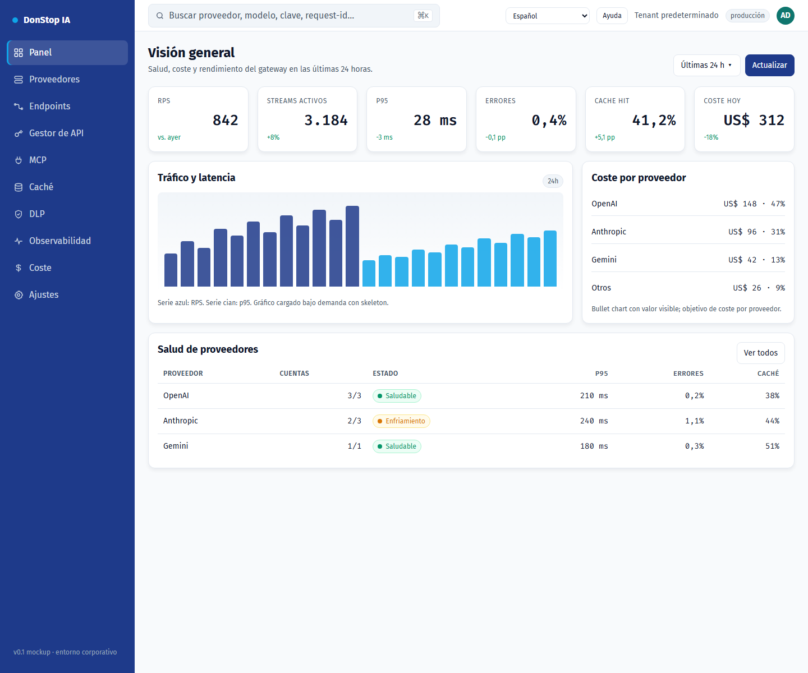

# DonStop IA

**Idiomas:** [English](README.md) · [Português (Portugal)](README.pt-PT.md) · [Português (Brasil)](README.pt-BR.md) · **[Español](README.es.md)** · [Français](README.fr.md) · [Deutsch](README.de.md)

> Si falta una traducción o está desactualizada, el inglés es el fallback: [README.md](README.md).

DonStop IA es un gateway corporativo de IA autohospedado. Expone una API compatible con OpenAI, enruta solicitudes entre proveedores y varias cuentas con failover, aplica caché exacta y semántica, enruta el tráfico upstream mediante proxies Webshare, aplica políticas DLP y registra cuotas, coste y observabilidad. El diseño mantiene `tenant_id` desde el inicio para que un P0 single-tenant evolucione a multi-tenancy.



*Prototipo de la consola de administración — Dashboard*

## Estado del proyecto

Este repositorio contiene actualmente la **arquitectura, la documentación de producto, el design system y un prototipo estático y funcional de la consola de administración**. El data plane en Go, la aplicación Next.js del admin, la base de datos y el despliegue de producción están especificados, pero **aún no implementados**. El prototipo no sirve tráfico `/v1` real.

| Área | Estado |
|---|---|
| Documentación de producto/arquitectura (`docs/`) | Redactada y versionada |
| Design system y mockups (`design-system/`) | Disponible |
| Prototipo de la consola de administración | Consola estática funcional con i18n, onboarding, Ajustes, MCP y enlaces de la guía |
| Gateway en Go (`gateway/`) | Planificado |
| Admin Next.js (aplicación `admin/`) | Planificado; `admin/` contiene actualmente el runtime compartido del prototipo y la validación |
| Despliegue Docker Swarm (`deploy/`) | Planificado |

## Qué contiene este repositorio

| Ruta | Propósito |
|---|---|
| [`docs/`](docs/README.md) | PRD, DER, UML, análisis de stack, ADRs, roadmap, backlog, arquitectura y referencias |
| [`design-system/`](design-system/MASTER.md) | Tokens de diseño, especificaciones de páginas y mockup navegable de la consola |
| [`design-system/mockups/console.html`](design-system/mockups/console.html) | Prototipo funcional de la consola de administración |
| [`admin/`](admin/README.md) | Runtime de i18n, catálogos de locale, lógica de preferencias, enlaces de la guía y validación |
| [`docs/user-guide/`](docs/user-guide/README.md) | Guía del usuario versionada en seis idiomas, con capturas de pantalla |
| [`scripts/`](scripts/) | Generación de la guía del usuario y captura de imágenes |

## Requisitos previos

Necesarios para el repositorio actual:

- **Git**
- **Node.js 22+** (las pruebas, el lint y el build usan solo APIs nativas de Node)
- **Python 3** (servidor HTTP estático para la consola)
- **Google Chrome** (opcional; solo para recapturar las imágenes de la guía)

Stack planificado, **no necesario** hasta que se implementen el gateway y el admin Next.js:

- Go 1.24+
- PostgreSQL 17 + PgBouncer
- Redis 8 (o Valkey 8)
- Qdrant
- NATS JetStream
- Docker Swarm

Kubernetes no está soportado por este proyecto.

## Instalación

1. Clona el repositorio:

```bash
git clone https://github.com/alltomatos/dontstop.git
cd dontstop
```

2. Inicia un servidor HTTP local desde la raíz del repositorio:

```bash
python -m http.server 8765 --bind 127.0.0.1
```

3. Abre la consola:

```text
http://127.0.0.1:8765/design-system/mockups/console.html
```

4. Valida el runtime compartido y la guía:

```bash
cd admin
npm test
npm run lint
npm run build
```

No se requiere `npm install`: el paquete admin no tiene dependencias externas. El resultado del build se escribe en `admin/dist/` y está en `.gitignore`.

## Configuración

### Internacionalización

- Locales soportados: `en`, `pt-PT`, `pt-BR`, `es`, `fr`, `de`.
- Catálogos de locale: `admin/locales/<locale>.json`.
- Fallback: las claves ausentes resuelven a inglés; si el inglés también falta, se muestra la propia clave y la UI sigue funcionando.
- Preferencia: guardada en `localStorage` bajo la clave **`dontstop.locale`** como string BCP-47 simple (por ejemplo `"es"`).
- Primer acceso: el onboarding sugiere el locale más cercano desde `navigator.languages`; confirmar persiste la elección y las visitas posteriores no muestran el onboarding.
- Ajustes cambia el idioma de inmediato, actualiza `<html lang>` y recalcula los enlaces de ayuda sin recargar.

### Enlaces de ayuda

Edita `admin/src/guide-links.js` (`GUIDE_CONFIG`) para definir la URL del repositorio, la rama y la ruta base de la guía. El patrón de URL es:

```text
https://github.com/alltomatos/dontstop/blob/main/docs/user-guide/<locale>/<slug>.md
```

Orden de fallback: locale actual → inglés → `docs/user-guide/README.md`.

### Parámetros de URL de la consola

| Parámetro | Efecto |
|---|---|
| `?lang=es` | Aplica un locale solo a la sesión actual, sin persistirlo |
| `?onboarding=1` | Fuerza el onboarding de primer acceso |
| `?open=new-key#api-manager` | Abre el modal de nueva clave de API |
| `#settings` | Abre Ajustes |
| `#mcp` | Abre la página MCP |
| `?view=list#providers` | Abre Proveedores en vista de lista |

El prototipo actual no requiere variables de entorno, base de datos, Redis ni Qdrant. Nunca hagas commit de secretos.

## Uso rápido

Abre la consola y navega por la barra lateral:

```text
http://127.0.0.1:8765/design-system/mockups/console.html
```

Atajos útiles:

```text
http://127.0.0.1:8765/design-system/mockups/console.html?lang=es#dashboard
http://127.0.0.1:8765/design-system/mockups/console.html?onboarding=1
http://127.0.0.1:8765/design-system/mockups/console.html?open=new-key#api-manager
http://127.0.0.1:8765/design-system/mockups/console.html#settings
http://127.0.0.1:8765/design-system/mockups/console.html#mcp
```

Regenerar el contenido textual de la guía del usuario:

```bash
node scripts/generate-user-guide.js
```

Recapturar las 72 imágenes (el servidor debe estar en ejecución; se requiere Chrome):

```bash
node scripts/capture-user-guide.js
```

En macOS/Linux, define `CHROME_PATH` si Chrome no está en la ruta predeterminada de Windows:

```bash
CHROME_PATH=/path/to/chrome node scripts/capture-user-guide.js
```

## Comandos principales

| Comando | Propósito |
|---|---|
| `python -m http.server 8765 --bind 127.0.0.1` | Servir el repositorio y la consola localmente |
| `cd admin && npm test` | Ejecutar pruebas de i18n, preferencias, enlaces y cobertura de la guía |
| `cd admin && npm run lint` | Validar paridad de locales, inventario, imágenes y manifest de la guía |
| `cd admin && npm run build` | Validar y escribir `admin/dist/` |
| `node scripts/generate-user-guide.js` | Regenerar los 72 archivos de la guía, índices y manifest |
| `node scripts/capture-user-guide.js` | Recapturar 12 pantallas × 6 locales |
| `git status` | Revisar cambios antes de hacer commit |

## Solución de problemas

### La consola está en blanco o los enlaces no funcionan

Sirve el repositorio por HTTP desde su raíz. Abrir `console.html` mediante `file://` bloquea la carga de locales y del manifest.

### El puerto ya está en uso

Usa otro puerto y actualiza la URL:

```bash
python -m http.server 8766 --bind 127.0.0.1
```

### Faltan traducciones o están mezcladas

- Confirma que la página se sirve desde la raíz del repositorio, para que `/admin/locales/<locale>.json` sea accesible.
- Revisa la consola del navegador para solicitudes `fetch` fallidas.
- Borra `dontstop.locale` en DevTools y recarga para reabrir el onboarding.
- Confirma la paridad de claves con `cd admin && npm run lint`.

### El enlace de Ayuda devuelve 404

- Revisa `GUIDE_CONFIG.repoUrl`, `branch` y `basePath` en `admin/src/guide-links.js`.
- Confirma que el archivo existe en `docs/user-guide/<locale>/<slug>.md`.
- Confirma que la rama existe en GitHub.

### La captura de imágenes falla

- Inicia primero el servidor local.
- Instala Google Chrome o define `CHROME_PATH`.
- Asegúrate de que el puerto `8765` esté libre.

### Las pruebas o el lint fallan tras añadir una traducción

Añade la misma clave a los seis archivos de `admin/locales/`. La prueba de paridad falla cuando las claves difieren. Regenera la guía tras cambiar slugs o inventario.

### La API del gateway no está disponible

El repositorio actual es una especificación y un prototipo de consola; el tráfico `/v1` aún no se sirve. El gateway planificado está documentado en [`docs/01-PRD.md`](docs/01-PRD.md), [`docs/03-UML.md`](docs/03-UML.md) y [`docs/architecture/ADD.md`](docs/architecture/ADD.md).

## Documentación

- [Índice de documentación](docs/README.md)
- [Requisitos de producto (PRD)](docs/01-PRD.md)
- [Modelo de datos (DER)](docs/02-DER.md)
- [UML y secuencias](docs/03-UML.md)
- [Análisis de stack](docs/04-ANALISE-STACK.md)
- [Architecture Decision Records](docs/05-ADRS.md)
- [Roadmap y riesgos](docs/06-ROADMAP-RISCOS.md)
- [i18n y guía del usuario](docs/07-I18N-E-USER-GUIDE.md)
- [Backlog](docs/BACKLOG.md)
- [Arquitectura consolidada](docs/architecture/ADD.md)
- [Guía del usuario (seis idiomas)](docs/user-guide/README.md)
- [Design system](design-system/MASTER.md)
- [Mockup de la consola](design-system/mockups/console.html)
- [Runtime del admin](admin/README.md)
- [Referencia MCP](docs/reference/MCP-REFERENCIAS.md)
- [Referencia de endpoints y API Manager](docs/reference/ENDPOINTS-API-MANAGER-REFERENCIAS.md)

## Contribución

- Nunca hagas commit directamente en `main` o `master`; usa ramas `feat/`, `fix/`, `refactor/`, `docs/`, `test/` o `chore/`.
- Usa Conventional Commits.
- Ejecuta `cd admin && npm test && npm run lint && npm run build` antes de abrir un pull request.
- Los cambios de arquitectura requieren un ADR en `docs/05-ADRS.md` (o `docs/adr/`).
- Sigue [`AGENTS.md`](AGENTS.md) para las reglas de ingeniería, seguridad, i18n y guía del usuario.
