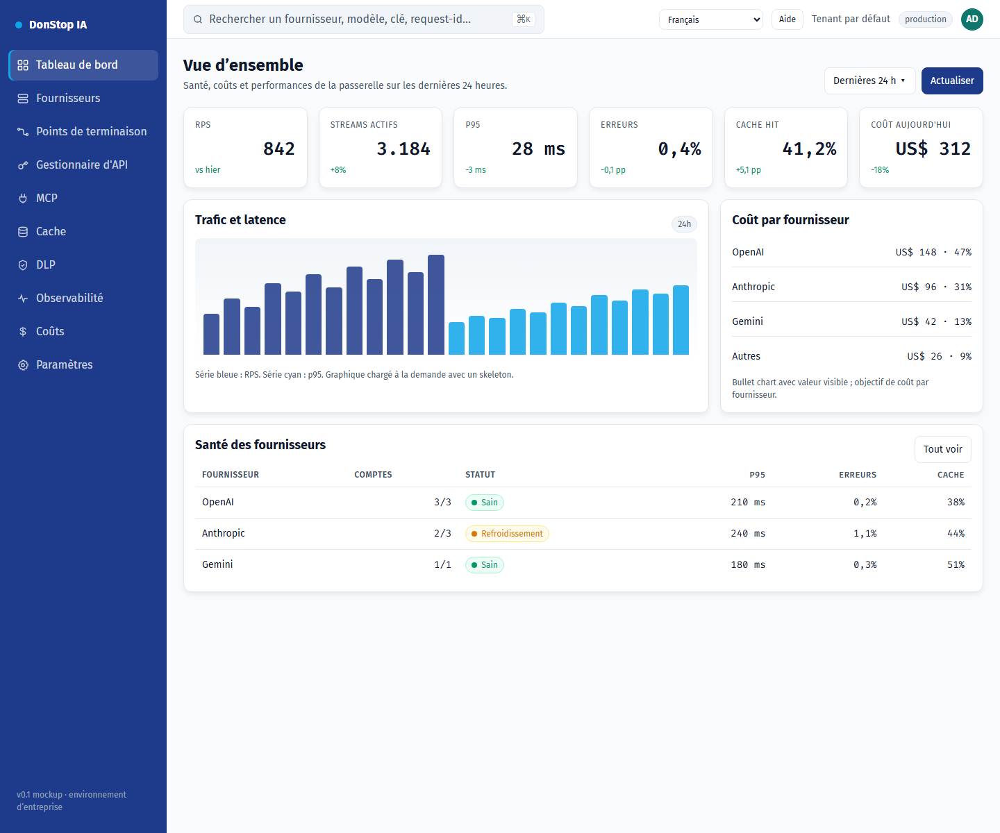

# DonStop IA

**Langues :** [English](README.md) · [Português (Portugal)](README.pt-PT.md) · [Português (Brasil)](README.pt-BR.md) · [Español](README.es.md) · **[Français](README.fr.md)** · [Deutsch](README.de.md)

> Si une traduction est absente ou obsolète, l’anglais fait office de fallback : [README.md](README.md).

DonStop IA est une passerelle d’IA d’entreprise auto-hébergée. Elle expose une API compatible OpenAI, route les requêtes entre fournisseurs et plusieurs comptes avec failover, met en cache les réponses exactes et sémantiques, achemine le trafic upstream via des proxys Webshare, applique des politiques DLP et suit les quotas, les coûts et l’observabilité. La conception conserve `tenant_id` dès le départ afin qu’un P0 single-tenant puisse évoluer vers le multi-tenancy.



*Prototype de la console d’administration — Dashboard*

## État du projet

Ce dépôt contient actuellement **l’architecture, la documentation produit, le design system et un prototype statique et fonctionnel de la console d’administration**. Le data plane en Go, l’application Next.js de l’admin, la base de données et le déploiement de production sont spécifiés mais **pas encore implémentés**. Le prototype ne sert pas de trafic `/v1` réel.

| Domaine | État |
|---|---|
| Documentation produit/architecture (`docs/`) | Rédigée et versionnée |
| Design system et mockups (`design-system/`) | Disponible |
| Prototype de la console d’administration | Console statique fonctionnelle avec i18n, onboarding, Paramètres, MCP et liens du guide |
| Passerelle Go (`gateway/`) | Planifiée |
| Admin Next.js (application `admin/`) | Planifié ; `admin/` contient actuellement le runtime partagé du prototype et la validation |
| Déploiement Docker Swarm (`deploy/`) | Planifié |

## Contenu du dépôt

| Chemin | Rôle |
|---|---|
| [`docs/`](docs/README.md) | PRD, DER, UML, analyse de stack, ADRs, roadmap, backlog, architecture et références |
| [`design-system/`](design-system/MASTER.md) | Tokens de design, spécifications de pages et mockup navigable de la console |
| [`design-system/mockups/console.html`](design-system/mockups/console.html) | Prototype fonctionnel de la console d’administration |
| [`admin/`](admin/README.md) | Runtime i18n, catalogues de locale, logique de préférences, liens du guide et validation |
| [`docs/user-guide/`](docs/user-guide/README.md) | Guide utilisateur versionné en six langues, avec captures d’écran |
| [`scripts/`](scripts/) | Génération du guide utilisateur et capture des images |

## Prérequis

Nécessaires pour le dépôt actuel :

- **Git**
- **Node.js 22+** (les tests, le lint et le build utilisent uniquement les API natives de Node)
- **Python 3** (serveur HTTP statique pour la console)
- **Google Chrome** (facultatif ; uniquement pour recapturer les images du guide)

Stack planifiée, **non nécessaire** tant que la passerelle et l’admin Next.js ne sont pas implémentés :

- Go 1.24+
- PostgreSQL 17 + PgBouncer
- Redis 8 (ou Valkey 8)
- Qdrant
- NATS JetStream
- Docker Swarm

Kubernetes n’est pas pris en charge par ce projet.

## Installation

1. Clonez le dépôt :

```bash
git clone https://github.com/alltomatos/dontstop.git
cd dontstop
```

2. Démarrez un serveur HTTP local depuis la racine du dépôt :

```bash
python -m http.server 8765 --bind 127.0.0.1
```

3. Ouvrez la console :

```text
http://127.0.0.1:8765/design-system/mockups/console.html
```

4. Validez le runtime partagé et le guide :

```bash
cd admin
npm test
npm run lint
npm run build
```

`npm install` n’est pas nécessaire : le package admin n’a aucune dépendance externe. Le résultat du build est écrit dans `admin/dist/` et ignoré par `.gitignore`.

## Configuration

### Internationalisation

- Locales prises en charge : `en`, `pt-PT`, `pt-BR`, `es`, `fr`, `de`.
- Catalogues de locale : `admin/locales/<locale>.json`.
- Fallback : les clés absentes sont résolues en anglais ; si l’anglais manque aussi, la clé elle-même est affichée et l’UI continue de fonctionner.
- Préférence : stockée dans `localStorage` sous la clé **`dontstop.locale`** sous forme de chaîne BCP-47 simple (par exemple `"fr"`).
- Premier accès : l’onboarding propose la locale la plus proche à partir de `navigator.languages` ; la confirmation persiste le choix et les visites suivantes n’affichent plus l’onboarding.
- Paramètres change la langue immédiatement, met à jour `<html lang>` et recalcule les liens d’aide sans rechargement.

### Liens d’aide

Modifiez `admin/src/guide-links.js` (`GUIDE_CONFIG`) pour définir l’URL du dépôt, la branche et le chemin de base du guide. Le modèle d’URL est :

```text
https://github.com/alltomatos/dontstop/blob/main/docs/user-guide/<locale>/<slug>.md
```

Ordre de fallback : locale actuelle → anglais → `docs/user-guide/README.md`.

### Paramètres d’URL de la console

| Paramètre | Effet |
|---|---|
| `?lang=fr` | Applique une locale à la session courante sans la persister |
| `?onboarding=1` | Force l’onboarding du premier accès |
| `?open=new-key#api-manager` | Ouvre la modale de nouvelle clé d’API |
| `#settings` | Ouvre les Paramètres |
| `#mcp` | Ouvre la page MCP |
| `?view=list#providers` | Ouvre Fournisseurs en vue liste |

Le prototype actuel ne requiert ni variable d’environnement, ni base de données, ni Redis, ni Qdrant. Ne committez jamais de secrets.

## Utilisation rapide

Ouvrez la console et naviguez dans la barre latérale :

```text
http://127.0.0.1:8765/design-system/mockups/console.html
```

Raccourcis utiles :

```text
http://127.0.0.1:8765/design-system/mockups/console.html?lang=fr#dashboard
http://127.0.0.1:8765/design-system/mockups/console.html?onboarding=1
http://127.0.0.1:8765/design-system/mockups/console.html?open=new-key#api-manager
http://127.0.0.1:8765/design-system/mockups/console.html#settings
http://127.0.0.1:8765/design-system/mockups/console.html#mcp
```

Régénérer le contenu textuel du guide utilisateur :

```bash
node scripts/generate-user-guide.js
```

Recapturer les 72 images (le serveur doit être démarré ; Chrome est requis) :

```bash
node scripts/capture-user-guide.js
```

Sous macOS/Linux, définissez `CHROME_PATH` si Chrome n’est pas au chemin Windows par défaut :

```bash
CHROME_PATH=/path/to/chrome node scripts/capture-user-guide.js
```

## Commandes principales

| Commande | Rôle |
|---|---|
| `python -m http.server 8765 --bind 127.0.0.1` | Servir le dépôt et la console en local |
| `cd admin && npm test` | Lancer les tests i18n, préférences, liens et couverture du guide |
| `cd admin && npm run lint` | Valider la parité des locales, l’inventaire, les images et le manifeste du guide |
| `cd admin && npm run build` | Valider et écrire `admin/dist/` |
| `node scripts/generate-user-guide.js` | Régénérer les 72 fichiers du guide, les index et le manifeste |
| `node scripts/capture-user-guide.js` | Recapturer 12 écrans × 6 locales |
| `git status` | Vérifier les changements avant commit |

## Résolution des problèmes

### La console est vide ou les liens ne fonctionnent pas

Servez le dépôt via HTTP depuis sa racine. Ouvrir `console.html` via `file://` bloque le chargement des locales et du manifeste.

### Le port est déjà utilisé

Utilisez un autre port et mettez à jour l’URL :

```bash
python -m http.server 8766 --bind 127.0.0.1
```

### Des traductions manquent ou sont mélangées

- Vérifiez que la page est servie depuis la racine du dépôt, afin que `/admin/locales/<locale>.json` soit accessible.
- Consultez la console du navigateur pour les requêtes `fetch` en échec.
- Effacez `dontstop.locale` dans les DevTools et rechargez pour rouvrir l’onboarding.
- Vérifiez la parité des clés avec `cd admin && npm run lint`.

### Le lien Aide renvoie 404

- Vérifiez `GUIDE_CONFIG.repoUrl`, `branch` et `basePath` dans `admin/src/guide-links.js`.
- Confirmez que le fichier existe dans `docs/user-guide/<locale>/<slug>.md`.
- Confirmez que la branche existe sur GitHub.

### La capture d’images échoue

- Démarrez d’abord le serveur local.
- Installez Google Chrome ou définissez `CHROME_PATH`.
- Assurez-vous que le port `8765` est libre.

### Les tests ou le lint échouent après ajout d’une traduction

Ajoutez la même clé aux six fichiers de `admin/locales/`. Le test de parité échoue lorsque les clés diffèrent. Régénérez le guide après modification des slugs ou de l’inventaire.

### L’API de la passerelle n’est pas disponible

Le dépôt actuel est une spécification et un prototype de console ; le trafic `/v1` n’est pas encore servi. La passerelle planifiée est documentée dans [`docs/01-PRD.md`](docs/01-PRD.md), [`docs/03-UML.md`](docs/03-UML.md) et [`docs/architecture/ADD.md`](docs/architecture/ADD.md).

## Documentation

- [Index de la documentation](docs/README.md)
- [Exigences produit (PRD)](docs/01-PRD.md)
- [Modèle de données (DER)](docs/02-DER.md)
- [UML et séquences](docs/03-UML.md)
- [Analyse de stack](docs/04-ANALISE-STACK.md)
- [Architecture Decision Records](docs/05-ADRS.md)
- [Roadmap et risques](docs/06-ROADMAP-RISCOS.md)
- [i18n et guide utilisateur](docs/07-I18N-E-USER-GUIDE.md)
- [Backlog](docs/BACKLOG.md)
- [Architecture consolidée](docs/architecture/ADD.md)
- [Guide utilisateur (six langues)](docs/user-guide/README.md)
- [Design system](design-system/MASTER.md)
- [Mockup de la console](design-system/mockups/console.html)
- [Runtime de l’admin](admin/README.md)
- [Référence MCP](docs/reference/MCP-REFERENCIAS.md)
- [Référence endpoints et API Manager](docs/reference/ENDPOINTS-API-MANAGER-REFERENCIAS.md)

## Contribution

- Ne committez jamais directement sur `main` ou `master` ; utilisez les branches `feat/`, `fix/`, `refactor/`, `docs/`, `test/` ou `chore/`.
- Utilisez les Conventional Commits.
- Exécutez `cd admin && npm test && npm run lint && npm run build` avant d’ouvrir une pull request.
- Les changements d’architecture nécessitent un ADR dans `docs/05-ADRS.md` (ou `docs/adr/`).
- Suivez [`AGENTS.md`](AGENTS.md) pour les règles d’ingénierie, de sécurité, d’i18n et de guide utilisateur.
