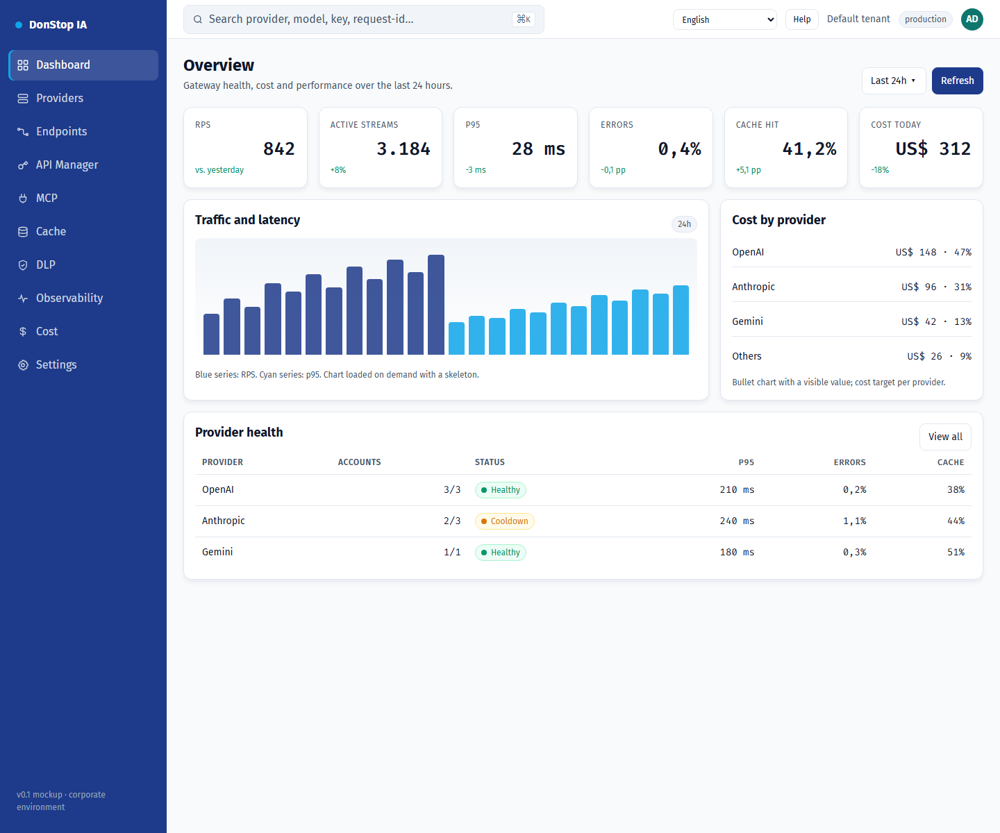

# DonStop IA

**Languages:** **[English](README.md)** · [Português (Portugal)](README.pt-PT.md) · [Português (Brasil)](README.pt-BR.md) · [Español](README.es.md) · [Français](README.fr.md) · [Deutsch](README.de.md)

> If a translation is missing or outdated, English is the fallback: [README.md](README.md).

DonStop IA is a self-hosted corporate AI gateway. It exposes an OpenAI-compatible API, routes requests across providers and multiple accounts with failover, caches exact and semantic responses, routes upstream traffic through Webshare proxies, applies DLP policies, and tracks quotas, cost and observability. The design keeps `tenant_id` from the start so a single-tenant P0 can evolve into multi-tenancy.



*Admin console prototype — Dashboard*

## Project status

This repository currently contains the **architecture, product documentation, design system and a functional static admin console prototype**. The Go data plane, Next.js admin application, database and production deployment are specified but **not implemented yet**. The prototype does not serve live `/v1` traffic.

| Area | Status |
|---|---|
| Product/architecture docs (`docs/`) | Drafted and versioned |
| Design system and mockups (`design-system/`) | Available |
| Admin console prototype | Functional static console with i18n, onboarding, Settings, MCP and user-guide links |
| Go gateway (`gateway/`) | Planned |
| Next.js admin (`admin/` app) | Planned; `admin/` currently holds the shared prototype runtime and validation |
| Docker Swarm deployment (`deploy/`) | Planned |

## What is in this repository

| Path | Purpose |
|---|---|
| [`docs/`](docs/README.md) | PRD, DER, UML, stack analysis, ADRs, roadmap, backlog, architecture and references |
| [`design-system/`](design-system/MASTER.md) | Design tokens, page specs and the clickable console mockup |
| [`design-system/mockups/console.html`](design-system/mockups/console.html) | Functional admin console prototype |
| [`admin/`](admin/README.md) | i18n runtime, locale catalogs, preference logic, guide links and validation |
| [`docs/user-guide/`](docs/user-guide/README.md) | Versioned user guide in six languages with screenshots |
| [`scripts/`](scripts/) | User-guide generation and screenshot capture |

## Prerequisites

Required for the current repository:

- **Git**
- **Node.js 22+** (tests, lint and build use only Node built-ins)
- **Python 3** (static HTTP server for the console)
- **Google Chrome** (optional; only for recapturing user-guide screenshots)

Planned stack, **not required** until the gateway and Next.js admin are implemented:

- Go 1.24+
- PostgreSQL 17 + PgBouncer
- Redis 8 (or Valkey 8)
- Qdrant
- NATS JetStream
- Docker Swarm

Kubernetes is not supported by this project.

## Installation

1. Clone the repository:

```bash
git clone https://github.com/alltomatos/dontstop.git
cd dontstop
```

2. Start a local HTTP server from the repository root:

```bash
python -m http.server 8765 --bind 127.0.0.1
```

3. Open the console:

```text
http://127.0.0.1:8765/design-system/mockups/console.html
```

4. Validate the shared runtime and guide:

```bash
cd admin
npm test
npm run lint
npm run build
```

No `npm install` is required: the admin package has no external dependencies. The build output is written to `admin/dist/` and is gitignored.

## Configuration

### Internationalization

- Supported locales: `en`, `pt-PT`, `pt-BR`, `es`, `fr`, `de`.
- Locale catalogs: `admin/locales/<locale>.json`.
- Fallback: missing keys resolve to English; if English is also missing, the key itself is shown and the UI keeps working.
- Preference: stored in `localStorage` under **`dontstop.locale`** as a plain BCP-47 string (for example `"pt-BR"`).
- First access: onboarding suggests the closest locale from `navigator.languages`; confirming persists the choice and later visits skip onboarding.
- Settings changes the locale immediately, updates `<html lang>` and recalculates help links without reloading.

### Help links

Edit `admin/src/guide-links.js` (`GUIDE_CONFIG`) to set the repository URL, branch and guide base path. The URL pattern is:

```text
https://github.com/alltomatos/dontstop/blob/main/docs/user-guide/<locale>/<slug>.md
```

Fallback order: current locale → English → `docs/user-guide/README.md`.

### Console URL parameters

| Parameter | Effect |
|---|---|
| `?lang=pt-BR` | Applies a locale for the current session without persisting it |
| `?onboarding=1` | Forces the first-access onboarding |
| `?open=new-key#api-manager` | Opens the new API key modal |
| `#settings` | Opens Settings |
| `#mcp` | Opens the MCP page |
| `?view=list#providers` | Opens Providers in list view |

No environment variables, database, Redis or Qdrant are required by the current prototype. Never commit secrets.

## Quick usage

Open the console and navigate the sidebar:

```text
http://127.0.0.1:8765/design-system/mockups/console.html
```

Useful shortcuts:

```text
http://127.0.0.1:8765/design-system/mockups/console.html?lang=pt-BR#dashboard
http://127.0.0.1:8765/design-system/mockups/console.html?onboarding=1
http://127.0.0.1:8765/design-system/mockups/console.html?open=new-key#api-manager
http://127.0.0.1:8765/design-system/mockups/console.html#settings
http://127.0.0.1:8765/design-system/mockups/console.html#mcp
```

Regenerate the user-guide textual content:

```bash
node scripts/generate-user-guide.js
```

Recapture all 72 screenshots (server must be running; Chrome required):

```bash
node scripts/capture-user-guide.js
```

On macOS/Linux, set `CHROME_PATH` if Chrome is not in the default Windows path:

```bash
CHROME_PATH=/path/to/chrome node scripts/capture-user-guide.js
```

## Main commands

| Command | Purpose |
|---|---|
| `python -m http.server 8765 --bind 127.0.0.1` | Serve the repository and console locally |
| `cd admin && npm test` | Run i18n, preferences, guide-link and guide-coverage tests |
| `cd admin && npm run lint` | Validate locale parity, guide inventory, images and manifest |
| `cd admin && npm run build` | Validate and write `admin/dist/` |
| `node scripts/generate-user-guide.js` | Regenerate the 72 guide files, indexes and manifest |
| `node scripts/capture-user-guide.js` | Recapture 12 screens × 6 locales |
| `git status` | Review changes before committing |

## Troubleshooting

### The console is blank or links do not work

Serve the repository over HTTP from its root. Opening `console.html` via `file://` blocks locale and manifest loading.

### The port is already in use

Use another port and update the URL:

```bash
python -m http.server 8766 --bind 127.0.0.1
```

### Translations are missing or mixed

- Confirm the page is served from the repository root, so `/admin/locales/<locale>.json` is reachable.
- Check the browser console for failed `fetch` requests.
- Clear `dontstop.locale` in DevTools and reload to reopen onboarding.
- Confirm key parity with `cd admin && npm run lint`.

### The Help link returns 404

- Check `GUIDE_CONFIG.repoUrl`, `branch` and `basePath` in `admin/src/guide-links.js`.
- Confirm the file exists at `docs/user-guide/<locale>/<slug>.md`.
- Confirm the branch exists on GitHub.

### Screenshot capture fails

- Start the local server first.
- Install Google Chrome or set `CHROME_PATH`.
- Ensure port `8765` is free.

### Tests or lint fail after adding a translation

Add the same key to all six files in `admin/locales/`. The parity test fails when keys differ. Regenerate guides after changing slugs or inventory.

### The gateway API is not available

The current repository is a specification and console prototype; `/v1` traffic is not served yet. The planned gateway is documented in [`docs/01-PRD.md`](docs/01-PRD.md), [`docs/03-UML.md`](docs/03-UML.md) and [`docs/architecture/ADD.md`](docs/architecture/ADD.md).

## Documentation

- [Documentation index](docs/README.md)
- [Product requirements (PRD)](docs/01-PRD.md)
- [Data model (DER)](docs/02-DER.md)
- [UML and sequences](docs/03-UML.md)
- [Stack analysis](docs/04-ANALISE-STACK.md)
- [Architecture Decision Records](docs/05-ADRS.md)
- [Roadmap and risks](docs/06-ROADMAP-RISCOS.md)
- [i18n and user guide](docs/07-I18N-E-USER-GUIDE.md)
- [Backlog](docs/BACKLOG.md)
- [Consolidated architecture](docs/architecture/ADD.md)
- [User guide (six languages)](docs/user-guide/README.md)
- [Design system](design-system/MASTER.md)
- [Console mockup](design-system/mockups/console.html)
- [Admin runtime](admin/README.md)
- [MCP reference](docs/reference/MCP-REFERENCIAS.md)
- [Endpoints and API Manager reference](docs/reference/ENDPOINTS-API-MANAGER-REFERENCIAS.md)

## Contributing

- Never commit directly to `main` or `master`; use `feat/`, `fix/`, `refactor/`, `docs/`, `test/` or `chore/` branches.
- Use Conventional Commits.
- Run `cd admin && npm test && npm run lint && npm run build` before opening a pull request.
- Architecture changes require an ADR in `docs/05-ADRS.md` (or `docs/adr/`).
- Follow [`AGENTS.md`](AGENTS.md) for engineering, security, i18n and user-guide rules.
