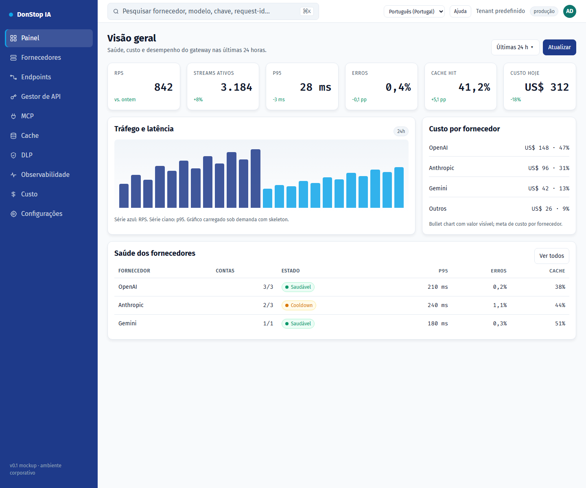

# DonStop IA

**Idiomas:** [English](README.md) · **[Português (Portugal)](README.pt-PT.md)** · [Português (Brasil)](README.pt-BR.md) · [Español](README.es.md) · [Français](README.fr.md) · [Deutsch](README.de.md)

> Se uma tradução estiver em falta ou desatualizada, o inglês é o fallback: [README.md](README.md).

O DonStop IA é um gateway corporativo de IA auto-alojado. Expõe uma API compatível com OpenAI, encaminha pedidos entre fornecedores e múltiplas contas com failover, faz cache exato e semântico, encaminha o tráfego upstream através de proxies Webshare, aplica políticas de DLP e acompanha quotas, custo e observabilidade. O desenho mantém `tenant_id` desde o início para que um P0 single-tenant evolua para multi-tenancy.



*Protótipo da consola de administração — Dashboard*

## Estado do projeto

Este repositório contém atualmente a **arquitetura, a documentação de produto, o design system e um protótipo estático e funcional da consola de administração**. O plano de dados em Go, a aplicação Next.js do admin, a base de dados e o deploy de produção estão especificados, mas **ainda não implementados**. O protótipo não serve tráfego `/v1` real.

| Área | Estado |
|---|---|
| Documentação de produto/arquitetura (`docs/`) | Redigida e versionada |
| Design system e mockups (`design-system/`) | Disponível |
| Protótipo da consola de administração | Consola estática funcional com i18n, onboarding, Configurações, MCP e links do guia |
| Gateway em Go (`gateway/`) | Planeado |
| Admin Next.js (aplicação `admin/`) | Planeado; `admin/` contém atualmente o runtime partilhado do protótipo e a validação |
| Deploy Docker Swarm (`deploy/`) | Planeado |

## O que existe neste repositório

| Caminho | Objetivo |
|---|---|
| [`docs/`](docs/README.md) | PRD, DER, UML, análise de stack, ADRs, roadmap, backlog, arquitetura e referências |
| [`design-system/`](design-system/MASTER.md) | Tokens de design, especificações de páginas e mockup navegável da consola |
| [`design-system/mockups/console.html`](design-system/mockups/console.html) | Protótipo funcional da consola de administração |
| [`admin/`](admin/README.md) | Runtime de i18n, catálogos de locale, lógica de preferência, links do guia e validação |
| [`docs/user-guide/`](docs/user-guide/README.md) | Guia do utilizador versionado em seis idiomas, com capturas de ecrã |
| [`scripts/`](scripts/) | Geração do guia do utilizador e captura de imagens |

## Pré-requisitos

Necessários para o repositório atual:

- **Git**
- **Node.js 22+** (os testes, lint e build usam apenas APIs nativas do Node)
- **Python 3** (servidor HTTP estático para a consola)
- **Google Chrome** (opcional; apenas para recapturar as imagens do guia)

Stack planeada, **não necessária** até o gateway e o admin Next.js serem implementados:

- Go 1.24+
- PostgreSQL 17 + PgBouncer
- Redis 8 (ou Valkey 8)
- Qdrant
- NATS JetStream
- Docker Swarm

O Kubernetes não é suportado por este projeto.

## Instalação

1. Clonar o repositório:

```bash
git clone https://github.com/alltomatos/dontstop.git
cd dontstop
```

2. Iniciar um servidor HTTP local a partir da raiz do repositório:

```bash
python -m http.server 8765 --bind 127.0.0.1
```

3. Abrir a consola:

```text
http://127.0.0.1:8765/design-system/mockups/console.html
```

4. Validar o runtime partilhado e o guia:

```bash
cd admin
npm test
npm run lint
npm run build
```

Não é necessário `npm install`: o pacote admin não tem dependências externas. O resultado do build é escrito em `admin/dist/` e está no `.gitignore`.

## Configuração

### Internacionalização

- Locales suportados: `en`, `pt-PT`, `pt-BR`, `es`, `fr`, `de`.
- Catálogos de locale: `admin/locales/<locale>.json`.
- Fallback: chaves em falta resolvem para inglês; se o inglês também faltar, a própria chave é apresentada e a UI continua a funcionar.
- Preferência: guardada em `localStorage` na chave **`dontstop.locale`** como string BCP-47 simples (por exemplo `"pt-PT"`).
- Primeiro acesso: o onboarding sugere o locale mais próximo a partir de `navigator.languages`; confirmar persiste a escolha e as visitas seguintes não mostram o onboarding.
- Configurações altera o idioma imediatamente, atualiza `<html lang>` e recalcula os links de ajuda sem recarregar.

### Links de ajuda

Edite `admin/src/guide-links.js` (`GUIDE_CONFIG`) para definir o URL do repositório, o branch e o caminho base do guia. O padrão do URL é:

```text
https://github.com/alltomatos/dontstop/blob/main/docs/user-guide/<locale>/<slug>.md
```

Ordem de fallback: locale atual → inglês → `docs/user-guide/README.md`.

### Parâmetros de URL da consola

| Parâmetro | Efeito |
|---|---|
| `?lang=pt-PT` | Aplica um locale apenas à sessão atual, sem o persistir |
| `?onboarding=1` | Força o onboarding de primeiro acesso |
| `?open=new-key#api-manager` | Abre o modal de nova chave de API |
| `#settings` | Abre Configurações |
| `#mcp` | Abre a página MCP |
| `?view=list#providers` | Abre Fornecedores em vista de lista |

O protótipo atual não requer variáveis de ambiente, base de dados, Redis ou Qdrant. Nunca faça commit de segredos.

## Utilização rápida

Abra a consola e navegue pela barra lateral:

```text
http://127.0.0.1:8765/design-system/mockups/console.html
```

Atalhos úteis:

```text
http://127.0.0.1:8765/design-system/mockups/console.html?lang=pt-PT#dashboard
http://127.0.0.1:8765/design-system/mockups/console.html?onboarding=1
http://127.0.0.1:8765/design-system/mockups/console.html?open=new-key#api-manager
http://127.0.0.1:8765/design-system/mockups/console.html#settings
http://127.0.0.1:8765/design-system/mockups/console.html#mcp
```

Regenerar o conteúdo textual do guia do utilizador:

```bash
node scripts/generate-user-guide.js
```

Recapturar as 72 imagens (o servidor tem de estar a correr; Chrome é necessário):

```bash
node scripts/capture-user-guide.js
```

Em macOS/Linux, defina `CHROME_PATH` se o Chrome não estiver no caminho predefinido do Windows:

```bash
CHROME_PATH=/path/to/chrome node scripts/capture-user-guide.js
```

## Comandos principais

| Comando | Objetivo |
|---|---|
| `python -m http.server 8765 --bind 127.0.0.1` | Servir o repositório e a consola localmente |
| `cd admin && npm test` | Executar testes de i18n, preferências, links e cobertura do guia |
| `cd admin && npm run lint` | Validar paridade de locales, inventário, imagens e manifest do guia |
| `cd admin && npm run build` | Validar e escrever `admin/dist/` |
| `node scripts/generate-user-guide.js` | Regenerar os 72 ficheiros do guia, índices e manifest |
| `node scripts/capture-user-guide.js` | Recapturar 12 ecrãs × 6 locales |
| `git status` | Rever alterações antes de fazer commit |

## Resolução de problemas

### A consola está em branco ou os links não funcionam

Sirva o repositório por HTTP a partir da raiz. Abrir `console.html` via `file://` bloqueia o carregamento dos locales e do manifest.

### A porta já está em uso

Use outra porta e atualize o URL:

```bash
python -m http.server 8766 --bind 127.0.0.1
```

### Faltam traduções ou estão misturadas

- Confirme que a página é servida a partir da raiz do repositório, para que `/admin/locales/<locale>.json` esteja acessível.
- Verifique a consola do navegador para pedidos `fetch` falhados.
- Limpe `dontstop.locale` nas DevTools e recarregue para reabrir o onboarding.
- Confirme a paridade de chaves com `cd admin && npm run lint`.

### O link Ajuda devolve 404

- Verifique `GUIDE_CONFIG.repoUrl`, `branch` e `basePath` em `admin/src/guide-links.js`.
- Confirme que o ficheiro existe em `docs/user-guide/<locale>/<slug>.md`.
- Confirme que o branch existe no GitHub.

### A captura de imagens falha

- Inicie primeiro o servidor local.
- Instale o Google Chrome ou defina `CHROME_PATH`.
- Garanta que a porta `8765` está livre.

### Os testes ou o lint falham depois de adicionar uma tradução

Adicione a mesma chave aos seis ficheiros em `admin/locales/`. O teste de paridade falha quando as chaves diferem. Regenerar o guia após alterar slugs ou inventário.

### A API do gateway não está disponível

O repositório atual é uma especificação e um protótipo de consola; o tráfego `/v1` ainda não é servido. O gateway planeado está documentado em [`docs/01-PRD.md`](docs/01-PRD.md), [`docs/03-UML.md`](docs/03-UML.md) e [`docs/architecture/ADD.md`](docs/architecture/ADD.md).

## Documentação

- [Índice da documentação](docs/README.md)
- [Requisitos de produto (PRD)](docs/01-PRD.md)
- [Modelo de dados (DER)](docs/02-DER.md)
- [UML e sequências](docs/03-UML.md)
- [Análise de stack](docs/04-ANALISE-STACK.md)
- [Architecture Decision Records](docs/05-ADRS.md)
- [Roadmap e riscos](docs/06-ROADMAP-RISCOS.md)
- [i18n e guia do utilizador](docs/07-I18N-E-USER-GUIDE.md)
- [Backlog](docs/BACKLOG.md)
- [Arquitetura consolidada](docs/architecture/ADD.md)
- [Guia do utilizador (seis idiomas)](docs/user-guide/README.md)
- [Design system](design-system/MASTER.md)
- [Mockup da consola](design-system/mockups/console.html)
- [Runtime do admin](admin/README.md)
- [Referência MCP](docs/reference/MCP-REFERENCIAS.md)
- [Referência de endpoints e API Manager](docs/reference/ENDPOINTS-API-MANAGER-REFERENCIAS.md)

## Contribuição

- Nunca faça commit diretamente em `main` ou `master`; use branches `feat/`, `fix/`, `refactor/`, `docs/`, `test/` ou `chore/`.
- Use Conventional Commits.
- Execute `cd admin && npm test && npm run lint && npm run build` antes de abrir um pull request.
- Alterações de arquitetura exigem um ADR em `docs/05-ADRS.md` (ou `docs/adr/`).
- Siga o [`AGENTS.md`](AGENTS.md) para as regras de engenharia, segurança, i18n e guia do utilizador.
