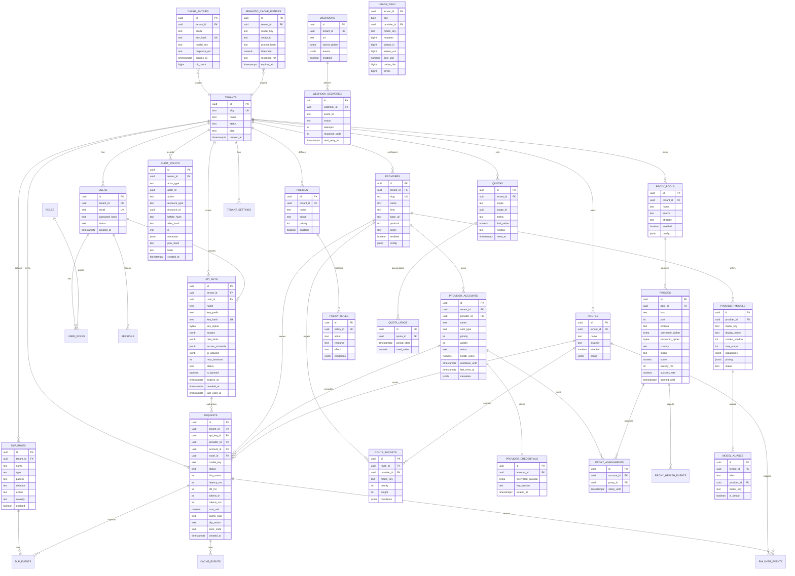
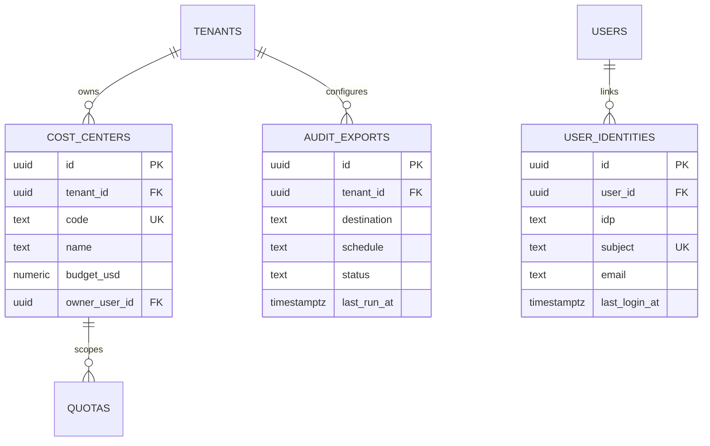
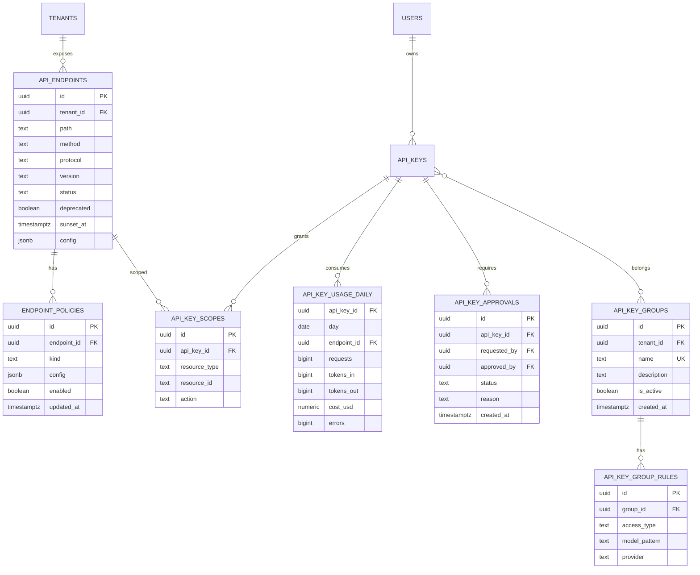
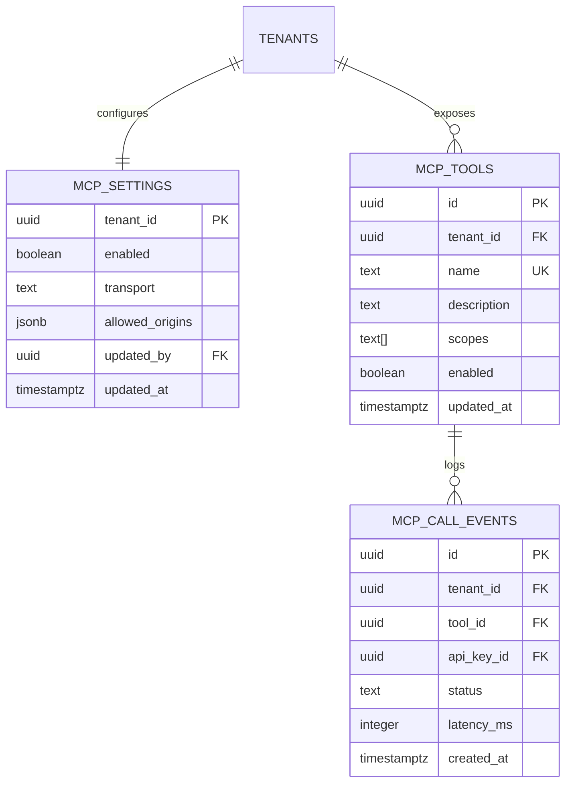

# dontstop — DER (Diagrama Entidade-Relacionamento)

> Fontes: `[REPO]`, `[MAP-9R]`, `[MAP-OMNI]`, `[MAP-ALLCODE]` (ver [README](README.md)).
> Banco de verdade proposto: **PostgreSQL 17**. Cache exato em **Redis**; vetores em **Qdrant**.
> O DER já inclui `tenant_id` em todas as entidades de domínio para permitir multi-tenancy futura.

## 1. Princípios do modelo

1. **Single-tenant agora, multi-tenant depois:** todas as tabelas raiz têm `tenant_id`; o P0 usa um tenant padrão.
2. **Segredos separados do domínio:** credenciais ficam em `provider_credentials`/`proxies` cifradas, nunca em colunas de texto.
3. **Cache não é system of record:** o payload do cache exato vive no Redis; o Postgres guarda metadados para invalidação e estatística. Vetores vivem no Qdrant; o Postgres guarda o ponteiro.
4. **Histórico é imutável:** `audit_events` é append-only com hash encadeado; `requests` é particionada por mês.
5. **IDs ordenáveis por tempo:** UUIDv7 (ou ULID) para facilitar paginação e partições.

## 2. Diagrama ER (Mermaid)

> **Nota sobre unicidade:** no diagrama, `UK` indica unicidade lógica. Onde a unicidade é composta com `tenant_id` (por exemplo `users.email`, `providers.slug`, `cache_entries.key_hash`), o índice real está definido na seção 5.

## 3. Dicionário de entidades

### 3.1 Tenancy e acesso

| Entidade | Papel | Chaves e regras |
|---|---|---|
| `tenants` | Unidade de isolamento | PK `id`; `slug` único; tenant padrão fixo no P0 |
| `users` | Operadores do console | PK `id`; `email` único por tenant; `password_hash` Argon2id |
| `roles` / `user_roles` | RBAC | `roles(id)`, `user_roles(user_id, role_id)` PK composta |
| `sessions` | Sessão do console | `token_hash` único; expiração e rotação |
| `api_keys` | Autenticação de clientes | `key_hash` único; `key_prefix` para identificação; último uso |
| `tenant_settings` | Configuração por tenant | PK `(tenant_id, key)`; valor JSONB validado |

### 3.2 Provedores e roteamento

| Entidade | Papel | Chaves e regras |
|---|---|---|
| `providers` | Fornecedor lógico | `(tenant_id, slug)` único; `kind`/`protocol` enumerados |
| `provider_models` | Catálogo de modelos | `(provider_id, model_key)` único; capabilities e pricing em JSONB |
| `provider_accounts` | Conta/credencial rotacionável | `(provider_id, priority)` indexado; `status` e `health_score` |
| `provider_credentials` | Segredo cifrado | 1:1 com account; `encrypted_payload` bytea; `key_version` |
| `routes` | Combo/política de encadeamento | `(tenant_id, name)` único; `strategy` |
| `route_targets` | Alvos ordenados | `(route_id, priority)`; FK para provider/model |
| `model_aliases` | Nome amigável → modelo real | `(tenant_id, alias)` único |
| `failover_events` | Histórico de troca de conta/modelo | Particionado por mês; `request_id` indexado |

### 3.3 Proxy Webshare

| Entidade | Papel | Chaves e regras |
|---|---|---|
| `proxy_pools` | Pool lógico | `(tenant_id, name)` único; `source` = webshare |
| `proxies` | Proxy individual | `(pool_id, host, port)` único; `score`, `latency_ms`, `success_rate` |
| `proxy_assignments` | Vínculo conta↔proxy | `(account_id, proxy_id)` único; `sticky_until` |
| `proxy_health_events` | Telemetria de saúde | Particionado por dia; retenção 30 d |

### 3.4 Política, DLP e cache

| Entidade | Papel | Chaves e regras |
|---|---|---|
| `policies` / `policy_rules` | Política de uso/roteamento | `action` + `resource` + `effect`; ordem por `priority` |
| `dlp_rules` | Regra de detecção/ação | `type` (pii, secret, injection), `detector`, `action` |
| `dlp_events` | Evidência de decisão | Sem PII bruta: guarda `hash`, campo e detector |
| `cache_entries` | Metadados do cache exato | `(tenant_id, key_hash)` único; `response_ref` aponta para Redis |
| `semantic_cache_entries` | Metadados do cache semântico | `vector_id` aponta para Qdrant; `threshold` |
| `cache_events` | Hit/miss e latência | Agregação posterior; retenção 30–90 d |

### 3.5 Uso, custo e auditoria

| Entidade | Papel | Chaves e regras |
|---|---|---|
| `requests` | Fato por requisição | Particionada por mês; FKs para tenant/key/provider/account/route |
| `usage_daily` | Agregado diário | PK `(tenant_id, day, provider_id, model_key)` |
| `audit_events` | Trilha imutável | Append-only; `prev_hash` + `hash` encadeados |
| `idempotency_keys` | Replay seguro | PK `(tenant_id, key)`; TTL |
| `webhooks` / `webhook_deliveries` | Notificação assíncrona | `secret_cipher`; retry com backoff |
| `quotas` / `quota_usage` | Limites e consumo | `scope` + `metric` + `window` |

### 3.6 Extensões corporativas (P1/P2)

| Entidade | Papel | Regras |
|---|---|---|
| `cost_centers` | Chargeback por centro de custo/time | `(tenant_id, code)` único; orçamento e dono |
| `user_identities` | Vínculo SSO (OIDC/SAML/SCIM) | `(idp, subject)` único; um usuário pode ter múltiplas identidades |
| `audit_exports` | Exportação para SIEM | Destino, agenda e status; credencial cifrada |
| `quotas.scope` | Escopo adicional `cost_center` | Limite por centro de custo no P1 |

> **Lazy loading/cache:** não exigem novas tabelas. L1 é memória do processo; L2 usa as chaves Redis existentes; eventos de cache continuam em `cache_events`.

### 3.7 Endpoints e API Manager (P0/P1)

| Entidade | Papel | Regras |
|---|---|---|
| `api_endpoints` | Catálogo público versionado | `(tenant_id, path, method, version)` único; `status` (`active/beta/off/deprecated`) |
| `endpoint_policies` | Política por endpoint | `kind` (`auth`, `rate_limit`, `models`, `cache`, `dlp`, `proxy`, `limits`, `cors`, `logging`); JSONB validado |
| `api_key_scopes` | Escopo da chave | `(api_key_id, resource_type, resource_id)` único; `resource_type` (`endpoint/model/provider`); ação (`read/write`) |
| `api_key_usage_daily` | Uso por chave/endpoint | PK `(api_key_id, day, endpoint_id)`; partição mensal opcional |
| `api_key_approvals` | Aprovação corporativa | P1; status `pending/approved/rejected`; auditoria |
| `api_key_groups` | Grupos de chaves (P1) | `(tenant_id, name)` único; `is_active` pausa grants sem remover denies |
| `api_key_group_rules` | Allow/deny por modelo/provider | `access_type` (`allow/deny`); deny tem precedência; padrão de modelo |
| `api_keys` (atributos) | Limites e ciclo de vida | `rate_limits` (RPM/TPM), `access_schedule` (dias/horário/tz), `ip_allowlist`, `max_sessions`, `key_cipher` (se reveal), `is_banned`, `revoked_at`; `expires_at NULL` = sem expiração (se a política permitir); `user_id` opcional para P2 (não exposto na UI do P0) |

> **Configuração em cache:** o gateway mantém o endpoint + políticas em Redis (TTL curto) e invalida por pub/sub quando o Admin altera. A fonte de verdade é o Postgres.

### 3.8 MCP (P0)

| Entidade | Papel | Regras |
|---|---|---|
| `mcp_settings` | Estado global do servidor MCP | **`enabled=false` por padrão**; `transport` (`stdio/sse/streamable-http`); ativação auditada; sem túnel |
| `mcp_tools` | Catálogo de ferramentas | `(tenant_id, name)` único; `enabled=false` remove anúncio; `scopes` obrigatórios |
| `mcp_call_events` | Atividade e auditoria | Ferramenta, chave, status e latência; partição mensal; nunca guardar payload/PII |

> **Sem segredo no endpoint MCP.** stdio é local; HTTP exige Bearer/escopo. Ativar, trocar transporte e desativar ferramenta são auditados.

## 4. Relacionamentos e cardinalidades

| Relação | Cardinalidade | Regra |
|---|---|---|
| Tenant → Users | 1:N | Usuário pertence a um tenant |
| Tenant → API keys | 1:N | Chave pertence a um tenant e, opcionalmente, a um usuário |
| API key ↔ Groups | N:M | Uma chave pode participar de vários grupos; regras deny vencem allow |
| Tenant → Providers | 1:N | Provider é sempre escopado ao tenant no P0 (global no P2) |
| Provider → Models | 1:N | Modelo não existe sem provider |
| Provider → Accounts | 1:N | Múltiplas contas por provider |
| Account → Credential | 1:1 | Uma credencial ativa por conta |
| Route → Targets | 1:N | Ordem por prioridade; pelo menos um alvo |
| Pool → Proxies | 1:N | Pool pode estar vazio (fallback direto) |
| Account ↔ Proxy | N:M | Via `proxy_assignments`, com sticky opcional |
| Request → Tenant/Key/Provider/Account/Route | N:1 | FKs opcionais para eventos de cache/DLP sem provider |
| Policy → Rules | 1:N | Regras avaliadas em ordem |
| Quota → Usage | 1:N | Consumo por período |
| Webhook → Deliveries | 1:N | Retry por entrega |

## 5. Chaves, índices e particionamento

### 5.1 Índices obrigatórios

| Tabela | Índice | Motivo |
|---|---|---|
| `api_keys` | `UNIQUE(key_hash)` | Autenticação O(1) |
| `providers` | `UNIQUE(tenant_id, slug)` | Idempotência de cadastro |
| `provider_models` | `UNIQUE(provider_id, model_key)` | Catálogo sem duplicata |
| `provider_accounts` | `(provider_id, status, priority)` | Seleção de conta |
| `route_targets` | `(route_id, priority)` | Ordem de fallback |
| `proxies` | `(pool_id, status, score DESC)` | Escolha do melhor proxy |
| `requests` | `(tenant_id, created_at DESC)` | Consulta por tenant |
| `requests` | `(provider_id, model_key, created_at DESC)` | Saúde/custo por modelo |
| `requests` | `(api_key_id, created_at DESC)` | Consumo por chave |
| `usage_daily` | `UNIQUE(tenant_id, day, provider_id, model_key)` | Agregação idempotente |
| `audit_events` | `(tenant_id, created_at DESC)` | Auditoria |
| `dlp_events` | `(tenant_id, created_at DESC)` | Investigação |
| `cache_entries` | `(tenant_id, key_hash)` único; `(expires_at)` | Hit e limpeza |
| `semantic_cache_entries` | `(tenant_id, model_key)`; `(expires_at)` | Busca e TTL |
| `proxy_health_events` | `(proxy_id, created_at DESC)` | Saúde |

### 5.2 Particionamento

| Tabela | Estratégia | Retenção |
|---|---|---|
| `requests` | Range mensal por `created_at` | 90 d quente; 1 ano em partições frias |
| `audit_events` | Range mensal | 1 ano (configurável) |
| `dlp_events` | Range mensal | 1 ano |
| `proxy_health_events` | Range diário | 30 d |
| `failover_events` | Range mensal | 90 d |
| `usage_daily` | Não particionar no P0 | 2 anos |

### 5.3 RLS (multi-tenancy futura)

- `ALTER TABLE ... ENABLE ROW LEVEL SECURITY` em todas as tabelas com `tenant_id`.
- Política: `USING (tenant_id = current_setting('app.tenant_id')::uuid)`.
- A aplicação define `SET LOCAL app.tenant_id = $1` por transação; o pool é reutilizado com reset.
- Teste negativo obrigatório: tentar ler/escrever tenant diferente deve retornar 0 linhas/erro.

## 6. Cache: onde cada dado vive

| Dado | Store | Chave | TTL |
|---|---|---|---|
| Resposta exata | Redis | `t:{tenant}:exact:{sha256}` | 1 h padrão (configurável) |
| Metadados de cache exato | Postgres `cache_entries` | `(tenant_id, key_hash)` | Igual ao TTL + 7 d para estatística |
| Vetor semântico | Qdrant | `point_id = uuid`; payload `{tenant_id, model_key, prompt_hash}` | 24 h máximo |
| Metadados semânticos | Postgres `semantic_cache_entries` | `vector_id` | 30 d |
| Rate limit/locks | Redis | `t:{tenant}:rl:{scope}:{id}` | Janela do limite |
| Circuit breaker/cooldown | Redis | `cb:{provider}` / `cd:{account}` | 15 s–30 min |
| Sessão do console | Redis/Postgres | `sess:{hash}` | 24 h |

## 7. Retenção e LGPD

| Dado | Retenção | Observação |
|---|---|---|
| Payload de prompt/resposta | **Off por padrão** | Opt-in por tenant; criptografado; acesso auditado |
| Metadados de requisição | 90 d quente; 1 ano frio | Sem conteúdo |
| Auditoria | 1 ano | Imutável; exportável |
| DLP events | 1 ano | Sem PII bruta; apenas hash/detector |
| Uso agregado | 2 anos | Base para FinOps |
| Cache | TTL curto | Invalidação por modelo/tenant |
| Proxy health | 30 d | Operação |

**Direito de exclusão:** chave por `tenant_id` e, no P1, `subject_id` pseudonimizado para apagar dados de um titular sem quebrar agregados.

## 8. Assunções, lacunas e decisões pendentes

- **Suposição:** UUIDv7/ULID disponível no runtime; se não, usar `gen_random_uuid()` + índice de tempo separado.
- **Suposição:** Postgres 17 com extensões `pgcrypto` e `pg_stat_statements`; `pgvector` só no fallback do ADR-004.
- **Lacuna:** volume real de `requests` (o desenho suporta partição, mas o limiar para ClickHouse é uma decisão P2).
- **Lacuna:** política de retenção de payload e base legal LGPD por tenant.
- **Pendente:** se `provider_credentials` terá envelope por tenant ou por instância no P0.
- **Pendente:** se o cache exato terá cópia em Postgres para auditoria ou apenas metadados (proposta: metadados).

**Origem de provedor:** `providers.origin` distingue apenas `native` (cat?logo embutido do dontstop) de `custom` (cadastro do operador). 9Router, OmniRoute e AllCode s?o refer?ncias conceituais e n?o aparecem como origem, canal ou depend?ncia de execu??o.

## 9. Fontes consultadas

- `[REPO]` — ausência de código e de esquema existente; modelo é proposta greenfield.
- `[MAP-9R]` — entidades de providers/keys/combos/usage e o risco de credenciais em texto plano (`connectionsRepo.js:52-62`, `apiKeysRepo.js:48,78`).
- `[MAP-OMNI]` — 222 migrações, SQLite/Drizzle, RLS/policies, quotas e a necessidade de particionar uso.
- `[MAP-ALLCODE]` — catálogo/provider/credential/integration e a lição de separar catálogo de execução.
