# dontstop — UML e diagramas de arquitetura

> Fontes: `[REPO]`, `[MAP-9R]`, `[MAP-OMNI]`, `[MAP-ALLCODE]` (ver [README](README.md)).
> Diagramas em Mermaid; são propostas de arquitetura, não código existente.

## 1. Diagrama de componentes

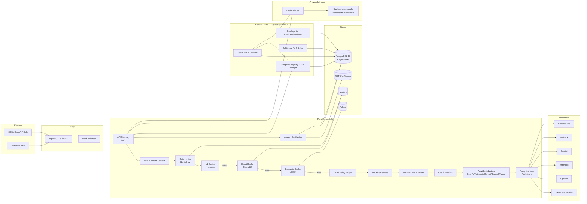

## 2. Sequência — requisição com cache exato

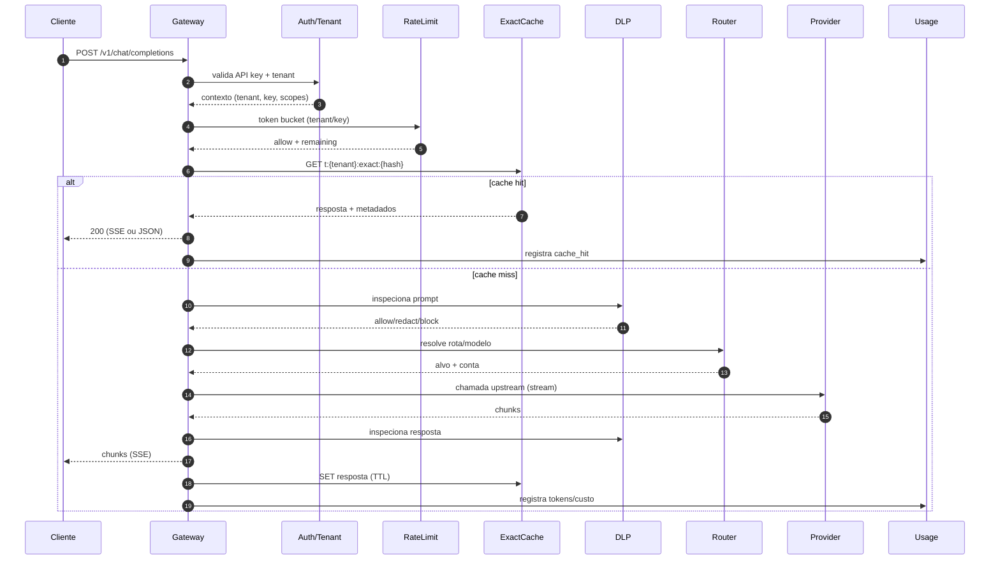

> **P0-α:** o primeiro slice executa Auth → RateLimit → ExactCache → Router/Failover → Provider → Usage/Outbox. DLP e cache semântico entram no P0-β/P1 sem alterar o contrato público. A sequência de entrega está em [ADD §6.2](architecture/ADD.md).

## 3. Sequência — cache semântico

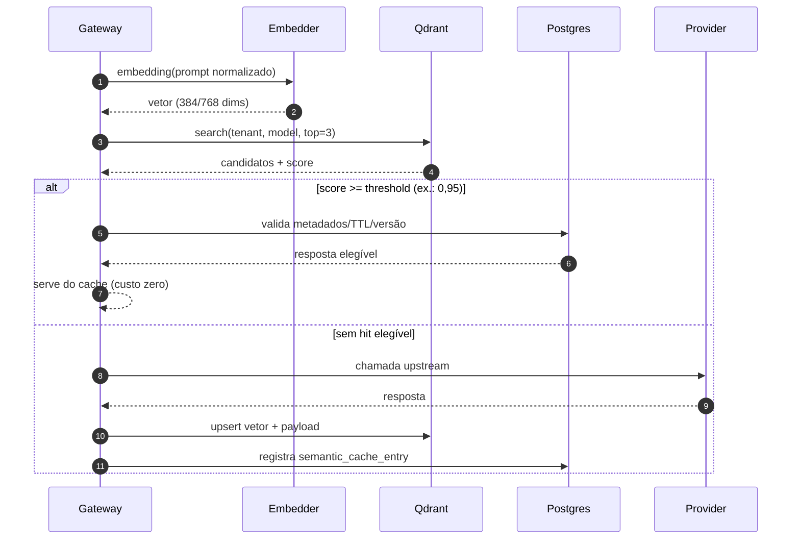

## 4. Sequência — failover de conta/modelo/provider

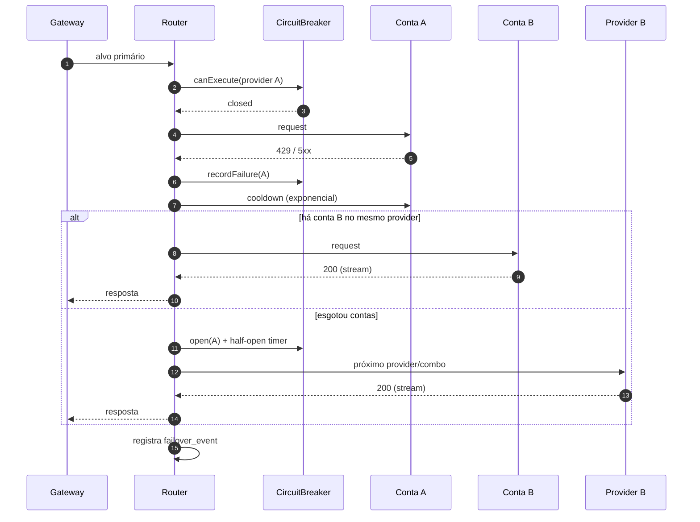

## 5. Sequência — seleção de proxy Webshare (isolamento por provedor)

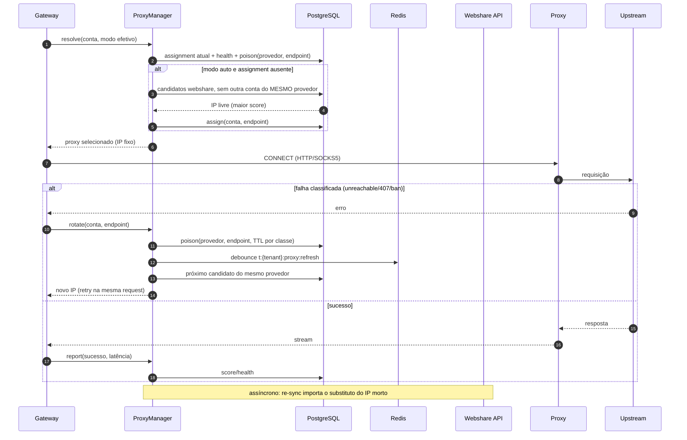

> Regra de alocação (ADR-024): 1 conta por IP **por provedor**; reuso entre provedores permitido.

## 6. Sequência — DLP (redact/block)

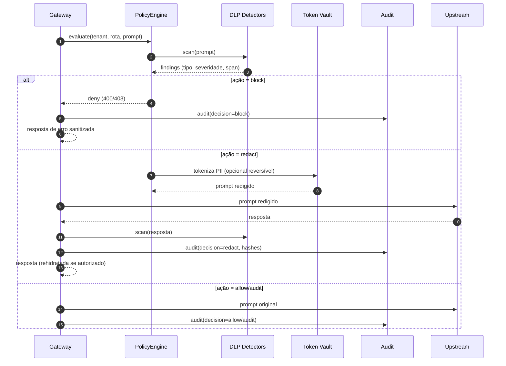

## 6.1 Sequência — Lazy loading do console

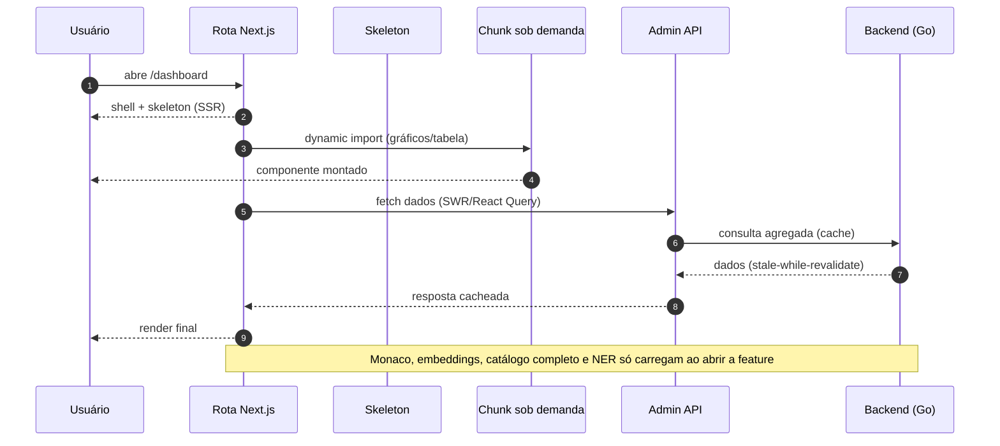

> **Backend lazy:** adaptadores de provider, catálogo de modelos, modelo de embeddings e pools de proxy inicializam no primeiro uso; apenas auth, rate limit e o provider padrão ficam no caminho quente. Init lazy deve falhar aberto com timeout e telemetria.

## 6.2 Sequência — endpoint + API key

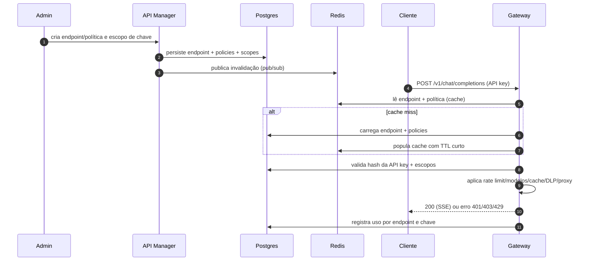

> **Regra:** endpoint desligado, versão deprecada ou escopo ausente falham antes de qualquer chamada upstream; a decisão é auditada. O API Manager nunca retorna o segredo completo após a criação.

## 7. Diagrama de classes (domínio)

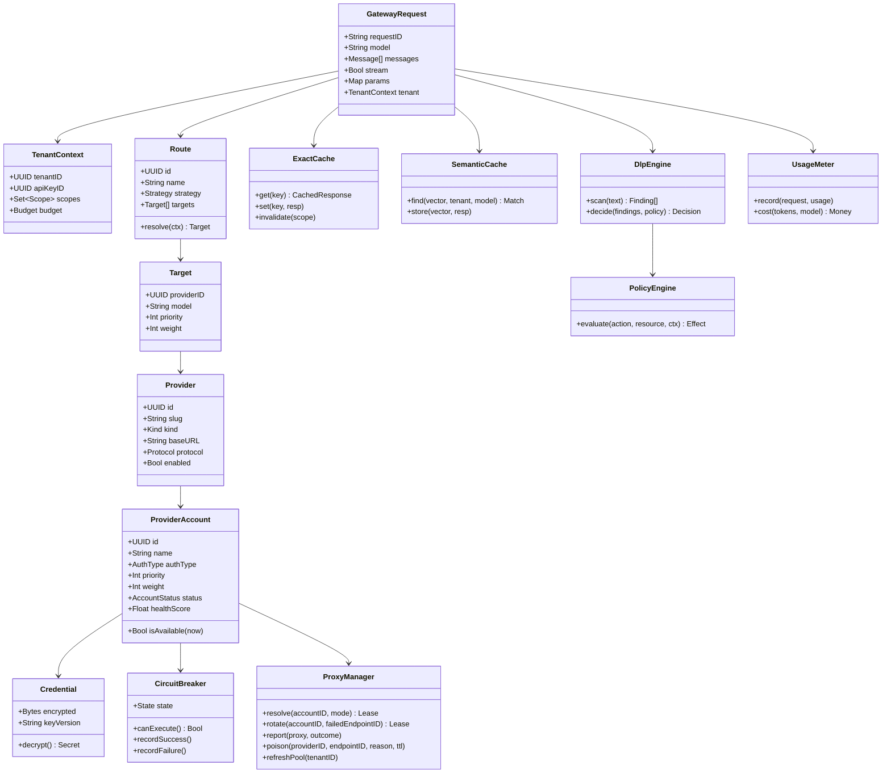

## 8. Diagrama de implantação

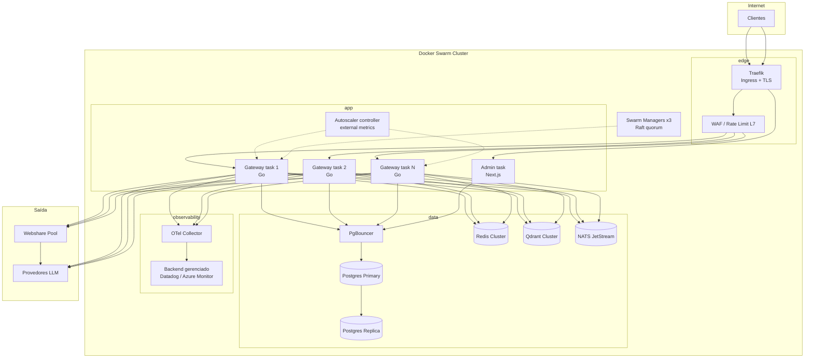

> **Notas de implantação (Docker Swarm):** 3 managers para quorum Raft e N workers; serviços `gateway`, `admin`, `traefik`, `pgbouncer`, `redis`, `qdrant`, `nats` e `otel-collector`; **sem Prometheus/Grafana/Loki/Tempo** — o `DD` é um backend gerenciado externo (Datadog ou Azure Monitor) que recebe OTLP. Redes overlay `edge`, `app` e `data` (esta com `--opt encrypted`); segredos via Docker secrets; dados persistidos em volumes locais com placement em nós rotulados (`node.labels.tier==data`) ou em serviços gerenciados. O Swarm **não possui HPA nativo**: o `SCALER` lê métricas do backend gerenciado e chama a Docker API; no P0 o scaling pode ser manual via runbook.

## 9. Máquinas de estado

### 9.1 Circuit breaker (provider)

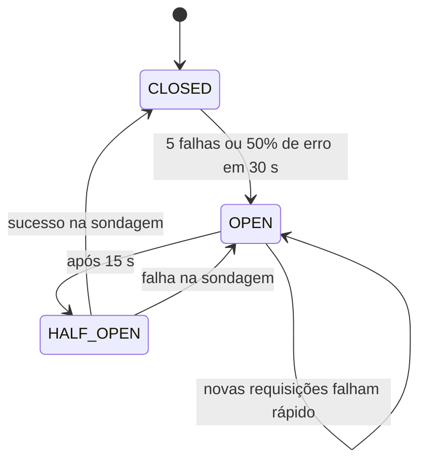

### 9.2 Conta/credencial

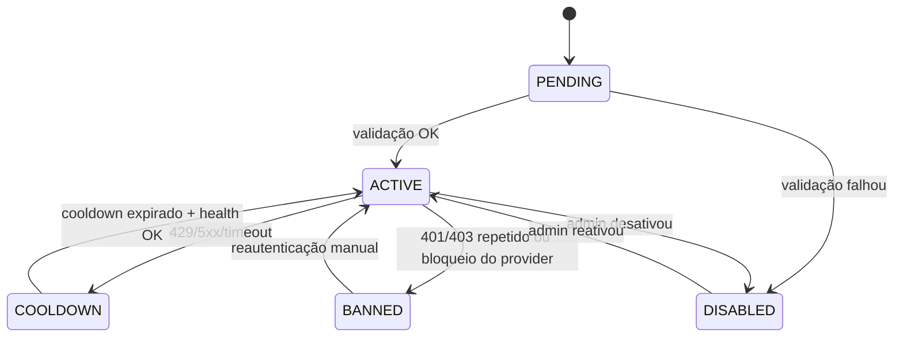

## 10. Observações de modelagem

- O diagrama de componentes separa **data plane** (Go, caminho quente) de **control plane** (TypeScript/Next.js, CRUD e console).
- O cache exato é consultado **antes** do DLP para evitar custo de inspeção em respostas já aprovadas; a política define se um hit pode ser servido sem reavaliação (por padrão, o cache é escopado por tenant e por versão de política).
- O failover registra evento antes de responder; a resposta ao cliente só é enviada quando um alvo entrega o primeiro chunk (ou corpo completo no não-streaming).
- O proxy é adquirido por tentativa de conta, não por requisição inteira, para permitir rotação sem recriar o contexto.
- O DLP em streaming opera em janelas com sobreposição; decisões `block` só podem ser tomadas antes do primeiro chunk enviado ao cliente (ou via abort explícito).

## 11. Premissas e lacunas

- **Premissa:** o ingress suporta HTTP/2 e SSE sem buffering; validar com o provedor de nuvem.
- **Premissa:** Qdrant e Redis aceitam cluster mode no ambiente alvo.
- **Lacuna:** se o data plane será Go puro ou se o time exigirá TypeScript (ADR-001).
- **Lacuna:** se haverá service mesh (Istio/Linkerd); não foi assumido no P0.
- **Pendente:** WebSocket para Responses API (P2) e backpressure específico.

## 12. Fontes consultadas

- `[MAP-9R]` — pipeline de requisição, combos, fallback de conta, cache/RTK e o risco de mutex global.
- `[MAP-OMNI]` — circuit breaker/cooldown/model lockout, route guard, policy engine e Redis opcional.
- `[MAP-ALLCODE]` — separação catálogo/execução, adaptadores de protocolo, OAuth e lacuna de feedback de rotação.
- `[REPO]` — confirmação de que os diagramas são propostas greenfield.
