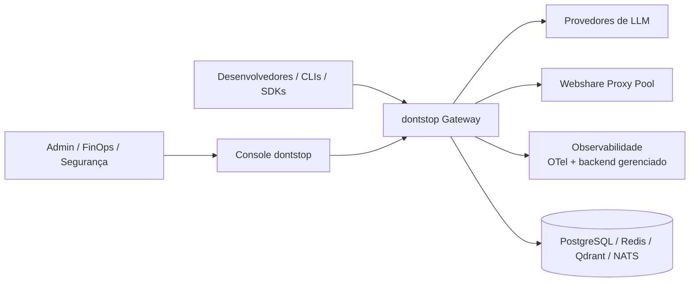
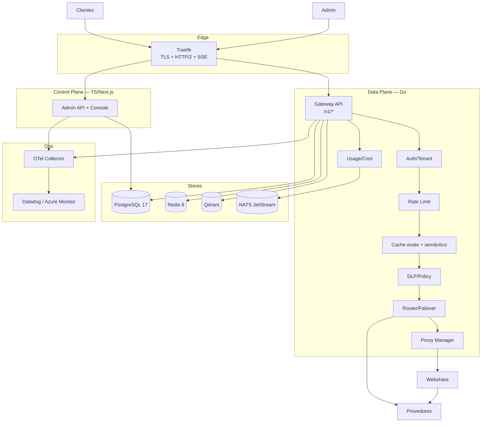
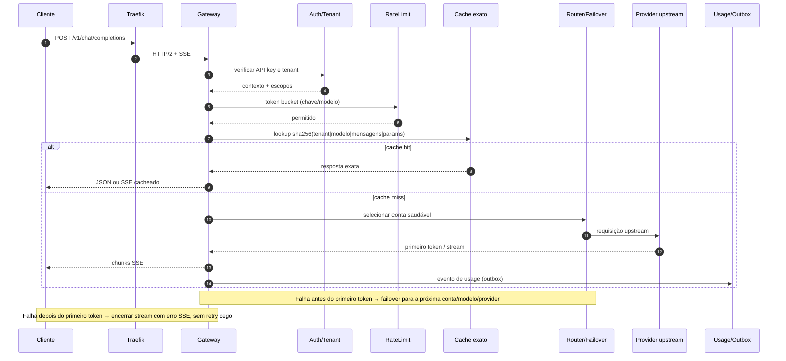

# dontstop — Architecture Design Document (ADD)

> **Status:** planejamento aprovado para handoff. Nenhum código implementado.
> **Data:** 2026-11-06
> **Fontes:** `[REPO]`, `[MAP-9R]`, `[MAP-OMNI]`, `[MAP-ALLCODE]` (ver [../README.md](../README.md)).
> **Decisão de orquestração:** **Docker Swarm** (Kubernetes fora de escopo por decisão do operador).

## 1. Contexto e objetivos

O dontstop é um gateway corporativo de IA, single-tenant no P0, com endpoint OpenAI-compatible, catálogo de provedores, failover multi-conta, cache exato/semântico, proxy Webshare, DLP e governança de custo. O objetivo é centralizar o consumo de LLMs com previsibilidade de custo, resiliência e auditoria.

**Objetivos mensuráveis:** 20.000 streams SSE, 1.000 RPS sustentado, overhead p95 ≤ 30 ms, disponibilidade 99,9%, cache total ≥ 40% e redução de custo ≥ 30%.

## 2. Restrições e premissas

| Tipo | Restrição/premissa |
|---|---|
| Deploy | **Docker Swarm** (3 managers + workers); sem Kubernetes |
| Tenancy | Single-tenant no P0, com `tenant_id` em todo o modelo |
| Rede | Egress via **Webshare** quando a política exigir; fallback direto |
| Dados | LGPD como baseline; payload off por padrão |
| Time | Stack final pendente (Go vs. TS) — ADR-001 tem fallback |
| Volumetria | Alvos de engenharia, não medições do ambiente atual |
| Código | Repositório greenfield: 0 arquivos de aplicação |

## 3. Atributos de qualidade (NFRs)

| Atributo | Meta | Referência |
|---|---|---|
| Concorrência | 20.000 SSE; 5.000/réplica | PRD NFR-01 |
| Throughput | 1.000 RPS; 3.000 burst | PRD NFR-02 |
| Latência de overhead | p95 ≤ 30 ms; p99 ≤ 80 ms | PRD NFR-03 |
| Disponibilidade | 99,9% mensal | PRD NFR-05 |
| Failover | RTO ≤ 2 s; RPO 0 config | PRD NFR-06 |
| Cache | exato ≥ 25%; total ≥ 40% | PRD NFR-07 |
| DLP | p95 ≤ 20–60 ms | PRD NFR-10 |
| Segurança | TLS 1.3, AES-256-GCM, Argon2id | PRD NFR-15 |

## 4. C4 — Contexto

## 5. C4 — Contêineres

## 6. Fluxos de runtime

| Fluxo | Resumo | Diagrama |
|---|---|---|
| Requisição + cache exato | Auth → rate limit → cache → DLP → rota → upstream → usage | [03-UML §2](../03-UML.md) |
| Cache semântico | Embedding → ANN no Qdrant → validação de metadados → resposta | [03-UML §3](../03-UML.md) |
| Failover | Circuit breaker → cooldown → próxima conta/modelo/provider | [03-UML §4](../03-UML.md) |
| Proxy Webshare | Acquire → health/score → CONNECT → report/quarentena | [03-UML §5](../03-UML.md) |
| Lazy loading do console | Shell SSR → skeleton → chunk sob demanda → dados com SWR | [03-UML §6.1](../03-UML.md) |
| Endpoint + API key | Resolve endpoint/política + escopo da chave → limites → roteamento | [03-UML §6.2](../03-UML.md) |
| DLP | Scan → decisão (allow/redact/block/audit) → auditoria | [03-UML §6](../03-UML.md) |

### 6.1 Envelope P0-α (primeiro slice vertical)

| Métrica | P0-α | Alvo corporativo |
|---|---|---|
| Throughput | 50 RPS sustentado; 150 RPS burst | 1.000 RPS; 3.000 burst |
| SSE simultâneo | 500 streams | 20.000 streams |
| Réplicas do gateway | 3 | 5+ |
| Regiões | 1 | multi-região (P2) |
| Tenancy | single-tenant | multi-tenant (P1/P2) |
| Providers | OpenAI + Anthropic | 15+ |
| Overhead p95 | ≤ 30 ms | ≤ 30 ms |
| Fim-a-fim p95 | ≤ 800 ms sem tempo do provedor | validar com carga real |
| Disponibilidade | 99,9% mensal | 99,9% mensal |
| Teste de carga | 2× envelope (100 RPS/300 burst) | 1.000 RPS/20.000 streams |

> O P0-α é um recorte de entrega, não uma redução do alvo. A evolução para o envelope corporativo é gate de P1 e exige teste de carga/chaos dedicado. Ver [ADR-018](../05-ADRS.md).

### 6.2 Sequência — `/v1/chat/completions` P0-α

## 7. Stack e decisões

| Camada | Decisão | ADR |
|---|---|---|
| Data plane | Go 1.24+ | ADR-001 |
| Control plane | TypeScript/Next.js 16 | ADR-001 |
| Banco | PostgreSQL 17 + PgBouncer | ADR-002 |
| Cache exato/coordenação | Redis 8 | ADR-003 |
| Cache semântico | Qdrant | ADR-004 |
| Eventos | NATS JetStream | ADR-005 |
| Observabilidade | OTel + backend gerenciado (Datadog/Azure Monitor) | ADR-006 |
| Tenancy | `tenant_id` + RLS | ADR-007 |
| Proxy | Webshare | ADR-008 |
| DLP | Regex + Presidio | ADR-009 |
| Orquestração | **Docker Swarm** | ADR-010 |
| Segredos | AES-256-GCM + envelope | ADR-011 |
| API | OpenAI-compatible | ADR-012 |
| Contrato público | OpenAPI 3.1 em `docs/contracts/openapi-v1.yaml` | ADR-012, ADR-018 |
| Envelope P0-α | 50 RPS, 150 burst, 500 SSE, 3 réplicas, 2 providers | ADR-018 |
| Endpoints/API Manager | Registry + políticas + escopos de chave | ADR-015 |
| MCP | Desligado por padrão; stdio/SSE/Streamable HTTP; ferramentas com escopo; sem túneis | ADR-016 |
| i18n/guia | Catálogos JSON, fallback en, onboarding/Settings e guia versionado por slug | ADR-017 |
| Lazy loading/cache em camadas | Route-level + init sob demanda + L1/L2/semântico | ADR-013 |
| Identidade corporativa | OIDC/SAML + MFA + RBAC | ADR-014 |

## 8. Persistência e dados

- **System of record:** PostgreSQL (tenants, providers, contas, credenciais cifradas, rotas, políticas, quotas, auditoria).
- **Cache exato:** Redis (payload) + metadados no Postgres para invalidação/estatística.
- **Cache semântico:** vetores no Qdrant; metadados no Postgres.
- **Eventos:** NATS JetStream (`usage`, `audit`, `webhooks`, `dlp`).
- **Outbox:** `usage_outbox`/`audit_outbox` no Postgres garantem que evento e resposta transacional não se percam; publicação no NATS ocorre após commit, com idempotência por `event_id`.
- **Retenção:** metadados 90 d/1 ano; auditoria 1 ano; payload off por padrão.
- **Detalhe:** [02-DER.md](../02-DER.md).

## 9. Segurança

- API keys com Argon2id; chave exibida apenas na criação.
- Credenciais de providers/proxies com AES-256-GCM e envelope key (KMS/Vault).
- TLS 1.3, HSTS, CSP no console; SSRF guard e allowlist de upstream.
- Redaction de headers/URL/body em logs e traces.
- DLP com decisão auditada; fail-closed para segredos de alta confiança.
- Auditoria append-only com hash encadeado.
- Supply chain: lockfile, SBOM, `govulncheck`, gitleaks, Trivy, CodeQL, imagens assinadas.

## 10. Observabilidade e SLOs

- OpenTelemetry em todos os serviços; trace-id propagado do cliente ao upstream.
- Métricas: latência p50/p95/p99, RPS, erros por código, saturação (réplicas, Redis, pools), cache hit/miss, failover, saúde de proxy, decisões DLP.
- **Backend gerenciado** (Datadog; alternativa Azure Monitor) via OTLP; **sem Prometheus/Grafana/Loki/Tempo**.
- Dashboards/SLOs no backend gerenciado; o console consome agregados e deep links.
- Logs estruturados (JSON) sem PII/segredos; amostragem de 10% em traces (100% em erros); cardinalidade limitada.

### 10.1 Lazy loading e cache em camadas

- **Frontend:** code splitting por rota, `dynamic import` para gráficos/Monaco/logs, virtualização, skeletons, prefetch no idle; metas LCP ≤ 2,5 s, INP ≤ 200 ms, CLS ≤ 0,1.
- **Backend:** eager só do crítico (config, auth, rate limit, provider padrão); lazy de adaptadores, catálogo, embeddings, proxy e NER com timeout/fail-open.
- **Cache:** L1 in-process (5–15 s) → L2 Redis (1 h) → semântico Qdrant (≤ 24 h, 0,95) → HTTP cache; invalidação por pub/sub e versão.
- **Detalhe:** [04-ANALISE-STACK §9.1](../04-ANALISE-STACK.md) e [ADR-013](../05-ADRS.md).

## 11. Implantação em Docker Swarm

| Item | Decisão |
|---|---|
| Topologia | 3 managers (Raft) + N workers; labels `tier=edge|app|data` |
| Ingress | Traefik com TLS, HTTP/2 e buffering desabilitado para SSE |
| Serviços | `gateway`, `admin`, `traefik`, `pgbouncer`, `redis`, `qdrant`, `nats`, `otel-collector`; **sem Prometheus/Grafana/Loki/Tempo** (backend gerenciado externo) |
| Redes | overlay `edge`, `app`, `data` (dados com `--opt encrypted`) |
| Segredos | Docker secrets (nunca em `environment`) |
| Update | `start-first`, paralelismo 2, delay 30 s, rollback em falha, `stop-grace-period 90s` |
| Health | `/healthz` e `/readyz`; start period compatível |
| Autoscaling | **não nativo**: `docker service scale` (P0) ou controlador externo com métricas do backend + Docker API (P1) |
| Estado | Postgres/Redis/Qdrant/NATS em nós `tier=data` com volumes e backup; serviços gerenciados quando possível |
| Multi-região | clusters Swarm separados atrás de LB global (P2) |

## 12. Multi-tenancy — ganchos no P0

`tenant_id` em todas as tabelas; RLS no P1; prefixo `t:{tenant}:` no Redis; payload `tenant_id` no Qdrant; quotas e políticas escopadas; auditoria sempre com tenant; chave de envelope por instância no P0 e por tenant no P2.

## 13. Riscos e lacunas

| Risco/lacuna | Mitigação |
|---|---|
| Sem código/benchmark local | Validar com k6/ghz antes do GA |
| Swarm sem autoscaling nativo | Controlador externo ou scale manual com alertas |
| Banda Webshare | Rotear só quando necessário; medir TB/mês |
| Cache semântico errar | Threshold alto, TTL curto, feature flag |
| Time sem Go | Fallback TypeScript documentado (ADR-001) |
| Plano Webshare/cloud/compliance | Decisões pendentes em [06-ROADMAP-RISCOS](../06-ROADMAP-RISCOS.md) |
| Contrato OpenAPI ainda sem lint/geração no CI | Slice S0.17 no [BACKLOG](../BACKLOG.md); contrato inicial em `docs/contracts/openapi-v1.yaml` |
| P0-α ainda não implementado | Executar o grafo de Issues do [DEVELOPER-ROADMAP](../../DEVELOPER-ROADMAP.md) |

## 14. Documentos relacionados

- [Sumário executivo](../00-SUMARIO-EXECUTIVO.md)
- [PRD](../01-PRD.md)
- [DER](../02-DER.md)
- [UML](../03-UML.md)
- [Análise de stack](../04-ANALISE-STACK.md)
- [ADRs](../05-ADRS.md)
- [Roadmap e riscos](../06-ROADMAP-RISCOS.md)
- [Backlog de implementação](../BACKLOG.md)
- [Contrato OpenAPI v1](../contracts/openapi-v1.yaml)
- [DEVELOPER-ROADMAP](../../DEVELOPER-ROADMAP.md)

## 15. Fontes consultadas

- `[REPO]` — greenfield, sem código.
- `[MAP-9R]` — fallback, cache, multitenancy e dívidas de segurança/concorrência.
- `[MAP-OMNI]` — escala, policies, Redis opcional, route guard e dívidas.
- `[MAP-ALLCODE]` — catálogo/plugins, adaptadores, rotação e acoplamentos.
