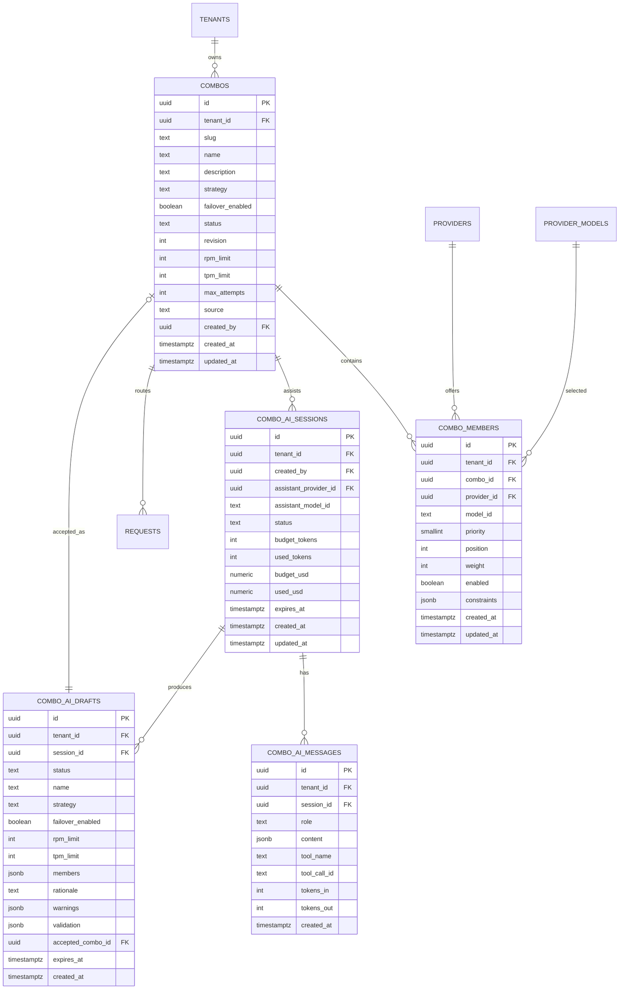

# Combos no dontstop — modelo, seleção, API e criação assistida por IA

> **Status:** especificação aprovada para implementação futura. **Nenhum código de produção foi
> criado nesta etapa.**
>
> **Relação com o AllCode:** o conceito foi estudado em
> [`COMBOS-ALLCODE-REFERENCE.md`](COMBOS-ALLCODE-REFERENCE.md). O AllCode é apenas referência
> conceitual; o dontstop não importa SDK, não chama o gateway do AllCode e não cria relay/upstream.
>
> **Decisão arquitetural:** [ADR-023](../05-ADRS.md#adr-023---combos-nativos-com-failover-na-mesma-requisição).
>
> **Mockup:** [`design-system/mockups/combos.html`](../../design-system/mockups/combos.html).
> **Spec visual:** [`design-system/pages/combos.md`](../../design-system/pages/combos.md).
> **Guia:** `docs/user-guide/<locale>/combos.md`.

## 1. Definição

Um **combo** é um modelo virtual do dontstop que representa uma política nomeada de encadeamento
de modelos/provedores. O cliente continua falando OpenAI-compatible:

```http
POST /v1/chat/completions
{"model":"combo/fast-coding","messages":[...]}
```

O gateway resolve o combo para um membro concreto (`provider_id` + `model_id`), escolhe uma conta
elegível desse provedor e só então chama o upstream. O cliente não precisa conhecer a conta, o
provedor ou o membro escolhido.

O combo é:

- **por tenant** (`tenant_id` obrigatório);
- **versionado** (`revision` incrementa em cada alteração);
- **exibido em `/v1/models`** somente quando `status = active`;
- **failover na mesma requisição** antes do primeiro chunk;
- **compatível com o failover existente** conta → modelo → provider;
- **sem credenciais próprias**: usa as contas já cadastradas nos provedores;
- **sem aninhamento** de combos no P0;
- **sem dependência** de AllCode, 9Router ou OmniRoute em runtime.

## 2. Escopo e não objetivos

### P0

- CRUD, ativação/desativação, reordenação e validação de combos.
- Três estratégias: `priority`, `round_robin`, `priority_round_robin`.
- Pesos opcionais dentro do mesmo tier de prioridade.
- Failover na mesma requisição com limite de tentativas.
- Rate limit de combo (RPM/TPM) compartilhado entre réplicas via Redis.
- Exposição em `/v1/models` e consumo por `/v1/chat/completions` (JSON e SSE).
- Criação manual e criação assistida por IA com rascunho revisável.
- Auditoria, métricas, tracing e estados de erro.

### P1

- Estratégias `least_latency` e `cost_optimized`.
- Pinagem opcional de conta em um membro.
- Histórico de versões com rollback.
- Grupos de combos e allow/deny por grupo de API key.
- Avaliação automática de qualidade por amostras.

### Fora de escopo

- Combo de combo.
- Edição do combo por chamadas públicas `/v1/*`.
- Chamar combos de outro tenant.
- Importar combos do AllCode.
- Criar automaticamente credenciais, contas ou providers.
- Salvar um combo automaticamente a partir da conversa de IA.

## 3. Modelo de dados

### 3.1 Entidades



### 3.2 `combos`

| Campo | Tipo | Regra |
|---|---|---|
| `id` | uuid | PK |
| `tenant_id` | uuid | FK `tenants`; obrigatório |
| `slug` | text | imutável após criação; `^[a-z][a-z0-9-]{1,62}$`; único por tenant |
| `name` | text | 1–80 caracteres; editável |
| `description` | text | 0–500 caracteres |
| `strategy` | enum | `priority`, `round_robin`, `priority_round_robin` |
| `failover_enabled` | boolean | padrão `true`; se `false`, não tenta outro membro do combo |
| `status` | enum | `draft`, `active`, `inactive` |
| `revision` | int | começa em 1; incrementa em qualquer alteração |
| `rpm_limit` | int null | 1–100000; nulo = sem limite |
| `tpm_limit` | int null | 1–100000000; nulo = sem limite |
| `max_attempts` | int | 1–8; padrão 5; limite de membros tentados por requisição |
| `source` | enum | `manual`, `ai` |
| `created_by` | uuid | FK `admin_users` |
| `created_at` / `updated_at` | timestamptz | UTC |

Índices:

- `UNIQUE (tenant_id, slug)`;
- `(tenant_id, status, updated_at DESC)`;
- `(tenant_id, name)` para busca;
- exclusão de `slug` reservado (`combo`, `models`, `chat`, `default`).

### 3.3 `combo_members`

| Campo | Tipo | Regra |
|---|---|---|
| `id` | uuid | PK |
| `tenant_id` | uuid | FK; deve coincidir com o combo |
| `combo_id` | uuid | FK `combos` `ON DELETE CASCADE` |
| `provider_id` | uuid | FK `providers` |
| `model_id` | text | FK composta `(tenant_id, provider_id, model_id)` → `provider_models` |
| `priority` | smallint | 0–100; menor = primeiro |
| `position` | int | ordem determinística dentro do tier; menor = primeiro |
| `weight` | int | 1–100; usado apenas dentro do mesmo `priority` |
| `enabled` | boolean | membro desativado não é elegível |
| `constraints` | jsonb | filtros opcionais (ver 3.4) |
| `created_at` / `updated_at` | timestamptz | UTC |

Regras:

- `UNIQUE (combo_id, provider_id, model_id)` — não repetir o mesmo modelo/provider no combo;
- `UNIQUE (combo_id, priority, position)` — posição determinística;
- no máximo **32 membros** por combo no P0;
- `ON DELETE RESTRICT` para provedor/modelo: remover provider/modelo exige remover o membro antes;
- membro com provider desativado, modelo inativo ou sem conta ativa permanece cadastrado, mas é
  **inelegível** na resolução e gera warning.

### 3.4 `constraints` (opcional no P0)

```json
{
  "requires": ["stream", "tools", "vision"],
  "min_context": 128000,
  "max_input_price_per_million": 3.0,
  "regions": ["us", "eu"],
  "max_latency_ms": 2500
}
```

No P0, `requires` e `min_context` são filtros de elegibilidade; `max_latency_ms` e preço são
**warnings** de seleção (não bloqueiam) até a telemetria de latência e preço estar consolidada.
Capabilities desconhecidas não são inferidas por nome.

### 3.5 Tabelas de IA

`combo_ai_sessions`, `combo_ai_messages` e `combo_ai_drafts` existem para dar suporte à criação
assistida sem transformar a conversa em fonte de verdade. O combo só existe em `combos` depois de
um aceite explícito do usuário.

Regras:

- `combo_ai_sessions.status`: `active`, `completed`, `cancelled`, `failed`, `expired`;
- mensagens guardam apenas conteúdo necessário à revisão; segredos e credenciais são proibidos;
- `expires_at` padrão 30 min para sessão e 24 h para rascunho;
- `combo_ai_drafts.status`: `draft`, `accepted`, `discarded`, `expired`;
- aceitar um rascunho cria um `combos` com `status = draft` e `source = ai`; não ativa
  automaticamente;
- `combo_ai_drafts.validation` guarda o resultado da última validação server-side;
- retenção de mensagens: 7 dias (configurável); nenhuma mensagem é usada para treinar modelos.

## 4. Regras de validação

| Regra | Quando | Resultado |
|---|---|---|
| Slug válido e único no tenant | create/update | `400 combo_slug_invalid` / `409 combo_slug_conflict` |
| Nome 1–80 | create/update | `400 combo_name_invalid` |
| 1–32 membros | create/update/activate | `400 combo_members_required` / `combo_members_limit` |
| Provider existe e pertence ao tenant | create/update | `400 combo_member_provider_invalid` |
| Modelo existe e está ativo | create/update | `400 combo_member_model_invalid` |
| Sem duplicata provider/model | create/update | `409 combo_member_duplicate` |
| `priority` 0–100 e `position` único no tier | create/update/reorder | `400 combo_member_order_invalid` |
| `weight` 1–100 | create/update | `400 combo_member_weight_invalid` |
| Pelo menos 1 membro elegível | activate | `409 combo_no_usable_member` |
| Pelo menos 1 conta ativa no provider | activate | warning `combo_member_no_account` |
| Modelo suporta `requires` | activate/resolve | membro inelegível + warning |
| Limites positivos | create/update | `400 combo_limit_invalid` |
| `revision` esperada no PATCH | update | `409 combo_revision_conflict` |
| Slug reservado | create | `400 combo_slug_reserved` |
| Combo não aninhado | create/update | `400 combo_nested_not_supported` |
| Exclusão exige confirmação do slug | delete | `409 combo_delete_confirmation` |

Mensagens de erro são sanitizadas e nunca incluem credenciais, base URL privada ou payload de
prompt. A validação de membros usa apenas metadados do catálogo e das contas.

## 5. Seleção de membro

### 5.1 Pipeline

```text
auth Bearer + escopo chat:write
  -> endpoint policy (modelo permitido? combo ativo?)
  -> cache exato? hit -> resposta + headers de combo
  -> resolver combo ativo do tenant
  -> montar membros elegíveis
  -> ordenar conforme estratégia
  -> para cada membro: resolver contas do provider/modelo
  -> failover de contas do membro
  -> falha retryable? próximo membro
  -> 400/413/422? terminal
  -> primeiro chunk? encerra sem trocar membro
  -> sucesso: resposta, usage e tracing
```

O combo é resolvido **depois** da autenticação, da política de endpoint e do cache. Um hit de cache
não executa seleção; a chave de cache inclui `combo:<slug>@<revision>` para que uma edição do combo
invalide respostas antigas.

### 5.2 Elegibilidade

Um membro é elegível quando:

1. `enabled = true`;
2. o combo está `active`;
3. o provider está habilitado no tenant;
4. o modelo está `active`;
5. existe pelo menos uma conta `active` e fora de cooldown;
6. `constraints.requires` é subconjunto das capabilities efetivas do modelo;
7. `constraints.min_context` é menor ou igual ao contexto conhecido do modelo.

O membro inelegível não é removido do banco; é ignorado na seleção e aparece no admin com motivo.
Se todos forem inelegíveis, a resposta é `503 combo_exhausted` sem chamar upstream.

### 5.3 `priority`

- Ordena por `priority` crescente e `position` crescente.
- Escolhe o primeiro elegível.
- Membros com a mesma prioridade usam peso (se configurado) para escolher o primeiro; depois a
  ordem de `position` é o desempate determinístico.
- Não há rotação entre requisições.

### 5.4 `round_robin`

- Ordena os elegíveis por `priority` e `position`.
- Um cursor atômico por combo em Redis (`t:{tenant}:combo:{id}:rr`) escolhe o índice
  `cursor % len(elegíveis)`.
- O cursor avança **uma vez por requisição admitida**, não por tentativa de failover.
- Se a lista de elegíveis mudar, o módulo usa a lista atual; não há promessa de fairness perfeita,
  mas não há índice fora do intervalo.

### 5.5 `priority_round_robin`

- Agrupa por `priority` (tiers), preservando `position`.
- Cada tier tem cursor próprio (`t:{tenant}:combo:{id}:tier:{priority}`).
- Rotaciona dentro do tier e concatena tiers do menor para o maior.
- Um tier sem elegíveis é pulado sem consumir cursor.

### 5.6 Pesos

`weight` só atua dentro do mesmo tier. A escolha é ponderada (`weight 1–100`); membros com peso
maior têm mais chance de serem escolhidos primeiro. O peso **não** substitui a prioridade: um tier
inferior nunca é escolhido antes de um tier superior elegível. A implementação deve usar uma fonte
aleatória injetável para testes determinísticos.

### 5.7 Failover na mesma requisição

Diferentemente do AllCode, o dontstop tenta o próximo membro **na mesma requisição**:

1. tenta todas as contas elegíveis do membro (respeitando o router de contas);
2. se o membro falhar com erro retryable, avança para o próximo membro elegível;
3. `400/413/422` do cliente são terminais e param o combo;
4. se o primeiro chunk já foi enviado, não troca de membro; encerra o stream com erro sanitizado;
5. `max_attempts` limita membros tentados (padrão 5, máximo 8); o router de contas mantém seu
   próprio limite por membro;
6. cada falha de conta grava cooldown no Redis existente;
7. falha de transporte/proxy segue a política de proxy por conta já implementada.

Ordem efetiva:

```text
combo tier/member -> todas as contas do provider/modelo -> próximo member -> próximo tier
```

Isso preserva o failover padrão **conta → modelo → provider** e adiciona o nível de combo.

### 5.8 Erros e respostas

| Situação | HTTP | Código |
|---|---|---|
| Combo não existe/não é do tenant | 404 | `combo_not_found` |
| Combo draft/inactive | 404 | `combo_not_found` (não revelar existência) |
| Sem membro elegível | 503 | `combo_exhausted` |
| Rate limit do combo | 429 | `combo_rate_limited` + `Retry-After` |
| Upstream 429 | 429 | `rate_limit_error` |
| Upstream quota | 402 | `billing_error` |
| Payload inválido | 400 | `invalid_request_error` |
| Timeout total | 504 | `timeout_error` |
| Stream já iniciado | SSE error | `stream_error` |

Nenhum erro inclui nome de conta, credencial, base URL privada ou prompt.

### 5.9 Rate limit

- Janela deslizante de 60 s por combo e tenant em Redis, via script Lua atômico.
- `rpm_limit`: incrementa na admissão da requisição.
- `tpm_limit`: reserva `prompt_estimado + max_tokens`; após a resposta, reconcilia com o usage real
  e devolve a diferença.
- Se a reserva exceder o limite, retorna `429` antes de qualquer chamada upstream.
- O limite é do combo, não de cada membro; o custo é atribuído ao combo e ao membro escolhido.
- A chave Redis é `t:{tenant}:combo:{id}:rl:{window}` e nunca compartilha entre tenants.

### 5.10 Cache

- A chave exata inclui `model=combo/<slug>@<revision>`.
- Editar, ativar, desativar, reordenar ou excluir um combo incrementa a revision/invalida o cache
  por pub/sub.
- Um hit devolve a resposta sem escolher membro; headers de resolução usam o último membro
  registrado no metadado do cache ou ficam ausentes com `X-Donstop-Combo-Cache: hit`.
- Cache semântico, quando existir, segue o mesmo escopo de combo e tenant.

## 6. Exposição OpenAI-compatible

### 6.1 `/v1/models`

Combos ativos são incluídos ao lado dos modelos normais:

```json
{
  "id": "combo/fast-coding",
  "object": "model",
  "created": 1760000000,
  "owned_by": "dontstop",
  "x-dontstop-origin": "combo",
  "x-dontstop-status": "active",
  "x-dontstop-strategy": "priority_round_robin",
  "x-dontstop-combo-members": 4
}
```

Regras:

- `id` canônico: `combo/<slug>`;
- `status`: `active` se houver ≥1 membro elegível; `degraded` se ativo sem membro elegível;
  combos `draft`/`inactive` não aparecem;
- não expor credenciais, contas ou base URLs;
- os membros completos ficam no admin (`GET /admin/v1/combos/{id}`);
- combos não colidem com modelos de provider porque o prefixo `combo/` é reservado.

### 6.2 `/v1/chat/completions`

Request:

```json
{
  "model": "combo/fast-coding",
  "messages": [{"role": "user", "content": "Resuma este contrato."}],
  "stream": true
}
```

Response:

- `model` permanece `combo/fast-coding`;
- headers:
  - `X-Donstop-Combo: fast-coding`
  - `X-Donstop-Combo-Revision: 3`
  - `X-Donstop-Combo-Strategy: priority_round_robin`
  - `X-Donstop-Resolved-Model: gpt-5-mini`
  - `X-Donstop-Resolved-Provider: openai`
  - `X-Donstop-Combo-Attempts: 2`
- em streaming, os headers são definidos antes do primeiro chunk; se a falha ocorrer antes dele,
  a resposta é JSON de erro; depois do primeiro chunk, o erro é um evento SSE sanitizado;
- o usage é atribuído ao combo, ao membro e à conta.

## 7. API administrativa

### 7.1 CRUD

| Método | Rota | Uso |
|---|---|---|
| GET | `/admin/v1/combos` | listar com `status`, `strategy`, `q`, paginação |
| POST | `/admin/v1/combos` | criar em `draft` |
| GET | `/admin/v1/combos/{id}` | detalhe com membros, validação e uso |
| PATCH | `/admin/v1/combos/{id}` | nome/descrição/estratégia/failover/limites; exige `revision` |
| PUT | `/admin/v1/combos/{id}/members` | substituir/reordenar membros em lote |
| POST | `/admin/v1/combos/{id}/activate` | ativar se houver membro elegível |
| POST | `/admin/v1/combos/{id}/deactivate` | desativar e invalidar cache |
| DELETE | `/admin/v1/combos/{id}` | excluir; exige confirmação do slug |
| POST | `/admin/v1/combos/{id}/validate` | dry-run de membros e resolução |
| POST | `/admin/v1/combos/{id}/test` | teste controlado de resolução/modelo |
| GET | `/admin/v1/combos/{id}/usage` | uso/custo por período e membro |

Payload de criação:

```json
{
  "slug": "fast-coding",
  "name": "Fast coding",
  "description": "Baixa latência para tarefas de código.",
  "strategy": "priority_round_robin",
  "failover_enabled": true,
  "rpm_limit": 300,
  "tpm_limit": 200000,
  "max_attempts": 5,
  "members": [
    {
      "provider_id": "uuid",
      "model_id": "gpt-5-mini",
      "priority": 0,
      "position": 0,
      "weight": 60,
      "enabled": true,
      "constraints": {"requires": ["stream"], "min_context": 64000}
    }
  ]
}
```

`POST` cria `status=draft`. O cliente ativa com uma ação explícita; não há ativação implícita ao
salvar.

### 7.2 IA

| Método | Rota | Uso |
|---|---|---|
| POST | `/admin/v1/combos/ai/sessions` | cria sessão com modelo assistente |
| GET | `/admin/v1/combos/ai/sessions/{id}` | histórico e estado |
| POST | `/admin/v1/combos/ai/sessions/{id}/messages` | envia mensagem; resposta SSE |
| POST | `/admin/v1/combos/ai/drafts/{draftId}/validate` | valida rascunho contra catálogo |
| POST | `/admin/v1/combos/ai/drafts/{draftId}/accept` | aceita como combo `draft` |
| DELETE | `/admin/v1/combos/ai/sessions/{id}` | cancela e apaga mensagens |

A IA **não** tem ferramenta de ativação, exclusão ou escrita direta em `combos`.

### 7.3 Contrato de eventos SSE da IA

Eventos compactos, sem payload de prompt no log:

```text
event: message.delta
data: {"text":"Vou priorizar modelos com tools e contexto..."}

event: tool.start
data: {"name":"catalog.search_models","label":"Lendo catálogo"}

event: tool.result
data: {"name":"catalog.search_models","count":14}

event: draft.updated
data: {"draft_id":"...","members":[...],"warnings":[...]}

event: error
data: {"code":"assistant_tools_unavailable","message":"..."}
```

O cliente nunca recebe credenciais, base URLs privadas, IDs de contas ou payload bruto de
ferramentas.

## 8. Criação assistida por IA

### 8.1 Objetivo

O usuário descreve o objetivo do combo em linguagem natural. A IA consulta o catálogo **real** e
monta um rascunho explicável, que o usuário revisa, edita, valida e salva. A IA não inventa
modelos nem ativa o combo.

### 8.2 Pré-condições

- O tenant precisa ter ao menos um modelo normal (não combo) com `tools` e `stream` para atuar como
  assistente.
- O usuário escolhe o **modelo assistente** ou usa o padrão do tenant; combos não podem ser
  assistentes para evitar recursão.
- O usuário precisa de escopo administrativo de combos.
- Se não houver catálogo utilizável, a sessão inicia em erro `assistant_catalog_empty`; não se
  tenta adivinhar.

### 8.3 Ferramentas do assistente

Todas são consultas server-side, somente leitura, limitadas ao tenant:

| Ferramenta | Entrada | Saída |
|---|---|---|
| `catalog.list_filters` | — | capabilities, providers, faixas de contexto/preço |
| `catalog.search_models` | query, capabilities, min_context, max_input_price, providers, limit | lista compacta de `{provider, model, display, capabilities, context, prices, status}` |
| `catalog.get_model` | provider, model | detalhes completos e contagem de contas ativas |
| `catalog.check_availability` | lista de `{provider, model}` | disponibilidade, motivo e saúde resumida |
| `draft.propose` | nome, estratégia, membros, justificativa | draft estruturado e warnings |
| `draft.validate` | draft | erros bloqueantes, warnings e membros removidos |
| `draft.save` | draft | persiste **somente** `combo_ai_drafts`; nunca `combos` |

Limites por sessão: 12 chamadas de ferramenta, 50k tokens de entrada, 8k de saída, 90 s de
execução e 30 min de sessão. O servidor impõe os limites; o modelo não decide sozinho.

### 8.4 Fluxo da conversa

1. **Abertura:** painel lateral “Criar com IA” com campo de objetivo e seletor de modelo
   assistente. Exemplos: “baixa latência para código”, “barato para resumos longos”, “visão para
   notas fiscais”.
2. **Entendimento:** a IA faz até 3 perguntas objetivas quando faltam restrições: custo, latência,
   capabilities, contexto, diversidade de provider, necessidade de fallback. Perguntas têm opções
   rápidas e campo livre.
3. **Consulta:** a IA chama `catalog.search_models`, filtra por capabilities/contexto/preço e
   compara disponibilidade. Cada chamada aparece como chip de progresso (“Lendo catálogo”,
   “Comparando custo”, “Validando disponibilidade”).
4. **Proposta:** a IA chama `draft.propose` com 2–8 membros, tiers, pesos e justificativa por
   membro. O rascunho aparece em um card editável ao lado do chat.
5. **Validação:** o servidor chama `draft.validate`; membros inexistentes, inativos ou sem conta
   são marcados. A IA explica warnings e oferece alternativas, mas não os esconde.
6. **Revisão:** o usuário edita nome, estratégia, prioridade, peso, remove/adiciona membros e ajusta
   limites. O chat não sobrescreve edições manuais sem confirmação.
7. **Salvar:** “Salvar rascunho” cria um combo `draft`; “Salvar e ativar” só habilita após validação
   sem erros bloqueantes. A ativação é uma ação explícita e auditada.
8. **Encerramento:** sessão vira `completed`; mensagens ficam retidas por 7 dias; o combo aparece na
   lista com `source=ai`.

### 8.5 Critérios de escolha da IA

A IA deve justificar cada membro e seguir esta ordem:

1. **Adequação:** capabilities obrigatórias (`tools`, `vision`, `reasoning`, `stream`) e contexto
   mínimo.
2. **Disponibilidade:** provider/modelo ativo, conta ativa, sem cooldown; membros indisponíveis só
   entram como último tier com warning.
3. **Diversidade:** evitar todos os membros no mesmo provider quando houver alternativa saudável;
   pelo menos um fallback de provider diferente é recomendado.
4. **Custo:** preferir menor preço de entrada/saída entre os que atendem; não usar preço como
   critério único.
5. **Latência:** usar telemetria quando existir; sem telemetria, declarar a suposição.
6. **Simplicidade:** 2–5 membros por padrão; máximo 8; não criar tiers redundantes.
7. **Explicabilidade:** cada membro tem uma razão curta; cada warning tem causa e ação.

A IA nunca inventa modelo, provider, preço, contexto ou capability. Se não houver dados, diz
“não disponível” e propõe um rascunho mínimo com warnings.

### 8.6 Apresentação do resultado

O card de rascunho mostra:

- nome, descrição, estratégia e failover;
- tabela de membros: provedor, modelo, tier, peso, capabilities, contexto, preço e estado;
- justificativa por membro;
- warnings bloqueantes (vermelho) e não bloqueantes (âmbar);
- resumo de cobertura: “4 membros, 2 providers, 1 fallback de provider”;
- ações: **Aplicar ao formulário**, **Validar novamente**, **Descartar**, **Salvar rascunho**,
  **Salvar e ativar**.

O rascunho é sempre revisável; não há “aplicar automaticamente” sem confirmação.

### 8.7 Estados de erro e limites

| Estado | Comportamento |
|---|---|
| Assistente sem tools | `assistant_tools_unavailable`; sugerir escolher outro modelo |
| Catálogo vazio | `assistant_catalog_empty`; CTA para conectar provider |
| Nenhum modelo elegível | rascunho vazio + explicação; não inventar membros |
| Ferramenta lenta | timeout de 15 s por chamada; retry uma vez; chip de falha |
| Limite de tokens/custo | `assistant_budget_exceeded`; encerrar turno e manter rascunho anterior |
| Rate limit do provedor | `assistant_rate_limited` + `Retry-After`; não trocar silenciosamente de modelo |
| Catálogo mudou | `draft_stale`; revalidar e destacar membros removidos |
| Sessão expirada | `session_expired`; oferecer novo rascunho, sem apagar combo existente |
| Falha de streaming | evento `error`; preservar mensagens já recebidas e permitir retry |
| Conteúdo sensível | DLP da política do endpoint do assistente; nunca logar prompt bruto |

## 9. UX e estados

### 9.1 Lista

- Colunas: nome/slug, status, estratégia, membros, providers, saúde, uso 24 h, atualização, ações.
- Busca, filtros por status/estratégia/provider e ordenação por nome/uso/atualização.
- Estado vazio com CTA “Criar combo” e “Criar com IA”.
- Ações: abrir detalhe, editar, ativar/desativar, duplicar (P1), excluir com confirmação.

### 9.2 Criação manual

- Passos: identidade → estratégia → membros → revisão.
- Identidade: nome, slug, descrição.
- Estratégia: três opções com explicação curta e exemplo.
- Membros: busca de modelo com debounce, filtros de capability, seleção de tier/prioridade, peso,
  reordenação por botões acessíveis (e drag como enhancement), remoção.
- Limites: RPM/TPM e máximo de tentativas.
- Revisão: resumo, warnings e validação; “Salvar rascunho” e “Salvar e ativar”.

### 9.3 Detalhe/edição

- Cabeçalho: nome, slug, status, revision, estratégia, ações.
- Abas: Membros, Validação, Uso, Auditoria.
- Membros: tabela com ordem, tier, peso, provider/modelo, capabilities, contexto, preço, saúde e
  motivo de inelegibilidade.
- Ações: editar, reordenar, ativar/desativar, testar resolução, excluir.
- Alterações concorrentes usam `revision`; conflito mostra “recarregar e mesclar”.

### 9.4 Estados obrigatórios

| Estado | UI |
|---|---|
| Carregando | skeleton de lista/detalhe; spinner no salvamento |
| Vazio | ilustração leve, explicação e CTA |
| Erro | banner com causa, retry e link de ajuda; não apagar dados do formulário |
| Sucesso | toast `aria-live`, atualização da lista e do detalhe |
| Conflito | banner de revision, ação “Recarregar” |
| Expirado | rascunho de IA expirado com ação “Revalidar” |
| Sem permissão | estado 403, sem revelar dados de outro tenant |

### 9.5 Acessibilidade

- WCAG 2.2 AA, foco visível, ordem de tabulação lógica.
- Reordenação por botões “Mover para cima/baixo” com `aria-label`; drag não é o único caminho.
- Status sempre com ícone + texto; nunca apenas cor.
- Chat da IA com `aria-live="polite"`, logs de ferramenta legíveis e foco preso no drawer.
- Tabelas com `aria-sort`, cabeçalho sticky e scroll horizontal apenas dentro do container.
- `prefers-reduced-motion` respeitado.

### 9.6 i18n

- Slug do guia: `combos`.
- Chaves em `admin/locales/*.json`: `combos.*`, `combos.ai.*`, `combos.errors.*`,
  `combos.strategy.*`, `combos.status.*`.
- Seis locales: `en`, `pt-PT`, `pt-BR`, `es`, `fr`, `de`; fallback `en`.
- Números, moeda e datas via `Intl`; strings de estratégia e status traduzidas.
- Link **Ajuda** contextual para `combos` nos seis idiomas.

## 10. Performance e lazy loading

- A lista carrega somente nome/status/estratégia/contagem; detalhe e uso são lazy ao abrir.
- Membros e catálogo do editor são paginados (20 por lote) com debounce de 250 ms.
- O drawer de detalhe carrega saúde/uso/auditoria sob demanda; nenhum chart no primeiro paint.
- A sessão de IA usa streaming; o card de rascunho é renderizado incrementalmente.
- Metas: LCP ≤ 2,5 s, INP ≤ 200 ms, CLS ≤ 0,1, bundle inicial ≤ 250 KB gzip.
- Nenhum módulo de IA, editor de membros ou tabela de uso entra no bundle inicial da lista.

## 11. Observabilidade e auditoria

- Spans: `combo.resolve`, `combo.select`, `combo.attempt`, `routing.failover`, `combo.cache`.
- Atributos sem PII: `combo_id`, `combo_revision`, `strategy`, `member_index`, `provider_id`,
  `model_id`, `attempt`, `failure_kind`, `latency_ms`.
- Métricas: seleção por membro, falhas por membro, taxa de exhausted, latência de resolução,
  hit de cache por combo, RPM/TPM, uso por combo.
- Auditoria append-only: create/update/activate/deactivate/delete, alteração de membros,
  aceite de rascunho de IA, teste manual.
- Nunca logar prompt, resposta, credencial, base URL privada ou payload de ferramenta.

## 12. Rollout

1. **Fase A:** migração, repositório, CRUD admin e validação; feature flag `combos.enabled=false`.
2. **Fase B:** exposição em `/v1/models` e resolução priority; testes de contrato e failover.
3. **Fase C:** round-robin/priority-round-robin e rate limit Redis; testes de concorrência.
4. **Fase D:** IA assistida em tenant piloto; ferramentas read-only e rascunho.
5. **Fase E:** ativação geral, dashboard de uso e playbook de operação.

Cada fase exige testes verdes, migração idempotente e rollback documentado. A ativação de combos
não pode alterar o comportamento de modelos normais.

## 13. Critérios de aceite

- [ ] Um combo ativo aparece em `/v1/models` como `combo/<slug>` com status e estratégia.
- [ ] `POST /v1/chat/completions` com `combo/<slug>` resolve um membro e retorna headers de
  resolução.
- [ ] Falha retryable de um membro tenta o próximo na mesma requisição antes do primeiro chunk.
- [ ] `400` do cliente não consome outro membro.
- [ ] `priority`, `round_robin` e `priority_round_robin` têm testes determinísticos.
- [ ] Cursores e rate limit funcionam com múltiplas réplicas via Redis.
- [ ] Combo sem membro elegível retorna `503 combo_exhausted` sem chamar upstream.
- [ ] CRUD, ativação, reordenação e exclusão são auditados.
- [ ] A IA consulta o catálogo real, produz rascunho explicável e nunca ativa/salva sozinha.
- [ ] Rascunho inválido mostra erros bloqueantes e não pode ser ativado.
- [ ] Seis locales e guia `combos` estão completos.
- [ ] Nenhum segredo/PII aparece em log, trace, resposta de erro ou auditoria.

## 14. Referências

- [`COMBOS-ALLCODE-REFERENCE.md`](COMBOS-ALLCODE-REFERENCE.md) — estudo do AllCode.
- [`PROVIDER-CATALOG.md`](PROVIDER-CATALOG.md) — catálogo versionado.
- [`ADMIN-API.md`](ADMIN-API.md) — padrão de APIs administrativas.
- [`docs/05-ADRS.md`](../05-ADRS.md) — ADR-022 (failover) e ADR-023 (combos).
- [`docs/02-DER.md`](../02-DER.md) — entidades e relacionamentos.
- [`design-system/pages/combos.md`](../../design-system/pages/combos.md) — spec visual.
