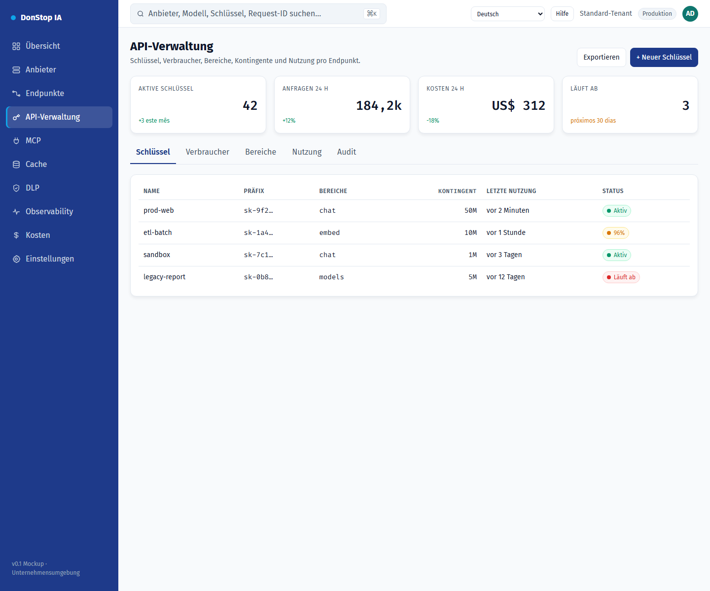

# API-Verwaltung

## Was diese Seite tut

Verwaltet API-Schlüssel, Bereiche, Kontingente, Ratenlimits, Ablauf und Nutzung pro Endpunkt.

## Wann verwenden

Verwenden Sie diese Seite, um diesen Teil des Gateways zu prüfen, zu konfigurieren oder zu betreiben.

## Schritt für Schritt

1. Öffnen Sie **API-Verwaltung** über die Seitenleiste.
2. Prüfen Sie die Kennzahlen und die Haupttabelle.
3. Verwenden Sie die unten beschriebenen Aktionen; Änderungen gelten sofort.
4. Öffnen Sie einen Schlüssel für Bereiche und Nutzung oder erstellen Sie mit + Neuer Schlüssel einen neuen.

## Felder und Aktionen

| Feld oder Aktion | Auf dieser Seite sichtbare Bezeichnung oder Aktion. |
|---|---|
| + Neuer Schlüssel | Auf dieser Seite sichtbare Bezeichnung oder Aktion. |
| Schlüssel | Auf dieser Seite sichtbare Bezeichnung oder Aktion. |
| Bereiche | Auf dieser Seite sichtbare Bezeichnung oder Aktion. |
| Kontingent | Auf dieser Seite sichtbare Bezeichnung oder Aktion. |
| Letzte Nutzung | Auf dieser Seite sichtbare Bezeichnung oder Aktion. |
| Status | Auf dieser Seite sichtbare Bezeichnung oder Aktion. |

## Häufige Fehler und Zustände

- Wenn Daten nicht geladen werden, versuchen Sie es erneut. Prüfen Sie Gateway und Anbieter, wenn der Fehler bleibt.
- Wenn eine Aktion deaktiviert ist, prüfen Sie Rolle und Tenant-Bereich.
- Leere Zustände sind vor der ersten Anfrage normal; folgen Sie der Handlungsaufforderung.

## Verwandte Leitfäden

- [Neuer API-Schlüssel](new-api-key.md)
- [Endpunkte](endpoints.md)
- [Kosten](cost.md)

> Screenshot von API-Verwaltung auf Deutsch.
