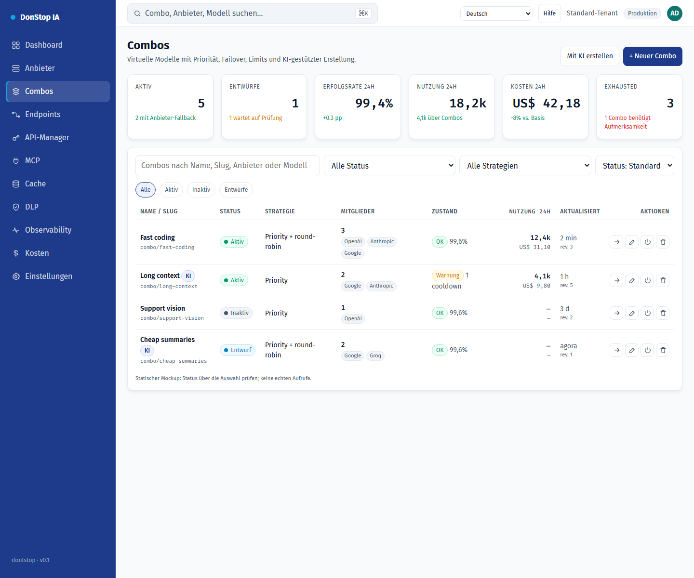

# Combos

## Was diese Seite tut

Erstellt und betreibt virtuelle Modelle aus Anbietermodellen mit Priorität, Failover, Limits und KI-gestütztem Entwurf.

## Wann verwenden

Verwenden Sie diese Seite, um diesen Teil des Gateways zu prüfen, zu konfigurieren oder zu betreiben.

## Schritt für Schritt

1. Öffnen Sie **Combos** über die Seitenleiste.
2. Prüfen Sie die Kennzahlen und die Haupttabelle.
3. Verwenden Sie die unten beschriebenen Aktionen; Änderungen gelten sofort.
4. Manuell oder mit KI erstellen, Mitglieder und Warnungen prüfen, validieren und erst dann speichern und explizit aktivieren.

## Felder und Aktionen

| Feld oder Aktion | Auf dieser Seite sichtbare Bezeichnung oder Aktion. |
|---|---|
| Status | Auf dieser Seite sichtbare Bezeichnung oder Aktion. |
| Bearbeiten | Auf dieser Seite sichtbare Bezeichnung oder Aktion. |
| Testen | Auf dieser Seite sichtbare Bezeichnung oder Aktion. |
| Schließen | Auf dieser Seite sichtbare Bezeichnung oder Aktion. |

## Häufige Fehler und Zustände

- Wenn Daten nicht geladen werden, versuchen Sie es erneut. Prüfen Sie Gateway und Anbieter, wenn der Fehler bleibt.
- Wenn eine Aktion deaktiviert ist, prüfen Sie Rolle und Tenant-Bereich.
- Leere Zustände sind vor der ersten Anfrage normal; folgen Sie der Handlungsaufforderung.

## Verwandte Leitfäden

- [Anbieter](providers.md)
- [Endpunkte](endpoints.md)
- [Kosten](cost.md)

> Screenshot von Combos auf Deutsch.
