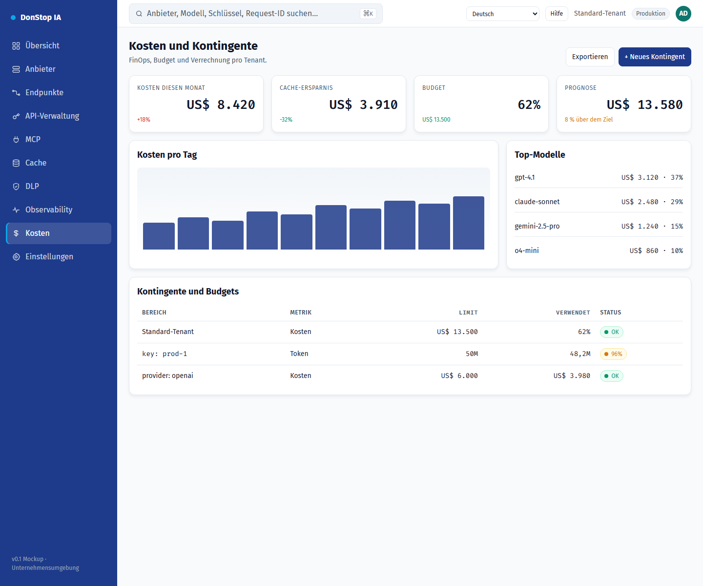

# Kosten

## Was diese Seite tut

Zeigt Tages- und Monatskosten, Prognose, Budget und Kontingente pro Tenant, Schlüssel und Anbieter.

## Wann verwenden

Verwenden Sie diese Seite, um diesen Teil des Gateways zu prüfen, zu konfigurieren oder zu betreiben.

## Schritt für Schritt

1. Öffnen Sie **Kosten** über die Seitenleiste.
2. Prüfen Sie die Kennzahlen und die Haupttabelle.
3. Verwenden Sie die unten beschriebenen Aktionen; Änderungen gelten sofort.
4. Legen Sie Kontingente und Budgets fest und exportieren Sie den Verrechnungsbericht.

## Felder und Aktionen

| Feld oder Aktion | Auf dieser Seite sichtbare Bezeichnung oder Aktion. |
|---|---|
| Kosten heute | Auf dieser Seite sichtbare Bezeichnung oder Aktion. |
| Kosten diesen Monat | Auf dieser Seite sichtbare Bezeichnung oder Aktion. |
| Prognose | Auf dieser Seite sichtbare Bezeichnung oder Aktion. |
| Budget | Auf dieser Seite sichtbare Bezeichnung oder Aktion. |
| Kontingente und Budgets | Auf dieser Seite sichtbare Bezeichnung oder Aktion. |

## Häufige Fehler und Zustände

- Wenn Daten nicht geladen werden, versuchen Sie es erneut. Prüfen Sie Gateway und Anbieter, wenn der Fehler bleibt.
- Wenn eine Aktion deaktiviert ist, prüfen Sie Rolle und Tenant-Bereich.
- Leere Zustände sind vor der ersten Anfrage normal; folgen Sie der Handlungsaufforderung.

## Verwandte Leitfäden

- [Übersicht](dashboard.md)
- [API-Verwaltung](api-manager.md)
- [Cache](cache.md)

> Screenshot von Kosten auf Deutsch.
