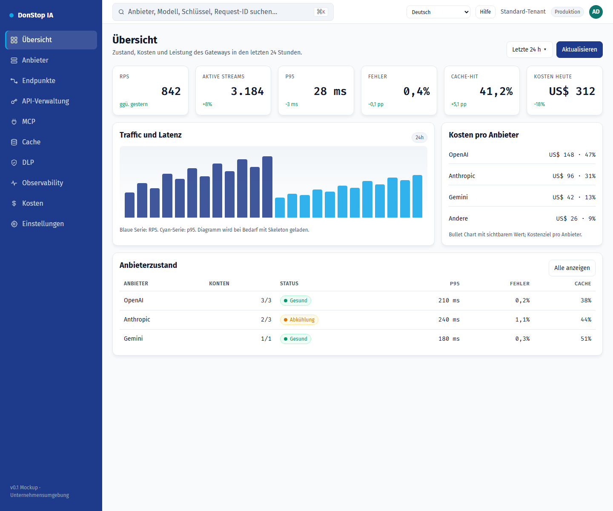

# Übersicht

## Was diese Seite tut

Zeigt Gateway-Zustand, Traffic, Kosten und Anbieterstatus der letzten 24 Stunden.

## Wann verwenden

Verwenden Sie diese Seite, um diesen Teil des Gateways zu prüfen, zu konfigurieren oder zu betreiben.

## Schritt für Schritt

1. Öffnen Sie **Übersicht** über die Seitenleiste.
2. Prüfen Sie die Kennzahlen und die Haupttabelle.
3. Verwenden Sie die unten beschriebenen Aktionen; Änderungen gelten sofort.
4. Prüfen Sie Anbieterzustand und Vorfälle, bevor Sie einen detaillierten Trace öffnen.

## Felder und Aktionen

| Feld oder Aktion | Auf dieser Seite sichtbare Bezeichnung oder Aktion. |
|---|---|
| Aktive Schlüssel | Auf dieser Seite sichtbare Bezeichnung oder Aktion. |
| Anfragen 24 h | Auf dieser Seite sichtbare Bezeichnung oder Aktion. |
| Kosten 24 h | Auf dieser Seite sichtbare Bezeichnung oder Aktion. |
| Läuft ab | Auf dieser Seite sichtbare Bezeichnung oder Aktion. |
| Anbieterzustand | Auf dieser Seite sichtbare Bezeichnung oder Aktion. |

## Häufige Fehler und Zustände

- Wenn Daten nicht geladen werden, versuchen Sie es erneut. Prüfen Sie Gateway und Anbieter, wenn der Fehler bleibt.
- Wenn eine Aktion deaktiviert ist, prüfen Sie Rolle und Tenant-Bereich.
- Leere Zustände sind vor der ersten Anfrage normal; folgen Sie der Handlungsaufforderung.

## Verwandte Leitfäden

- [Anbieter](providers.md)
- [Observability](observability.md)
- [Kosten](cost.md)

> Screenshot von Übersicht auf Deutsch.
