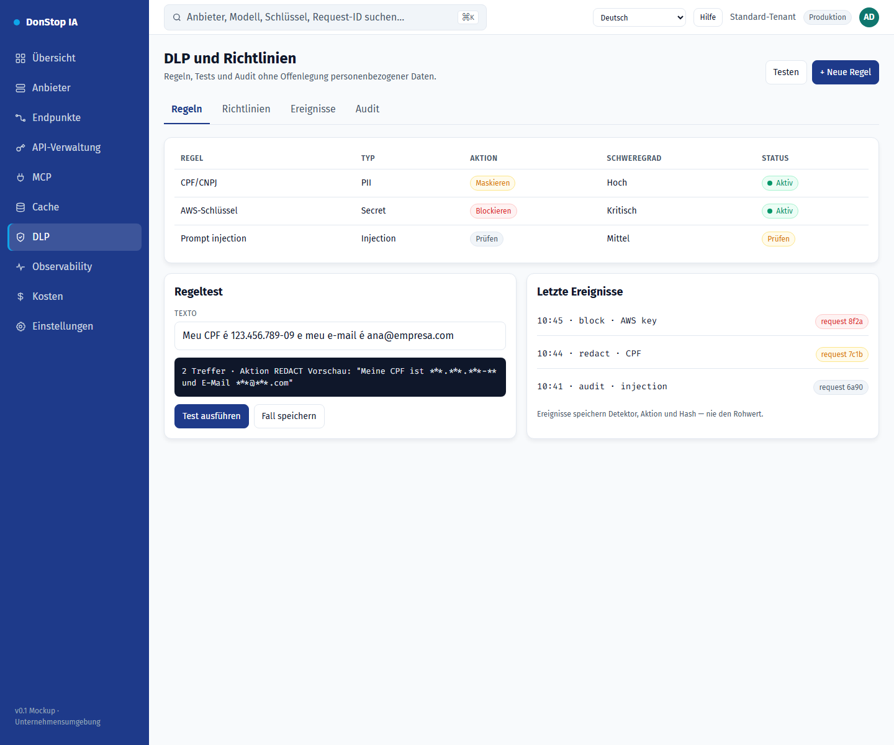

# DLP

## Was diese Seite tut

Definiert DLP-Regeln und -Richtlinien, testet Maskierung und auditiert Ereignisse ohne Offenlegung personenbezogener Daten.

## Wann verwenden

Verwenden Sie diese Seite, um diesen Teil des Gateways zu prüfen, zu konfigurieren oder zu betreiben.

## Schritt für Schritt

1. Öffnen Sie **DLP** über die Seitenleiste.
2. Prüfen Sie die Kennzahlen und die Haupttabelle.
3. Verwenden Sie die unten beschriebenen Aktionen; Änderungen gelten sofort.
4. Führen Sie einen Regeltest mit Beispieltext aus und bestätigen Sie die Aktion vor der Aktivierung.

## Felder und Aktionen

| Feld oder Aktion | Auf dieser Seite sichtbare Bezeichnung oder Aktion. |
|---|---|
| Regeln | Auf dieser Seite sichtbare Bezeichnung oder Aktion. |
| Aktion | Auf dieser Seite sichtbare Bezeichnung oder Aktion. |
| Schweregrad | Auf dieser Seite sichtbare Bezeichnung oder Aktion. |
| Status | Auf dieser Seite sichtbare Bezeichnung oder Aktion. |
| Test ausführen | Auf dieser Seite sichtbare Bezeichnung oder Aktion. |

## Häufige Fehler und Zustände

- Wenn Daten nicht geladen werden, versuchen Sie es erneut. Prüfen Sie Gateway und Anbieter, wenn der Fehler bleibt.
- Wenn eine Aktion deaktiviert ist, prüfen Sie Rolle und Tenant-Bereich.
- Leere Zustände sind vor der ersten Anfrage normal; folgen Sie der Handlungsaufforderung.

## Verwandte Leitfäden

- [Observability](observability.md)
- [API-Verwaltung](api-manager.md)
- [Cache](cache.md)

> Screenshot von DLP auf Deutsch.
