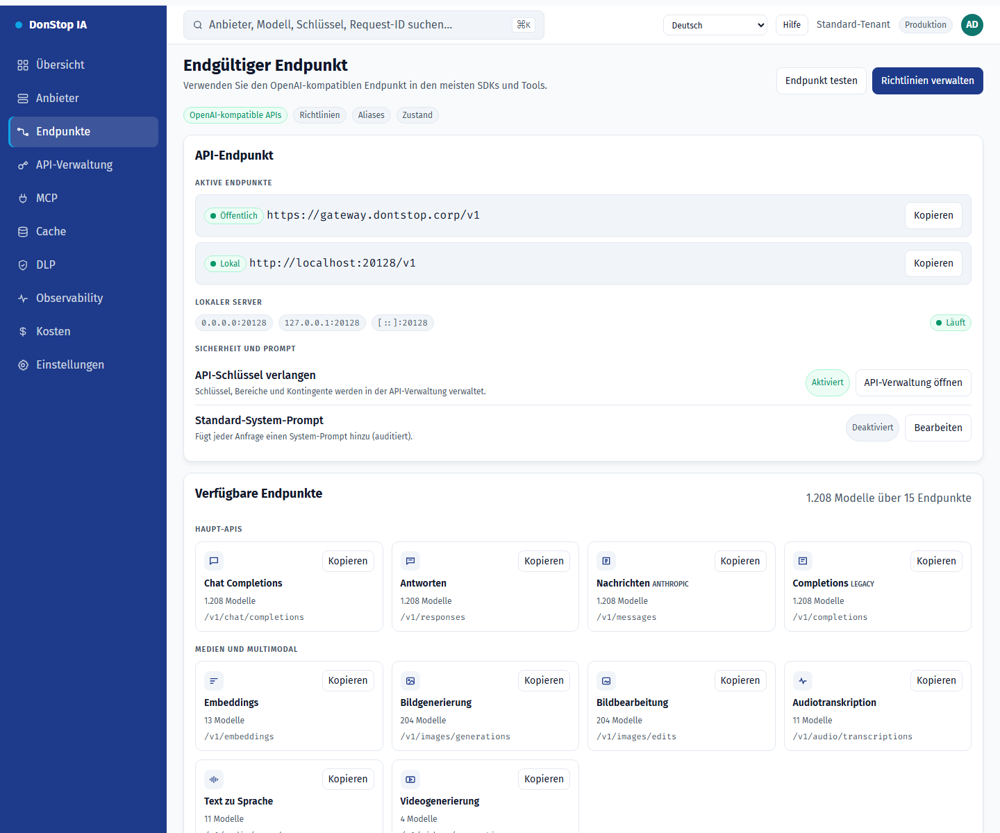

# Endpunkte

## Was diese Seite tut

Zeigt den endgültigen API-Endpunkt, öffentliche und lokale URLs, Routen, CLI-Aliase und den optionalen System-Prompt.

## Wann verwenden

Verwenden Sie diese Seite, um diesen Teil des Gateways zu prüfen, zu konfigurieren oder zu betreiben.

## Schritt für Schritt

1. Öffnen Sie **Endpunkte** über die Seitenleiste.
2. Prüfen Sie die Kennzahlen und die Haupttabelle.
3. Verwenden Sie die unten beschriebenen Aktionen; Änderungen gelten sofort.
4. Kopieren Sie die öffentliche oder lokale URL und nutzen Sie CLI-Aliase; Tunnel werden nicht angeboten.

## Felder und Aktionen

| Feld oder Aktion | Auf dieser Seite sichtbare Bezeichnung oder Aktion. |
|---|---|
| Basis-URL | Auf dieser Seite sichtbare Bezeichnung oder Aktion. |
| Öffentlich | Auf dieser Seite sichtbare Bezeichnung oder Aktion. |
| Lokal | Auf dieser Seite sichtbare Bezeichnung oder Aktion. |
| Verfügbare Endpunkte | Auf dieser Seite sichtbare Bezeichnung oder Aktion. |
| CLI-Aliase | Auf dieser Seite sichtbare Bezeichnung oder Aktion. |

## Häufige Fehler und Zustände

- Wenn Daten nicht geladen werden, versuchen Sie es erneut. Prüfen Sie Gateway und Anbieter, wenn der Fehler bleibt.
- Wenn eine Aktion deaktiviert ist, prüfen Sie Rolle und Tenant-Bereich.
- Leere Zustände sind vor der ersten Anfrage normal; folgen Sie der Handlungsaufforderung.

## Verwandte Leitfäden

- [API-Verwaltung](api-manager.md)
- [Anbieter](providers.md)
- [MCP](mcp.md)

> Screenshot von Endpunkte auf Deutsch.
