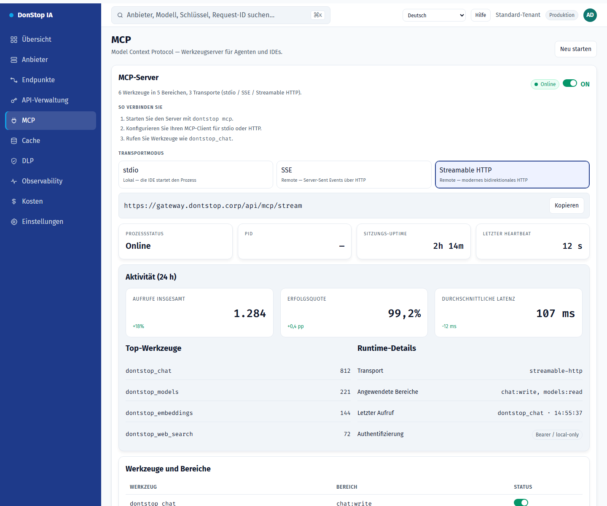

# MCP

## Was diese Seite tut

Steuert den MCP-Server: globales Ein/Aus, Transport, Status, Aktivität und bereitgestellte Werkzeuge.

## Wann verwenden

Verwenden Sie diese Seite, um diesen Teil des Gateways zu prüfen, zu konfigurieren oder zu betreiben.

## Schritt für Schritt

1. Öffnen Sie **MCP** über die Seitenleiste.
2. Prüfen Sie die Kennzahlen und die Haupttabelle.
3. Verwenden Sie die unten beschriebenen Aktionen; Änderungen gelten sofort.
4. Aktivieren Sie den Server, wählen Sie einen Transport und kopieren Sie Befehl oder URL.

## Felder und Aktionen

| Feld oder Aktion | Auf dieser Seite sichtbare Bezeichnung oder Aktion. |
|---|---|
| MCP-Server | Auf dieser Seite sichtbare Bezeichnung oder Aktion. |
| Transportmodus | Auf dieser Seite sichtbare Bezeichnung oder Aktion. |
| Aktivität (24 h) | Auf dieser Seite sichtbare Bezeichnung oder Aktion. |
| Werkzeuge und Bereiche | Auf dieser Seite sichtbare Bezeichnung oder Aktion. |
| Neu starten | Auf dieser Seite sichtbare Bezeichnung oder Aktion. |

## Häufige Fehler und Zustände

- Wenn Daten nicht geladen werden, versuchen Sie es erneut. Prüfen Sie Gateway und Anbieter, wenn der Fehler bleibt.
- Wenn eine Aktion deaktiviert ist, prüfen Sie Rolle und Tenant-Bereich.
- Leere Zustände sind vor der ersten Anfrage normal; folgen Sie der Handlungsaufforderung.

## Verwandte Leitfäden

- [API-Verwaltung](api-manager.md)
- [Endpunkte](endpoints.md)
- [Einstellungen](settings.md)

> Screenshot von MCP auf Deutsch.
