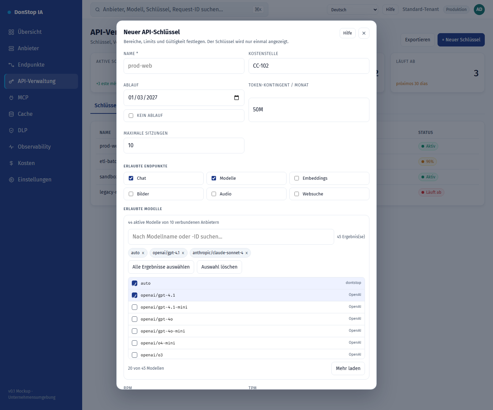

# Neuer API-Schlüssel

## Was diese Seite tut

Erstellt einen API-Schlüssel mit Bereichen, Modellbeschränkungen, Kontingenten, Ablauf und IP-/Sitzungslimits.

## Wann verwenden

Verwenden Sie diese Seite, um diesen Teil des Gateways zu prüfen, zu konfigurieren oder zu betreiben.

## Schritt für Schritt

1. Öffnen Sie **Neuer API-Schlüssel** über die Seitenleiste.
2. Prüfen Sie die Kennzahlen und die Haupttabelle.
3. Verwenden Sie die unten beschriebenen Aktionen; Änderungen gelten sofort.
4. Füllen Sie die Felder aus, wählen Sie Modelle, erstellen Sie den Schlüssel und kopieren Sie ihn einmal.

## Felder und Aktionen

| Feld oder Aktion | Auf dieser Seite sichtbare Bezeichnung oder Aktion. |
|---|---|
| Name * | Auf dieser Seite sichtbare Bezeichnung oder Aktion. |
| Kostenstelle | Auf dieser Seite sichtbare Bezeichnung oder Aktion. |
| Ablauf | Auf dieser Seite sichtbare Bezeichnung oder Aktion. |
| Token-Kontingent / Monat | Auf dieser Seite sichtbare Bezeichnung oder Aktion. |
| Erlaubte Endpunkte | Auf dieser Seite sichtbare Bezeichnung oder Aktion. |
| Erlaubte Modelle | Auf dieser Seite sichtbare Bezeichnung oder Aktion. |

## Häufige Fehler und Zustände

- Wenn Daten nicht geladen werden, versuchen Sie es erneut. Prüfen Sie Gateway und Anbieter, wenn der Fehler bleibt.
- Wenn eine Aktion deaktiviert ist, prüfen Sie Rolle und Tenant-Bereich.
- Leere Zustände sind vor der ersten Anfrage normal; folgen Sie der Handlungsaufforderung.

## Verwandte Leitfäden

- [API-Verwaltung](api-manager.md)
- [Endpunkte](endpoints.md)
- [Kosten](cost.md)

> Screenshot von Neuer API-Schlüssel auf Deutsch.
