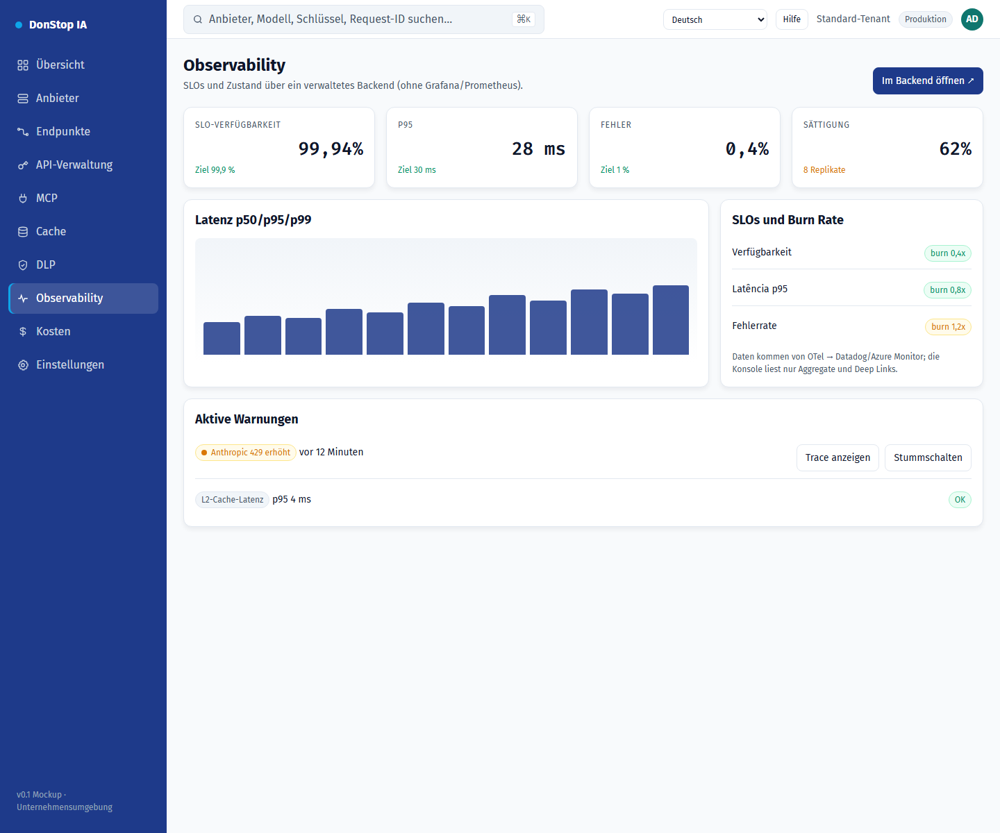

# Observability

## Was diese Seite tut

Zeigt SLOs, Verfügbarkeit, Warnungen, Traffic und Latenz mit Deep Links zum verwalteten Backend.

## Wann verwenden

Verwenden Sie diese Seite, um diesen Teil des Gateways zu prüfen, zu konfigurieren oder zu betreiben.

## Schritt für Schritt

1. Öffnen Sie **Observability** über die Seitenleiste.
2. Prüfen Sie die Kennzahlen und die Haupttabelle.
3. Verwenden Sie die unten beschriebenen Aktionen; Änderungen gelten sofort.
4. Nutzen Sie die Deep Links, um Traces und SLO-Details im verwalteten Backend zu öffnen.

## Felder und Aktionen

| Feld oder Aktion | Auf dieser Seite sichtbare Bezeichnung oder Aktion. |
|---|---|
| Verfügbarkeit | Auf dieser Seite sichtbare Bezeichnung oder Aktion. |
| SLOs und Burn Rate | Auf dieser Seite sichtbare Bezeichnung oder Aktion. |
| Aktive Warnungen | Auf dieser Seite sichtbare Bezeichnung oder Aktion. |
| Traffic und Latenz | Auf dieser Seite sichtbare Bezeichnung oder Aktion. |
| Im Backend öffnen ↗ | Auf dieser Seite sichtbare Bezeichnung oder Aktion. |

## Häufige Fehler und Zustände

- Wenn Daten nicht geladen werden, versuchen Sie es erneut. Prüfen Sie Gateway und Anbieter, wenn der Fehler bleibt.
- Wenn eine Aktion deaktiviert ist, prüfen Sie Rolle und Tenant-Bereich.
- Leere Zustände sind vor der ersten Anfrage normal; folgen Sie der Handlungsaufforderung.

## Verwandte Leitfäden

- [Übersicht](dashboard.md)
- [DLP](dlp.md)
- [Kosten](cost.md)

> Screenshot von Observability auf Deutsch.
