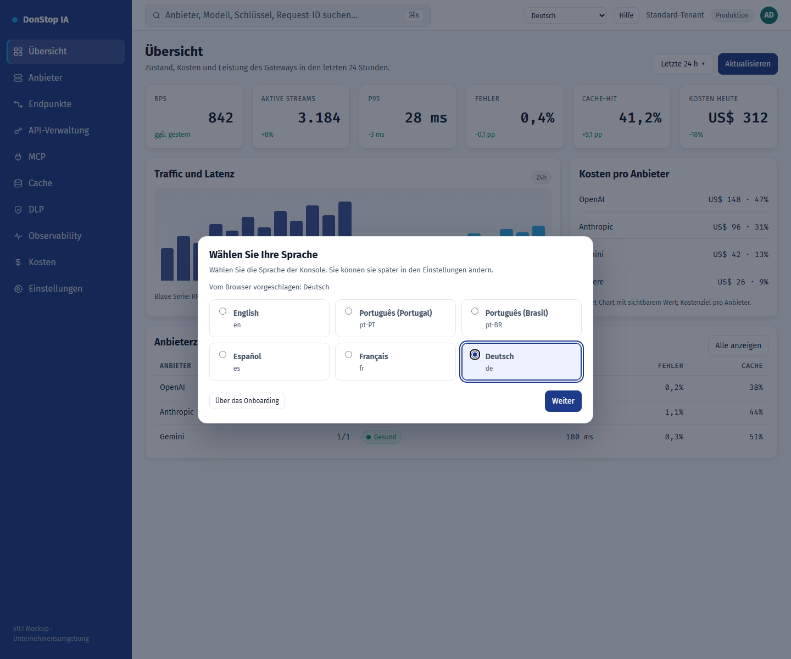

# Onboarding

## Was diese Seite tut

Erscheint beim ersten Zugriff zur Auswahl der Oberflächensprache, vorausgewählt aus dem Browser.

## Wann verwenden

Verwenden Sie diese Seite, um diesen Teil des Gateways zu prüfen, zu konfigurieren oder zu betreiben.

## Schritt für Schritt

1. Öffnen Sie **Onboarding** über die Seitenleiste.
2. Prüfen Sie die Kennzahlen und die Haupttabelle.
3. Verwenden Sie die unten beschriebenen Aktionen; Änderungen gelten sofort.
4. Wählen Sie die vorgeschlagene oder eine andere Sprache und klicken Sie auf Weiter.

## Felder und Aktionen

| Feld oder Aktion | Auf dieser Seite sichtbare Bezeichnung oder Aktion. |
|---|---|
| Sprache der Oberfläche | Auf dieser Seite sichtbare Bezeichnung oder Aktion. |
| Vom Browser vorgeschlagen: {locale} | Auf dieser Seite sichtbare Bezeichnung oder Aktion. |
| Weiter | Auf dieser Seite sichtbare Bezeichnung oder Aktion. |
| Über das Onboarding | Auf dieser Seite sichtbare Bezeichnung oder Aktion. |

## Häufige Fehler und Zustände

- Wenn Daten nicht geladen werden, versuchen Sie es erneut. Prüfen Sie Gateway und Anbieter, wenn der Fehler bleibt.
- Wenn eine Aktion deaktiviert ist, prüfen Sie Rolle und Tenant-Bereich.
- Leere Zustände sind vor der ersten Anfrage normal; folgen Sie der Handlungsaufforderung.

## Verwandte Leitfäden

- [Einstellungen](settings.md)
- [Übersicht](dashboard.md)
- [API-Verwaltung](api-manager.md)

> Screenshot von Onboarding auf Deutsch.
