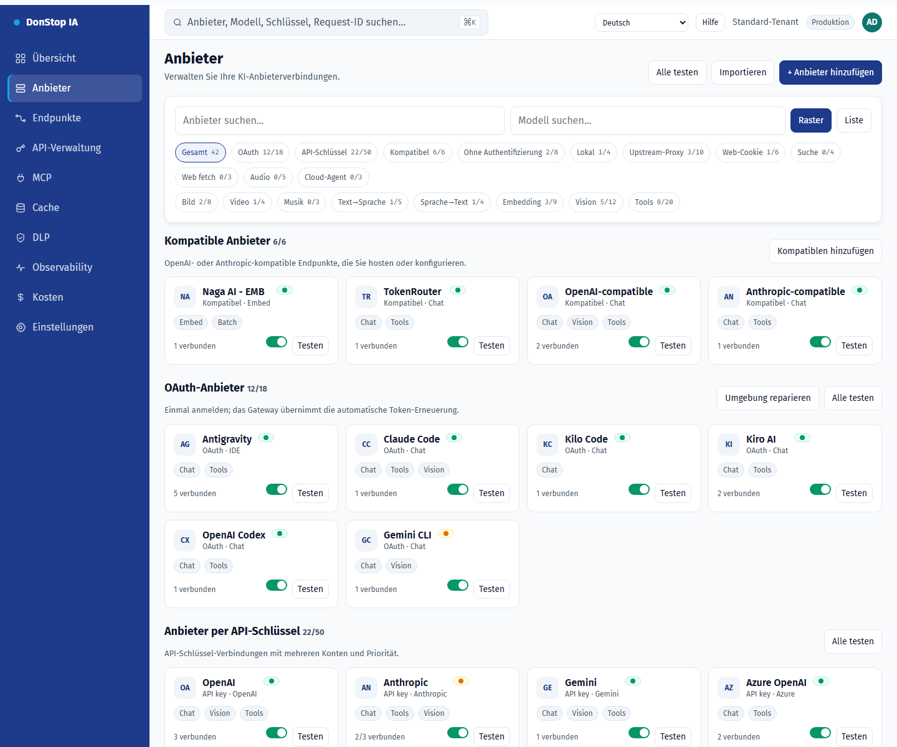
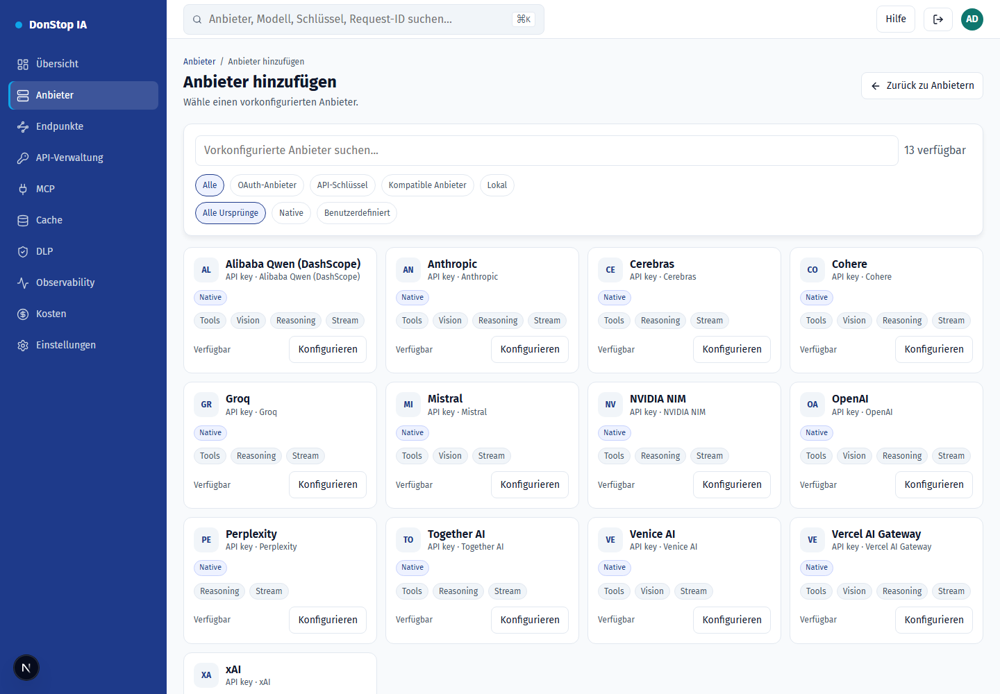
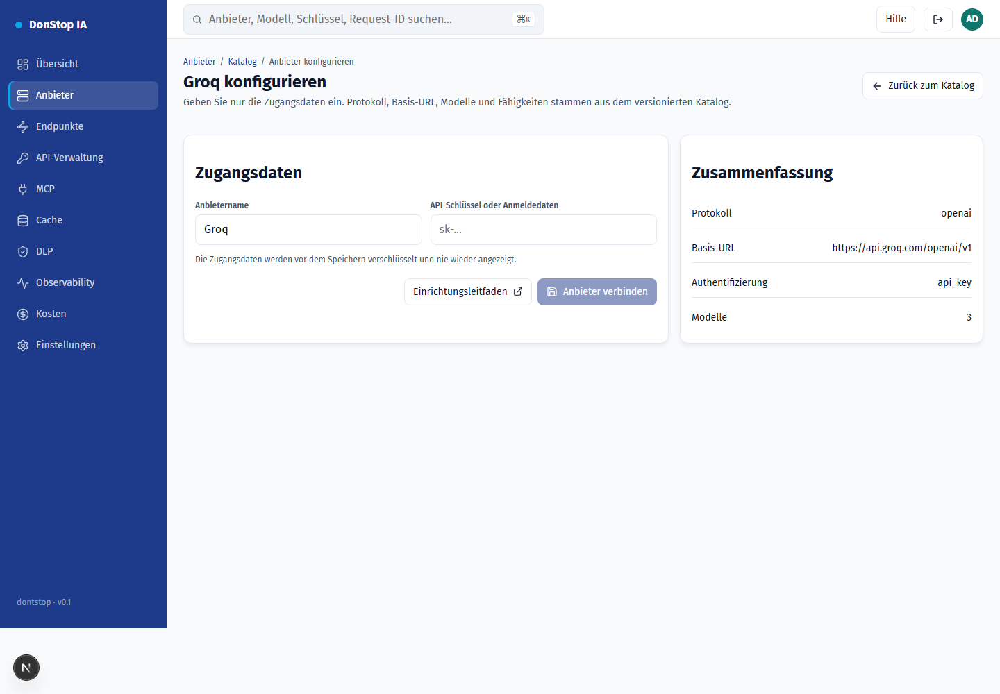
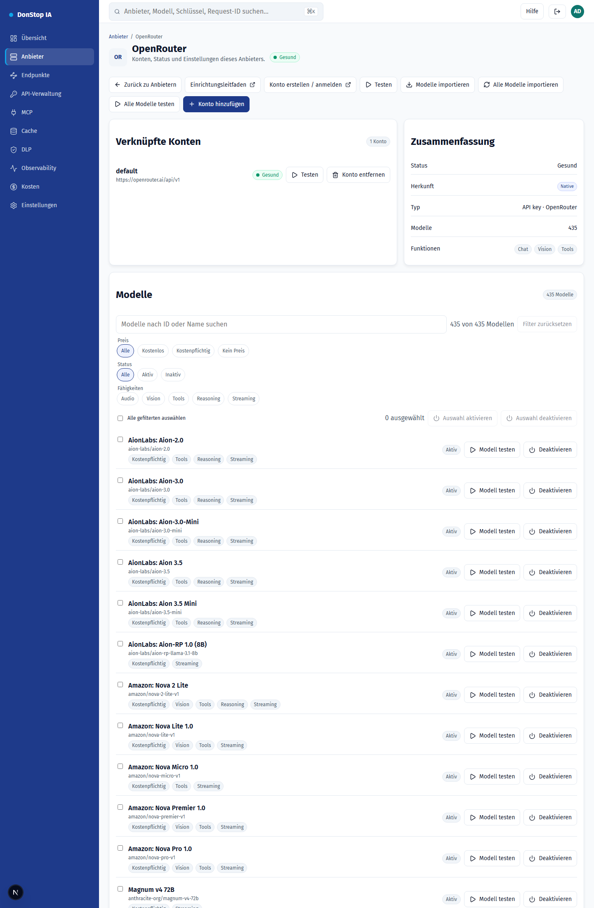

# Anbieter einrichten

Jeder Anbieter ist bereits im versionierten Katalog hinterlegt: Protokoll, Basis-URL, Modelle und Fähigkeiten. Sie geben nur die Zugangsdaten an.

## So konfigurieren Sie

1. Öffnen Sie Anbieter und wählen Sie Anbieter hinzufügen (oder die Karte im Katalog).
2. Wählen Sie den Anbieter und klicken Sie auf Konfigurieren.
3. Erstellen Sie den API-Schlüssel in der Anbieterkonsole (Link unten).
4. Fügen Sie den Schlüssel in das Feld Zugangsdaten ein und bestätigen Sie.
5. Der Anbieter erscheint in der Liste der konfigurierten Anbieter; testen Sie ihn und importieren Sie bei Bedarf Modelle.

## Schritt für Schritt

## Unterstützte Anbieter

| Provider | Auth | Base URL |
|---|---|---|
| Alibaba Qwen (DashScope) | API key | https://dashscope-intl.aliyuncs.com/compatible-mode/v1 |
| Anthropic | API key | https://api.anthropic.com |
| Cerebras | API key | https://api.cerebras.ai/v1 |
| Cohere | API key | https://api.cohere.com/compatibility/v1 |
| Groq | API key | https://api.groq.com/openai/v1 |
| Mistral | API key | https://api.mistral.ai/v1 |
| NVIDIA NIM | API key | https://integrate.api.nvidia.com/v1 |
| OpenAI | API key | https://api.openai.com/v1 |
| OpenRouter | API key | https://openrouter.ai/api/v1 |
| Perplexity | API key | https://api.perplexity.ai |
| Together AI | API key | https://api.together.xyz/v1 |
| Venice AI | API key | https://api.venice.ai/api/v1 |
| Vercel AI Gateway | API key | https://ai-gateway.vercel.sh/v1 |
| xAI | API key | https://api.x.ai/v1 |

## Alibaba Qwen (DashScope)

- Auth: API key
- Base URL: https://dashscope-intl.aliyuncs.com/compatible-mode/v1
- Crie a chave no Alibaba Cloud Model Studio (DashScope) e use o endpoint internacional.

## Anthropic

- Auth: API key
- Base URL: https://api.anthropic.com
- O gateway envia x-api-key e anthropic-version; não inclua esses headers manualmente.

## Cerebras

- Auth: API key
- Base URL: https://api.cerebras.ai/v1
- Compatível com OpenAI; use a chave do console da Cerebras.

## Cohere

- Auth: API key
- Base URL: https://api.cohere.com/compatibility/v1
- Use o endpoint de compatibilidade (/compatibility) e a chave do dashboard da Cohere.

## Groq

- Auth: API key
- Base URL: https://api.groq.com/openai/v1
- Compatível com OpenAI; a chave é criada no console da Groq.

## Mistral

- Auth: API key
- Base URL: https://api.mistral.ai/v1
- Compatível com OpenAI; use a chave do console da Mistral.

## NVIDIA NIM

- Auth: API key
- Base URL: https://integrate.api.nvidia.com/v1
- O endpoint de modelos é público; a credencial é exigida nas inferências.

## OpenAI

- Auth: API key
- Base URL: https://api.openai.com/v1
- Use uma chave de projeto. A organizaão/projeto não são enviados pelo gateway.

## OpenRouter

- Auth: API key
- Base URL: https://openrouter.ai/api/v1
- Importe modelos pelo botão Importar modelos ou use o modelo auto.

## Perplexity

- Auth: API key
- Base URL: https://api.perplexity.ai
- Perplexity não expõe /models: o teste e a importação de modelos ficam indisponíveis; o chat funciona.

## Together AI

- Auth: API key
- Base URL: https://api.together.xyz/v1
- Compatível com OpenAI; use a chave em api.together.ai.

## Venice AI

- Auth: API key
- Base URL: https://api.venice.ai/api/v1
- Compatível com OpenAI; a chave é criada em Settings > API.

## Vercel AI Gateway

- Auth: API key
- Base URL: https://ai-gateway.vercel.sh/v1
- Os IDs de modelo são namespaced (ex.: openai/gpt-4.1).

## xAI

- Auth: API key
- Base URL: https://api.x.ai/v1
- Use a chave do console da xAI; o gateway usa o endpoint de chat.

## Filter und Sammelaktionen

- Filtern Sie nach Preis (kostenlos/kostenpflichtig/kein Preis), Fähigkeiten (Audio, Vision, Tools, Reasoning, Streaming), Status oder Text.
- Wählen Sie alle gefilterten Modelle und aktivieren oder deaktivieren Sie sie gemeinsam; die App bestätigt die Anzahl und meldet jeden Fehler.
- Filter nutzen Anbietermetadaten; Modelle ohne Metadaten zeigen "keine Metadaten" und werden nie aus dem Namen abgeleitet.
## Modelle

- **Modelle synchronisieren** importiert alles, was der Anbieter anbietet, und behält den Aktivstatus bestehender Modelle bei.
- **Modell testen** sendet eine minimale Anfrage zur Prüfung von Zugangsdaten und Verfügbarkeit.
- **Aktivieren/Deaktivieren** legt fest, ob das Modell in `/v1/models` erscheint und Traffic erhält.
- **Alle Modelle testen** reiht alle konfigurierten Modelle ein und führt die Tests nacheinander im Hintergrund aus.
- **Alle Modelle importieren** registriert alles, was der Anbieter anbietet, mit einem Klick.

## Felder

| Field | Description |
|---|---|
| Zugangsdaten | API-Schlüssel aus der Anbieterkonsole. Er wird vor dem Speichern verschlüsselt. |
| Anbietername | Optionales Label für diese Instanz. |
| Basis-URL | Optionale Überschreibung; leer verwendet den Katalogwert. |

## Häufige Fehler

- 401: Schlüssel ungültig oder abgelaufen. Erstellen Sie einen neuen.
- 402: Das Anbieterkonto hat kein Guthaben.
- 429: Ratenlimit des Anbieters. Warten Sie den Cooldown ab.
- Anbieter nicht im Katalog: Es gibt noch keinen Adapter im Gateway.
