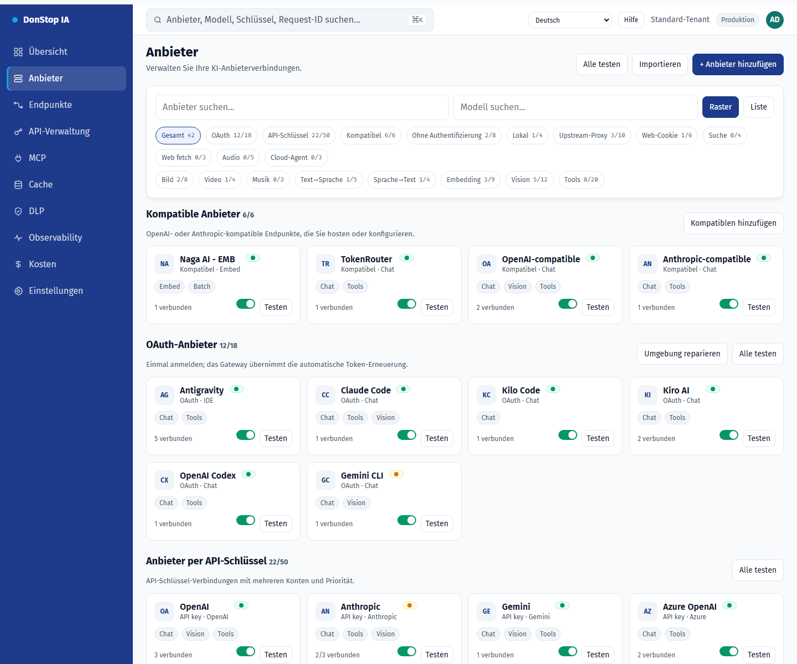

# Anbieter

## Was diese Seite tut

Listet KI-Anbieter, Konten, Verbindungsstatus und verfügbare Modelle mit Raster-/Listenansicht und Verbindungstests.

## Wann verwenden

Verwenden Sie diese Seite, um diesen Teil des Gateways zu prüfen, zu konfigurieren oder zu betreiben.

## Schritt für Schritt

1. Öffnen Sie **Anbieter** über die Seitenleiste.
2. Prüfen Sie die Kennzahlen und die Haupttabelle.
3. Verwenden Sie die unten beschriebenen Aktionen; Änderungen gelten sofort.
4. Nutzen Sie Raster/Liste, filtern Sie nach Authentifizierung oder Fähigkeit und testen Sie den Anbieter vor der Aktivierung.

## Felder und Aktionen

| Feld oder Aktion | Auf dieser Seite sichtbare Bezeichnung oder Aktion. |
|---|---|
| + Anbieter hinzufügen | Auf dieser Seite sichtbare Bezeichnung oder Aktion. |
| Raster | Auf dieser Seite sichtbare Bezeichnung oder Aktion. |
| Liste | Auf dieser Seite sichtbare Bezeichnung oder Aktion. |
| Testen | Auf dieser Seite sichtbare Bezeichnung oder Aktion. |
| Status | Auf dieser Seite sichtbare Bezeichnung oder Aktion. |

## Häufige Fehler und Zustände

- Wenn Daten nicht geladen werden, versuchen Sie es erneut. Prüfen Sie Gateway und Anbieter, wenn der Fehler bleibt.
- Wenn eine Aktion deaktiviert ist, prüfen Sie Rolle und Tenant-Bereich.
- Leere Zustände sind vor der ersten Anfrage normal; folgen Sie der Handlungsaufforderung.

## Verwandte Leitfäden

- [Endpunkte](endpoints.md)
- [Übersicht](dashboard.md)
- [Kosten](cost.md)

> Screenshot von Anbieter auf Deutsch.
