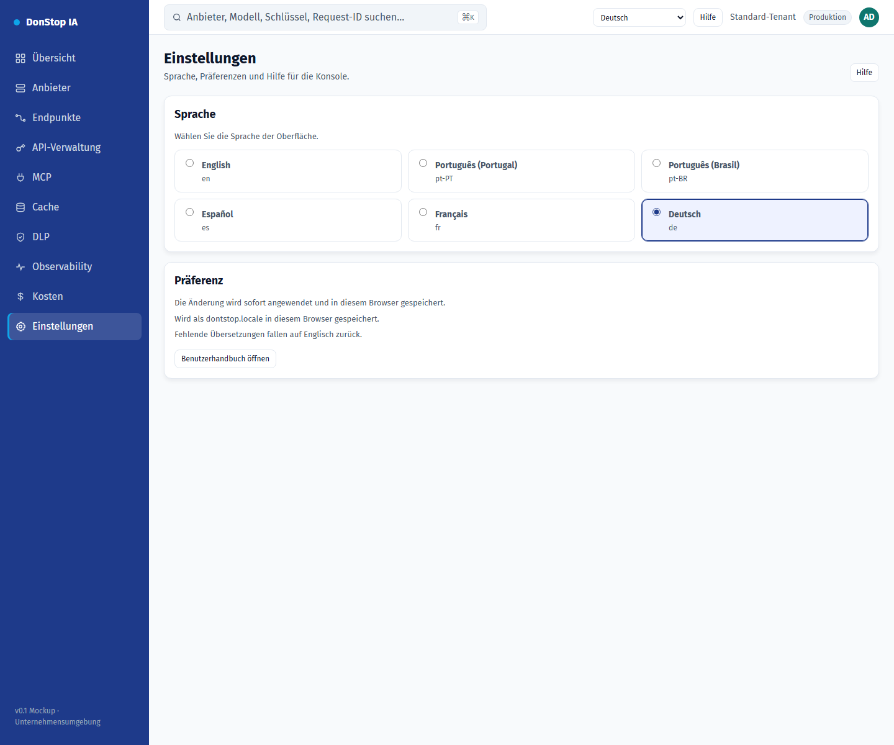

# Einstellungen

## Was diese Seite tut

Ermöglicht das Ändern der Oberflächensprache und zeigt, wo die Präferenz gespeichert wird.

## Wann verwenden

Verwenden Sie diese Seite, um diesen Teil des Gateways zu prüfen, zu konfigurieren oder zu betreiben.

## Schritt für Schritt

1. Öffnen Sie **Einstellungen** über die Seitenleiste.
2. Prüfen Sie die Kennzahlen und die Haupttabelle.
3. Verwenden Sie die unten beschriebenen Aktionen; Änderungen gelten sofort.
4. Wählen Sie eine Sprache; die Oberfläche aktualisiert sich sofort und die Auswahl wird gespeichert.

## Felder und Aktionen

| Feld oder Aktion | Auf dieser Seite sichtbare Bezeichnung oder Aktion. |
|---|---|
| Sprache | Auf dieser Seite sichtbare Bezeichnung oder Aktion. |
| Präferenz | Auf dieser Seite sichtbare Bezeichnung oder Aktion. |
| Wird als dontstop.locale in diesem Browser gespeichert. | Auf dieser Seite sichtbare Bezeichnung oder Aktion. |
| Fehlende Übersetzungen fallen auf Englisch zurück. | Auf dieser Seite sichtbare Bezeichnung oder Aktion. |
| Benutzerhandbuch öffnen | Auf dieser Seite sichtbare Bezeichnung oder Aktion. |

## Häufige Fehler und Zustände

- Wenn Daten nicht geladen werden, versuchen Sie es erneut. Prüfen Sie Gateway und Anbieter, wenn der Fehler bleibt.
- Wenn eine Aktion deaktiviert ist, prüfen Sie Rolle und Tenant-Bereich.
- Leere Zustände sind vor der ersten Anfrage normal; folgen Sie der Handlungsaufforderung.

## Verwandte Leitfäden

- [Onboarding](onboarding.md)
- [API-Verwaltung](api-manager.md)
- [MCP](mcp.md)

> Screenshot von Einstellungen auf Deutsch.
