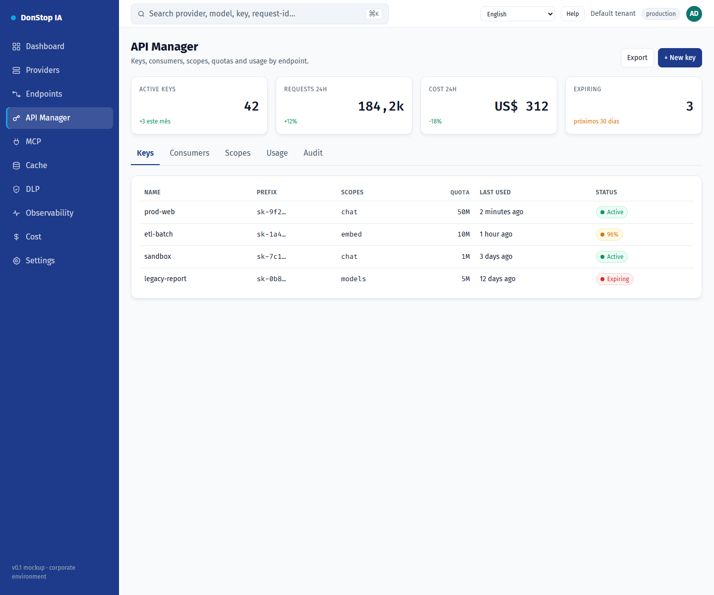

# API Manager

## What it does

Manages API keys, scopes, quotas, rate limits, expiration and usage by endpoint.

## When to use

Use this screen when you need to inspect, configure or operate this part of the gateway.

## Step by step

1. Open **API Manager** from the sidebar.
2. Review the indicators and the main table.
3. Use the actions described below; changes take effect immediately.
4. Open a key to review scopes and usage, or use + New key to create one.

## Fields and actions

| Field or action | Label or action visible on this screen. |
|---|---|
| + New key | Label or action visible on this screen. |
| Keys | Label or action visible on this screen. |
| Scopes | Label or action visible on this screen. |
| Quota | Label or action visible on this screen. |
| Last used | Label or action visible on this screen. |
| Status | Label or action visible on this screen. |

## Common errors and states

- If data fails to load, retry. If the error persists, check the gateway and provider status.
- If an action is disabled, confirm your role and the tenant scope.
- Empty states are expected before the first request; follow the call to action.

## Related guides

- [New API key](new-api-key.md)
- [Endpoints](endpoints.md)
- [Cost](cost.md)

> Screenshot of the API Manager screen in English.
