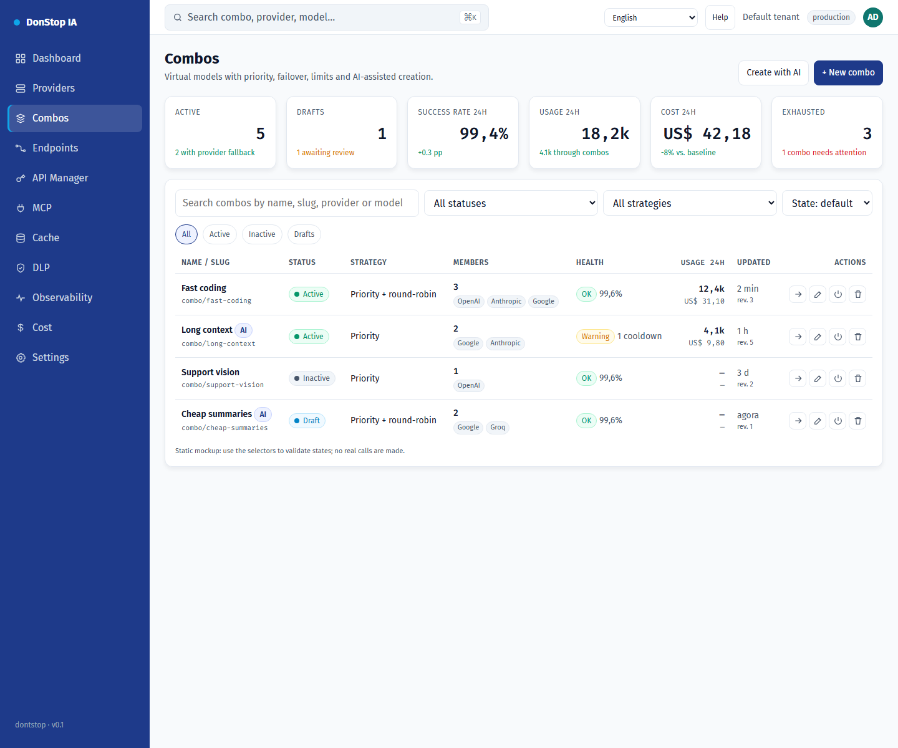

# Combos

## What it does

Creates and operates virtual models made of provider models, with priority, failover, limits and AI-assisted drafting.

## When to use

Use this screen when you need to inspect, configure or operate this part of the gateway.

## Step by step

1. Open **Combos** from the sidebar.
2. Review the indicators and the main table.
3. Use the actions described below; changes take effect immediately.
4. Create manually or with AI, review members and warnings, validate, then save and activate explicitly.

## Fields and actions

| Field or action | Label or action visible on this screen. |
|---|---|
| Status | Label or action visible on this screen. |
| Edit | Label or action visible on this screen. |
| Test | Label or action visible on this screen. |
| Close | Label or action visible on this screen. |

## Combos and AI

A combo is a virtual model named `combo/<slug>`. It tries its members by tier and fails over before the first streamed chunk. When a member fails, the next eligible member is attempted; `400/413/422` stop the request. The AI assistant reads the real catalog and produces a draft only: it never saves or activates a combo. Review warnings, validate, then save and activate explicitly.

## Common errors and states

- If data fails to load, retry. If the error persists, check the gateway and provider status.
- If an action is disabled, confirm your role and the tenant scope.
- Empty states are expected before the first request; follow the call to action.

## Related guides

- [Providers](providers.md)
- [Endpoints](endpoints.md)
- [Cost](cost.md)

> Screenshot of the Combos screen in English.
