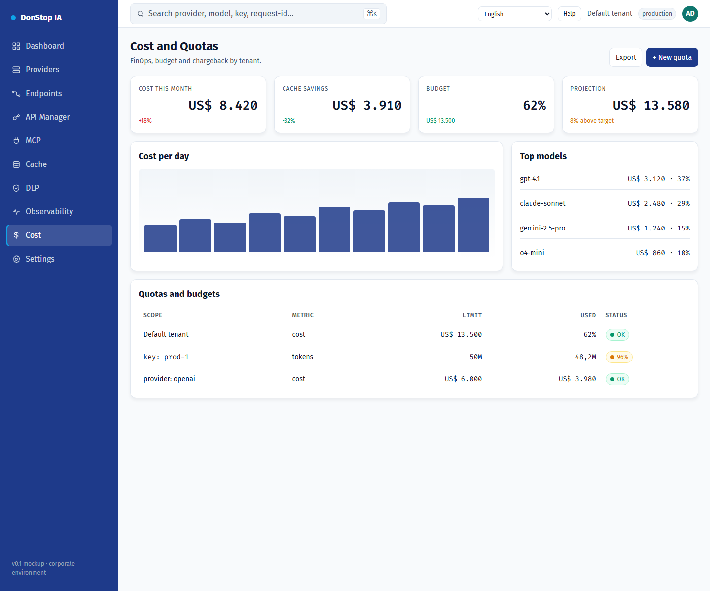

# Cost

## What it does

Shows daily and monthly cost, projection, budget and quotas by tenant, key and provider.

## When to use

Use this screen when you need to inspect, configure or operate this part of the gateway.

## Step by step

1. Open **Cost** from the sidebar.
2. Review the indicators and the main table.
3. Use the actions described below; changes take effect immediately.
4. Set quotas and budgets, then export the chargeback report.

## Fields and actions

| Field or action | Label or action visible on this screen. |
|---|---|
| Cost today | Label or action visible on this screen. |
| Cost this month | Label or action visible on this screen. |
| Projection | Label or action visible on this screen. |
| Budget | Label or action visible on this screen. |
| Quotas and budgets | Label or action visible on this screen. |

## Common errors and states

- If data fails to load, retry. If the error persists, check the gateway and provider status.
- If an action is disabled, confirm your role and the tenant scope.
- Empty states are expected before the first request; follow the call to action.

## Related guides

- [Dashboard](dashboard.md)
- [API Manager](api-manager.md)
- [Cache](cache.md)

> Screenshot of the Cost screen in English.
