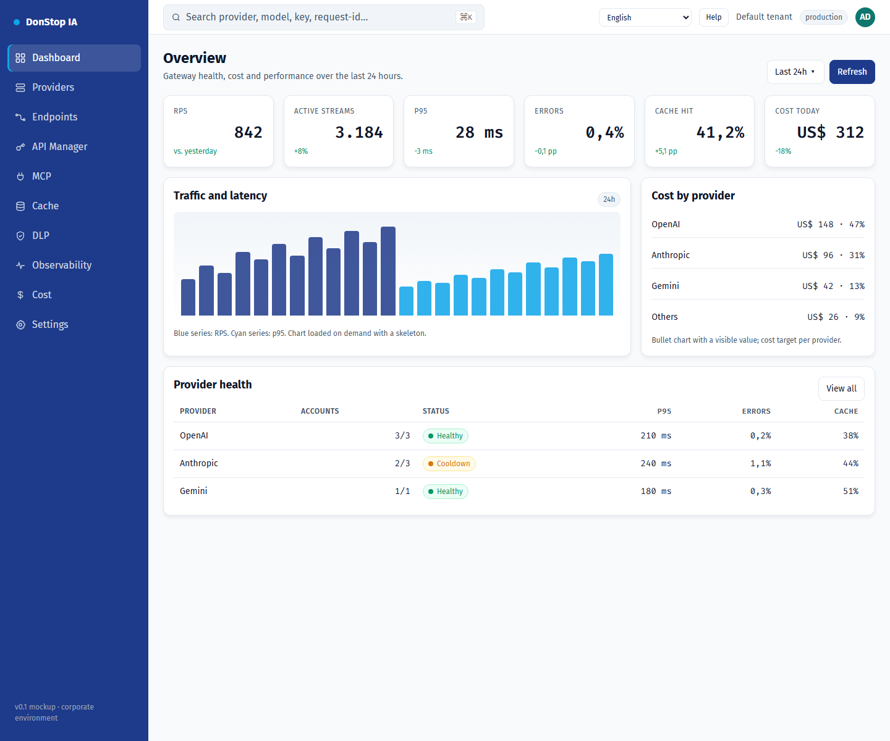

# Dashboard

## What it does

Shows gateway health, traffic, cost and provider status for the last 24 hours.

## When to use

Use this screen when you need to inspect, configure or operate this part of the gateway.

## Step by step

1. Open **Dashboard** from the sidebar.
2. Review the indicators and the main table.
3. Use the actions described below; changes take effect immediately.
4. Check provider health and incidents before opening a detailed trace.

## Fields and actions

| Field or action | Label or action visible on this screen. |
|---|---|
| Active keys | Label or action visible on this screen. |
| Requests 24h | Label or action visible on this screen. |
| Cost 24h | Label or action visible on this screen. |
| Expiring | Label or action visible on this screen. |
| Provider health | Label or action visible on this screen. |

## Common errors and states

- If data fails to load, retry. If the error persists, check the gateway and provider status.
- If an action is disabled, confirm your role and the tenant scope.
- Empty states are expected before the first request; follow the call to action.

## Related guides

- [Providers](providers.md)
- [Observability](observability.md)
- [Cost](cost.md)

> Screenshot of the Dashboard screen in English.
