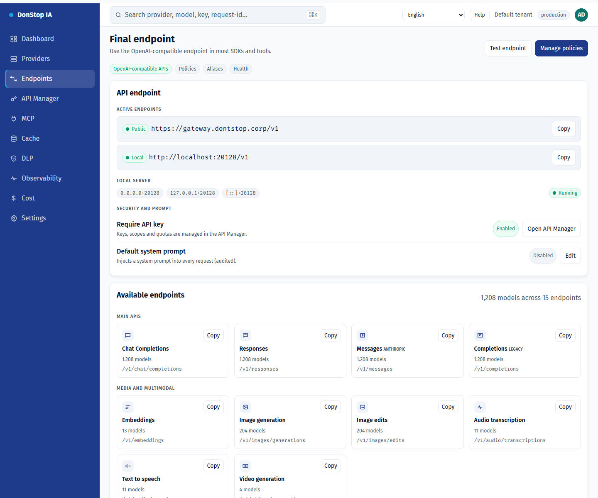

# Endpoints

## What it does

Shows the final API endpoint, public and local URLs, available routes, CLI aliases and the optional system prompt.

## When to use

Use this screen when you need to inspect, configure or operate this part of the gateway.

## Step by step

1. Open **Endpoints** from the sidebar.
2. Review the indicators and the main table.
3. Use the actions described below; changes take effect immediately.
4. Copy the public or local URL and use the aliases for CLIs; no tunnels are offered.

## Fields and actions

| Field or action | Label or action visible on this screen. |
|---|---|
| Base URL | Label or action visible on this screen. |
| Public | Label or action visible on this screen. |
| Local | Label or action visible on this screen. |
| Available endpoints | Label or action visible on this screen. |
| CLI aliases | Label or action visible on this screen. |

## Common errors and states

- If data fails to load, retry. If the error persists, check the gateway and provider status.
- If an action is disabled, confirm your role and the tenant scope.
- Empty states are expected before the first request; follow the call to action.

## Related guides

- [API Manager](api-manager.md)
- [Providers](providers.md)
- [MCP](mcp.md)

> Screenshot of the Endpoints screen in English.
