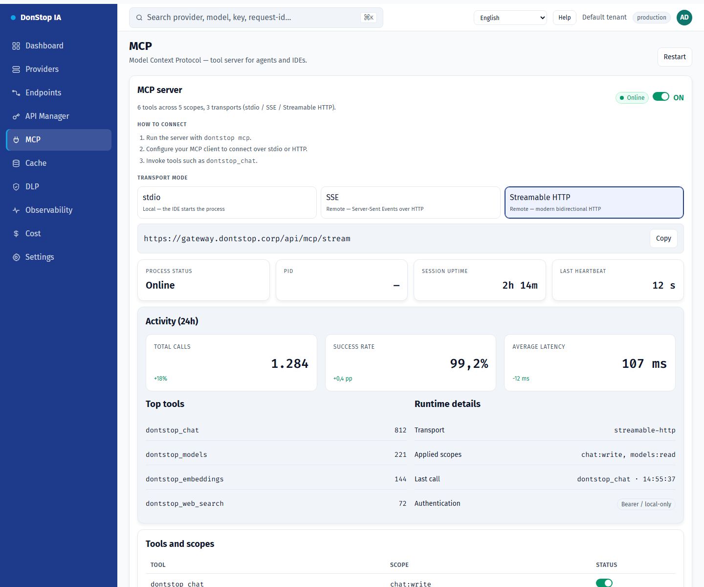

# MCP

## What it does

Controls the MCP server: global on/off, transport, status, activity and exposed tools.

## When to use

Use this screen when you need to inspect, configure or operate this part of the gateway.

## Step by step

1. Open **MCP** from the sidebar.
2. Review the indicators and the main table.
3. Use the actions described below; changes take effect immediately.
4. Enable the server, choose a transport and copy the command or URL.

## Fields and actions

| Field or action | Label or action visible on this screen. |
|---|---|
| MCP server | Label or action visible on this screen. |
| Transport mode | Label or action visible on this screen. |
| Activity (24h) | Label or action visible on this screen. |
| Tools and scopes | Label or action visible on this screen. |
| Restart | Label or action visible on this screen. |

## Common errors and states

- If data fails to load, retry. If the error persists, check the gateway and provider status.
- If an action is disabled, confirm your role and the tenant scope.
- Empty states are expected before the first request; follow the call to action.

## Related guides

- [API Manager](api-manager.md)
- [Endpoints](endpoints.md)
- [Settings](settings.md)

> Screenshot of the MCP screen in English.
