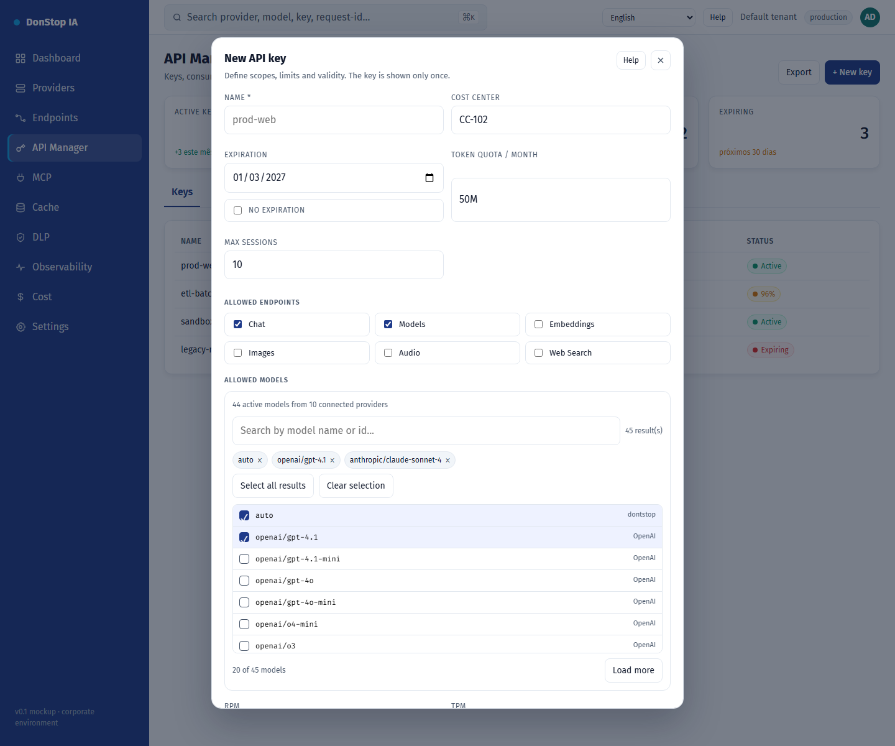

# New API key

## What it does

Creates an API key with scopes, model restrictions, quotas, expiration and IP/session limits.

## When to use

Use this screen when you need to inspect, configure or operate this part of the gateway.

## Step by step

1. Open **New API key** from the sidebar.
2. Review the indicators and the main table.
3. Use the actions described below; changes take effect immediately.
4. Fill in the fields, select models, create the key and copy it once.

## Fields and actions

| Field or action | Label or action visible on this screen. |
|---|---|
| Name * | Label or action visible on this screen. |
| Cost center | Label or action visible on this screen. |
| Expiration | Label or action visible on this screen. |
| Token quota / month | Label or action visible on this screen. |
| Allowed endpoints | Label or action visible on this screen. |
| Allowed models | Label or action visible on this screen. |

## Common errors and states

- If data fails to load, retry. If the error persists, check the gateway and provider status.
- If an action is disabled, confirm your role and the tenant scope.
- Empty states are expected before the first request; follow the call to action.

## Related guides

- [API Manager](api-manager.md)
- [Endpoints](endpoints.md)
- [Cost](cost.md)

> Screenshot of the New API key screen in English.
