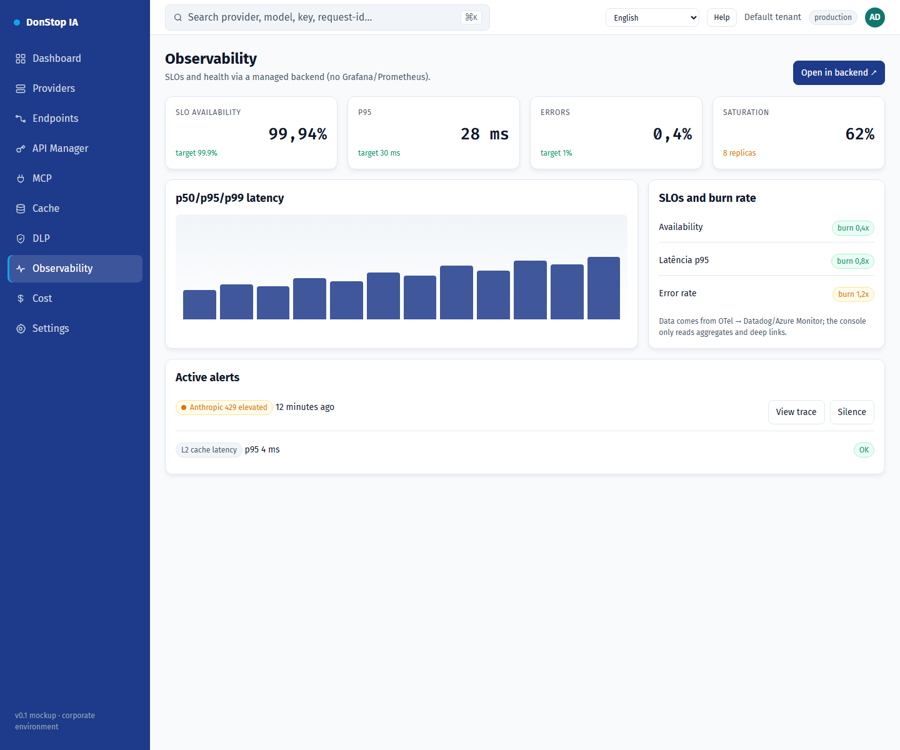

# Observability

## What it does

Shows SLOs, availability, alerts, traffic and latency, with deep links to the managed backend.

## When to use

Use this screen when you need to inspect, configure or operate this part of the gateway.

## Step by step

1. Open **Observability** from the sidebar.
2. Review the indicators and the main table.
3. Use the actions described below; changes take effect immediately.
4. Use the deep links to open traces and SLO details in the managed backend.

## Fields and actions

| Field or action | Label or action visible on this screen. |
|---|---|
| Availability | Label or action visible on this screen. |
| SLOs and burn rate | Label or action visible on this screen. |
| Active alerts | Label or action visible on this screen. |
| Traffic and latency | Label or action visible on this screen. |
| Open in backend ↗ | Label or action visible on this screen. |

## Common errors and states

- If data fails to load, retry. If the error persists, check the gateway and provider status.
- If an action is disabled, confirm your role and the tenant scope.
- Empty states are expected before the first request; follow the call to action.

## Related guides

- [Dashboard](dashboard.md)
- [DLP](dlp.md)
- [Cost](cost.md)

> Screenshot of the Observability screen in English.
