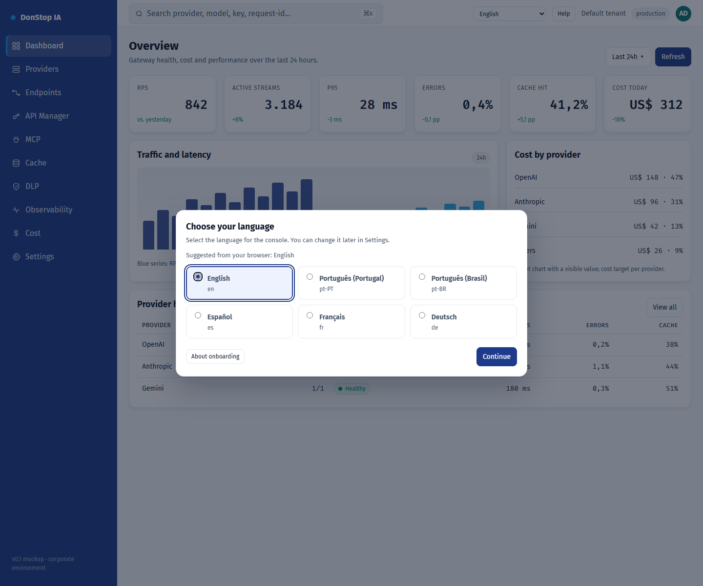

# Onboarding

## What it does

Appears on first access to choose the interface language, pre-selected from the browser.

## When to use

Use this screen when you need to inspect, configure or operate this part of the gateway.

## Step by step

1. Open **Onboarding** from the sidebar.
2. Review the indicators and the main table.
3. Use the actions described below; changes take effect immediately.
4. Choose the suggested language or another one, then select Continue.

## Fields and actions

| Field or action | Label or action visible on this screen. |
|---|---|
| Interface language | Label or action visible on this screen. |
| Suggested from your browser: {locale} | Label or action visible on this screen. |
| Continue | Label or action visible on this screen. |
| About onboarding | Label or action visible on this screen. |

## Common errors and states

- If data fails to load, retry. If the error persists, check the gateway and provider status.
- If an action is disabled, confirm your role and the tenant scope.
- Empty states are expected before the first request; follow the call to action.

## Related guides

- [Settings](settings.md)
- [Dashboard](dashboard.md)
- [API Manager](api-manager.md)

> Screenshot of the Onboarding screen in English.
