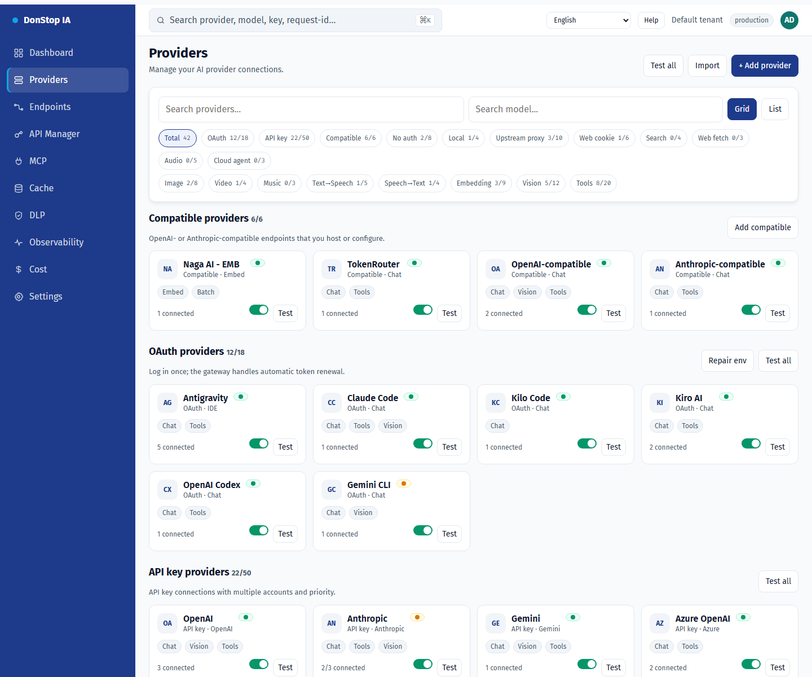
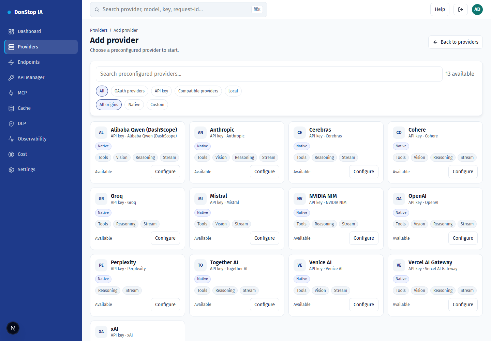
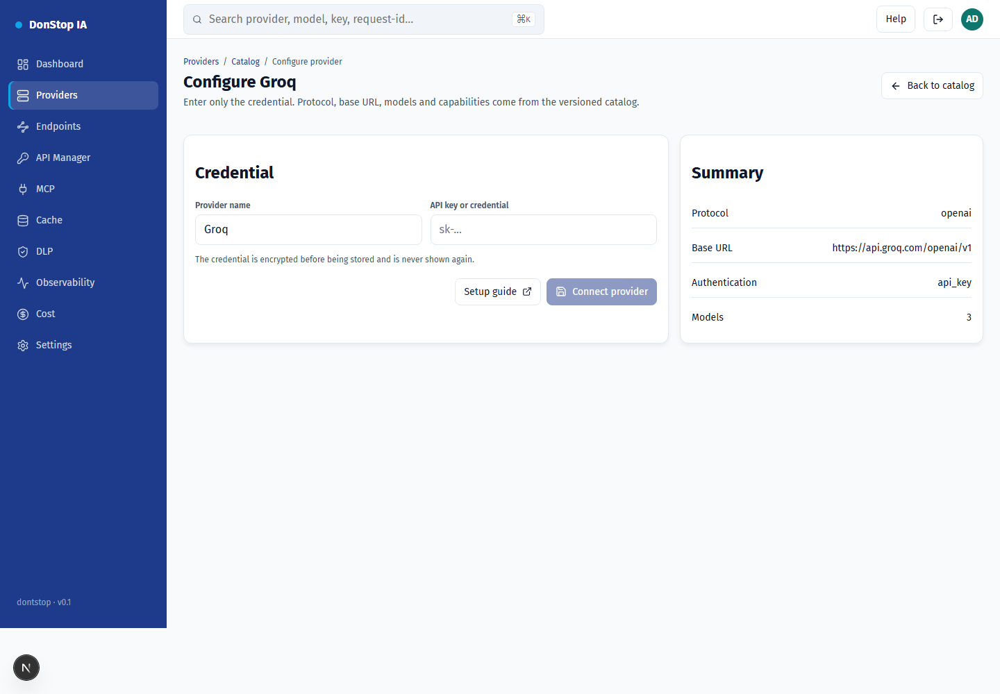
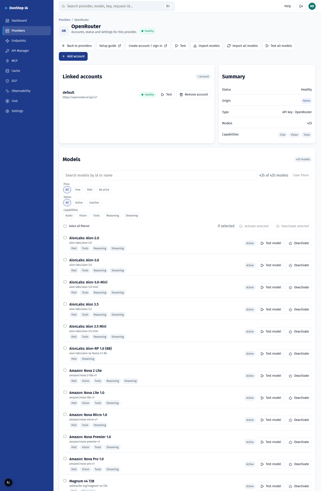

# Provider setup

Each provider below is pre-configured in the versioned catalog: protocol, base URL, models and capabilities. You only provide the credential.

## How to configure

1. Open Providers and choose Add provider (or the provider card in the catalog).
2. Select the provider and click Configure.
3. Create the API key on the provider console (link below).
4. Paste the key in the Credential field and confirm.
5. The provider moves to the configured list; test it and import models if needed.

## Step by step

## Supported providers

| Provider | Auth | Base URL |
|---|---|---|
| Alibaba Qwen (DashScope) | API key | https://dashscope-intl.aliyuncs.com/compatible-mode/v1 |
| Anthropic | API key | https://api.anthropic.com |
| Cerebras | API key | https://api.cerebras.ai/v1 |
| Cohere | API key | https://api.cohere.com/compatibility/v1 |
| Groq | API key | https://api.groq.com/openai/v1 |
| Mistral | API key | https://api.mistral.ai/v1 |
| NVIDIA NIM | API key | https://integrate.api.nvidia.com/v1 |
| OpenAI | API key | https://api.openai.com/v1 |
| OpenRouter | API key | https://openrouter.ai/api/v1 |
| Perplexity | API key | https://api.perplexity.ai |
| Together AI | API key | https://api.together.xyz/v1 |
| Venice AI | API key | https://api.venice.ai/api/v1 |
| Vercel AI Gateway | API key | https://ai-gateway.vercel.sh/v1 |
| xAI | API key | https://api.x.ai/v1 |

## Alibaba Qwen (DashScope)

- Auth: API key
- Base URL: https://dashscope-intl.aliyuncs.com/compatible-mode/v1
- Crie a chave no Alibaba Cloud Model Studio (DashScope) e use o endpoint internacional.

## Anthropic

- Auth: API key
- Base URL: https://api.anthropic.com
- O gateway envia x-api-key e anthropic-version; não inclua esses headers manualmente.

## Cerebras

- Auth: API key
- Base URL: https://api.cerebras.ai/v1
- Compatível com OpenAI; use a chave do console da Cerebras.

## Cohere

- Auth: API key
- Base URL: https://api.cohere.com/compatibility/v1
- Use o endpoint de compatibilidade (/compatibility) e a chave do dashboard da Cohere.

## Groq

- Auth: API key
- Base URL: https://api.groq.com/openai/v1
- Compatível com OpenAI; a chave é criada no console da Groq.

## Mistral

- Auth: API key
- Base URL: https://api.mistral.ai/v1
- Compatível com OpenAI; use a chave do console da Mistral.

## NVIDIA NIM

- Auth: API key
- Base URL: https://integrate.api.nvidia.com/v1
- O endpoint de modelos é público; a credencial é exigida nas inferências.

## OpenAI

- Auth: API key
- Base URL: https://api.openai.com/v1
- Use uma chave de projeto. A organizaão/projeto não são enviados pelo gateway.

## OpenRouter

- Auth: API key
- Base URL: https://openrouter.ai/api/v1
- Importe modelos pelo botão Importar modelos ou use o modelo auto.

## Perplexity

- Auth: API key
- Base URL: https://api.perplexity.ai
- Perplexity não expõe /models: o teste e a importação de modelos ficam indisponíveis; o chat funciona.

## Together AI

- Auth: API key
- Base URL: https://api.together.xyz/v1
- Compatível com OpenAI; use a chave em api.together.ai.

## Venice AI

- Auth: API key
- Base URL: https://api.venice.ai/api/v1
- Compatível com OpenAI; a chave é criada em Settings > API.

## Vercel AI Gateway

- Auth: API key
- Base URL: https://ai-gateway.vercel.sh/v1
- Os IDs de modelo são namespaced (ex.: openai/gpt-4.1).

## xAI

- Auth: API key
- Base URL: https://api.x.ai/v1
- Use a chave do console da xAI; o gateway usa o endpoint de chat.

## Model filters and bulk actions

- Filter by price (free/paid/no price), capabilities (audio, vision, tools, reasoning, streaming), status or text.
- Select all filtered models, then activate or deactivate them at once; the app confirms the count and reports each failure.
- Filters rely on provider metadata; models without metadata show "no metadata" and are not inferred from the name.
## Models

- **Sync models** imports everything the provider advertises and keeps the on/off state of models that already exist.
- **Test model** sends a minimal request to validate the credential and model availability.
- **Activate/Deactivate** controls whether the model appears in `/v1/models` and receives traffic.
- **Test all models** queues every configured model and runs the checks in the background, one at a time.
- **Import all models** registers everything the provider advertises in one click.

## Fields

| Field | Description |
|---|---|
| Credential | API key created in the provider console. It is encrypted before storage. |
| Provider name | Optional label for this provider instance. |
| Base URL | Optional override; the catalog default is used when empty. |

## Common errors

- 401: invalid or expired key. Create a new key and try again.
- 402: the provider account has no credit.
- 429: upstream rate limit. Wait for the cooldown.
- Provider not in the catalog: it still lacks a gateway adapter.
