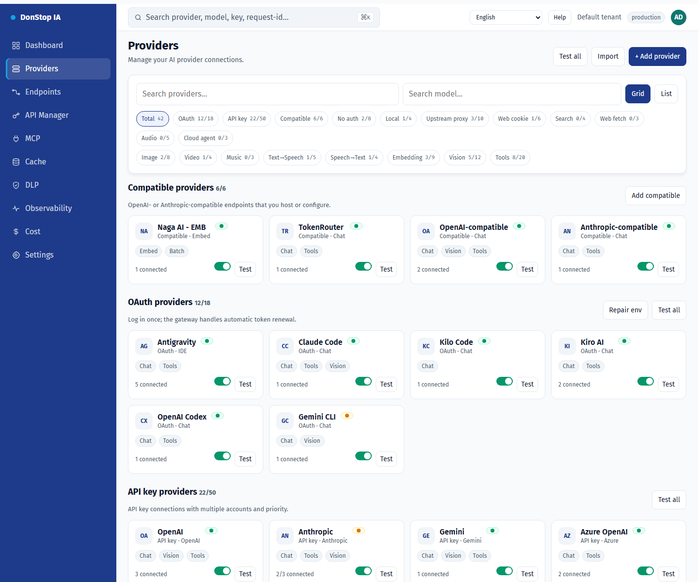

# Providers

## What it does

Lists AI providers, accounts, connection status and model availability, with grid/list views and connection tests.

## When to use

Use this screen when you need to inspect, configure or operate this part of the gateway.

## Step by step

1. Open **Providers** from the sidebar.
2. Review the indicators and the main table.
3. Use the actions described below; changes take effect immediately.
4. Use Grid/List, filter by auth or capability, then test a provider before enabling it.

## Fields and actions

| Field or action | Label or action visible on this screen. |
|---|---|
| + Add provider | Label or action visible on this screen. |
| Grid | Label or action visible on this screen. |
| List | Label or action visible on this screen. |
| Test | Label or action visible on this screen. |
| Status | Label or action visible on this screen. |

## Common errors and states

- If data fails to load, retry. If the error persists, check the gateway and provider status.
- If an action is disabled, confirm your role and the tenant scope.
- Empty states are expected before the first request; follow the call to action.

## Related guides

- [Endpoints](endpoints.md)
- [Dashboard](dashboard.md)
- [Cost](cost.md)

> Screenshot of the Providers screen in English.
