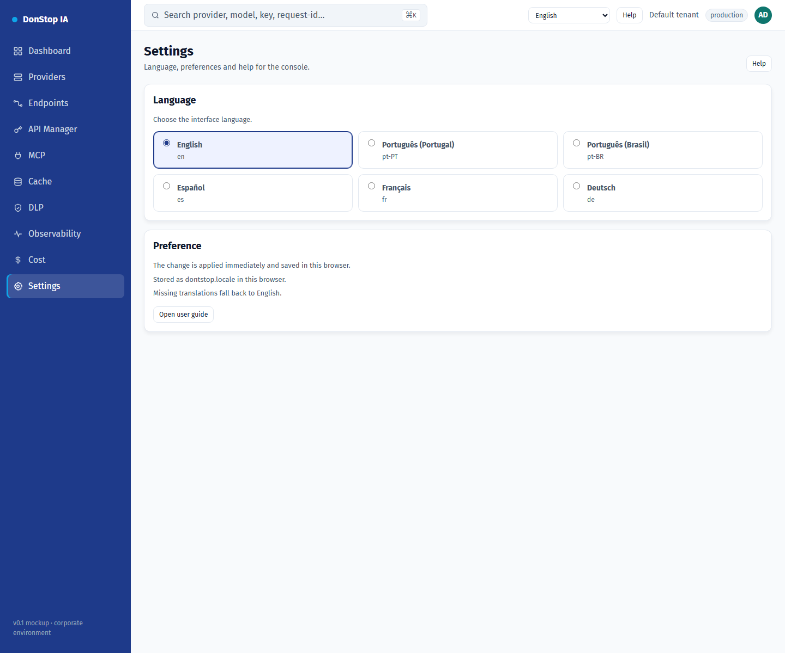

# Settings

## What it does

Lets you change the interface language and review where the preference is stored.

## When to use

Use this screen when you need to inspect, configure or operate this part of the gateway.

## Step by step

1. Open **Settings** from the sidebar.
2. Review the indicators and the main table.
3. Use the actions described below; changes take effect immediately.
4. Pick a language; the interface updates immediately and the choice is saved.

## Fields and actions

| Field or action | Label or action visible on this screen. |
|---|---|
| Language | Label or action visible on this screen. |
| Preference | Label or action visible on this screen. |
| Stored as dontstop.locale in this browser. | Label or action visible on this screen. |
| Missing translations fall back to English. | Label or action visible on this screen. |
| Open user guide | Label or action visible on this screen. |

## Common errors and states

- If data fails to load, retry. If the error persists, check the gateway and provider status.
- If an action is disabled, confirm your role and the tenant scope.
- Empty states are expected before the first request; follow the call to action.

## Related guides

- [Onboarding](onboarding.md)
- [API Manager](api-manager.md)
- [MCP](mcp.md)

> Screenshot of the Settings screen in English.
