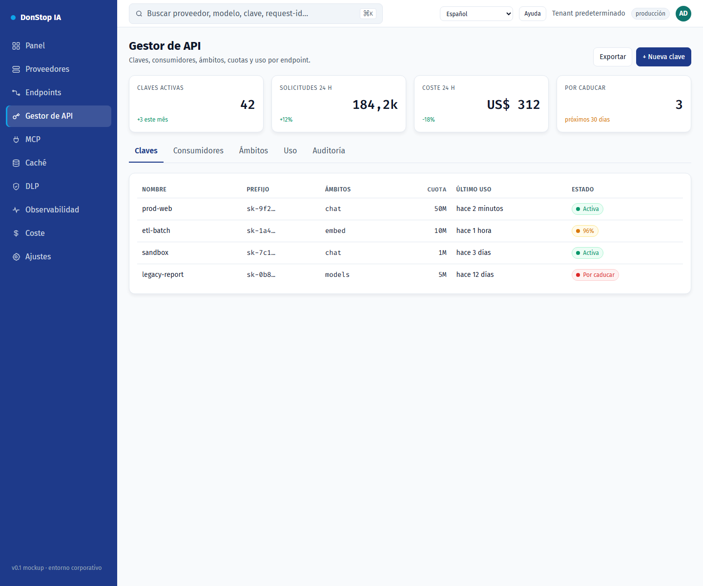

# Gestor de API

## Qué hace

Gestiona claves de API, ámbitos, cuotas, límites de tasa, caducidad y uso por endpoint.

## Cuándo usarla

Use esta pantalla cuando necesite inspeccionar, configurar u operar esta parte del gateway.

## Paso a paso

1. Abra **Gestor de API** desde la barra lateral.
2. Revise los indicadores y la tabla principal.
3. Use las acciones descritas abajo; los cambios se aplican de inmediato.
4. Abra una clave para revisar ámbitos y uso, o use + Nueva clave para crear una.

## Campos y acciones

| Campo o acción | Etiqueta o acción visible en esta pantalla. |
|---|---|
| + Nueva clave | Etiqueta o acción visible en esta pantalla. |
| Claves | Etiqueta o acción visible en esta pantalla. |
| Ámbitos | Etiqueta o acción visible en esta pantalla. |
| Cuota | Etiqueta o acción visible en esta pantalla. |
| Último uso | Etiqueta o acción visible en esta pantalla. |
| Estado | Etiqueta o acción visible en esta pantalla. |

## Errores y estados comunes

- Si los datos no cargan, vuelva a intentarlo. Si persiste, revise el gateway y los proveedores.
- Si una acción está deshabilitada, confirme su rol y el ámbito del tenant.
- Los estados vacíos son normales antes de la primera solicitud; siga la llamada a la acción.

## Guías relacionadas

- [Nueva clave de API](new-api-key.md)
- [Endpoints](endpoints.md)
- [Coste](cost.md)

> Captura de pantalla de Gestor de API en Español.
