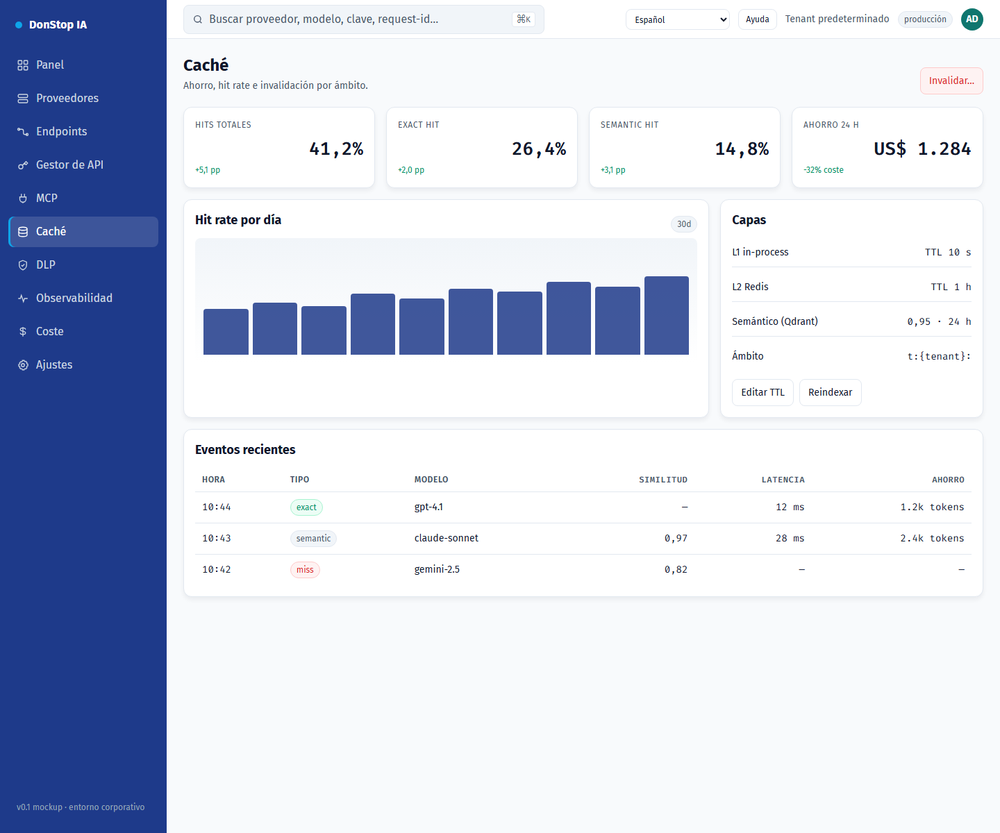

# Caché

## Qué hace

Muestra las capas de caché exacta y semántica, hit rate, ahorro y acciones de invalidación.

## Cuándo usarla

Use esta pantalla cuando necesite inspeccionar, configurar u operar esta parte del gateway.

## Paso a paso

1. Abra **Caché** desde la barra lateral.
2. Revise los indicadores y la tabla principal.
3. Use las acciones descritas abajo; los cambios se aplican de inmediato.
4. Revise el hit rate y el ahorro e invalide por modelo, proveedor o tenant si es necesario.

## Campos y acciones

| Campo o acción | Etiqueta o acción visible en esta pantalla. |
|---|---|
| Cache hit | Etiqueta o acción visible en esta pantalla. |
| Ahorro 24 h | Etiqueta o acción visible en esta pantalla. |
| Capas | Etiqueta o acción visible en esta pantalla. |
| Eventos recientes | Etiqueta o acción visible en esta pantalla. |
| Invalidar… | Etiqueta o acción visible en esta pantalla. |

## Errores y estados comunes

- Si los datos no cargan, vuelva a intentarlo. Si persiste, revise el gateway y los proveedores.
- Si una acción está deshabilitada, confirme su rol y el ámbito del tenant.
- Los estados vacíos son normales antes de la primera solicitud; siga la llamada a la acción.

## Guías relacionadas

- [Coste](cost.md)
- [Observabilidad](observability.md)
- [DLP](dlp.md)

> Captura de pantalla de Caché en Español.
