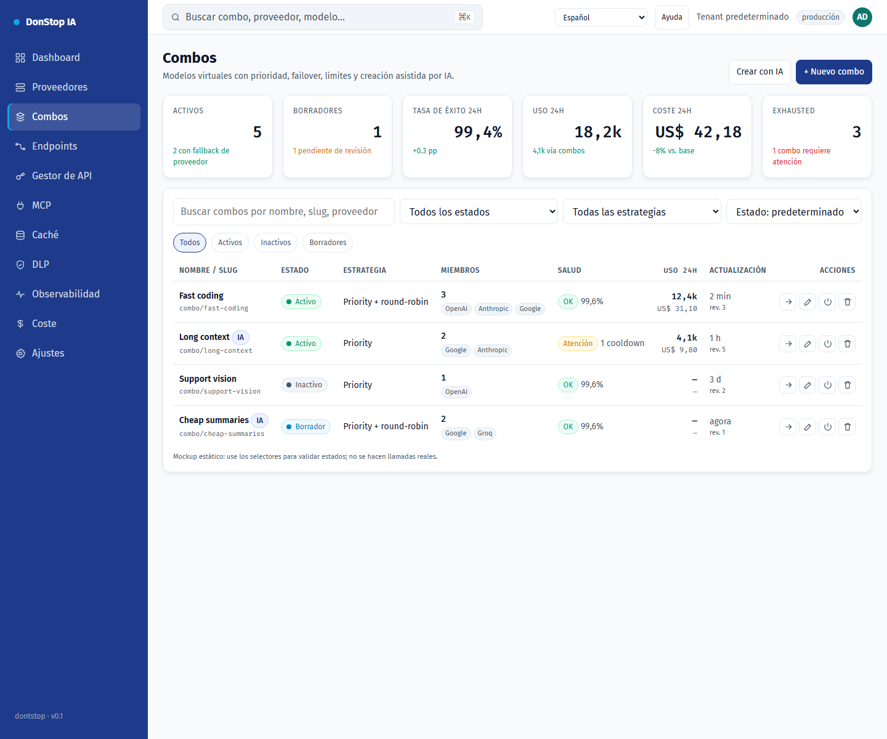

# Combos

## Qué hace

Crea y opera modelos virtuales compuestos por modelos de proveedores, con prioridad, failover, límites y borrador asistido por IA.

## Cuándo usarla

Use esta pantalla cuando necesite inspeccionar, configurar u operar esta parte del gateway.

## Paso a paso

1. Abra **Combos** desde la barra lateral.
2. Revise los indicadores y la tabla principal.
3. Use las acciones descritas abajo; los cambios se aplican de inmediato.
4. Cree manualmente o con IA, revise miembros y avisos, valide y solo entonces guarde y active explícitamente.

## Campos y acciones

| Campo o acción | Etiqueta o acción visible en esta pantalla. |
|---|---|
| Estado | Etiqueta o acción visible en esta pantalla. |
| Editar | Etiqueta o acción visible en esta pantalla. |
| Probar | Etiqueta o acción visible en esta pantalla. |
| Cerrar | Etiqueta o acción visible en esta pantalla. |

## Errores y estados comunes

- Si los datos no cargan, vuelva a intentarlo. Si persiste, revise el gateway y los proveedores.
- Si una acción está deshabilitada, confirme su rol y el ámbito del tenant.
- Los estados vacíos son normales antes de la primera solicitud; siga la llamada a la acción.

## Guías relacionadas

- [Proveedores](providers.md)
- [Endpoints](endpoints.md)
- [Coste](cost.md)

> Captura de pantalla de Combos en Español.
