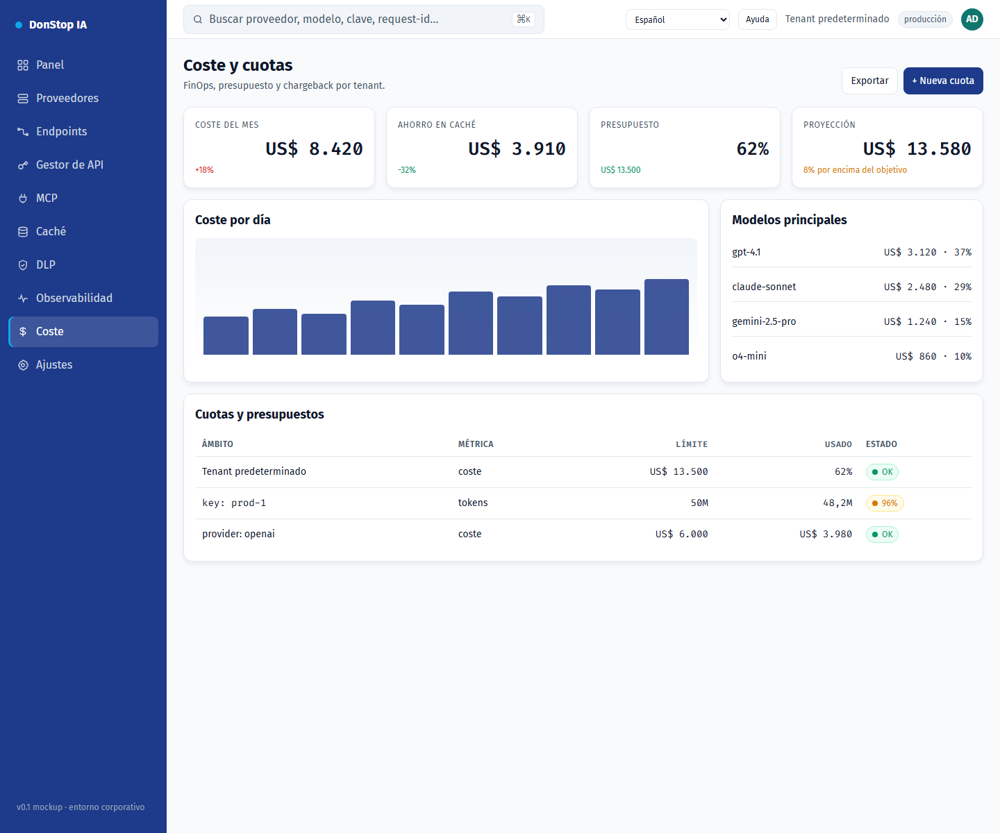

# Coste

## Qué hace

Muestra coste diario y mensual, proyección, presupuesto y cuotas por tenant, clave y proveedor.

## Cuándo usarla

Use esta pantalla cuando necesite inspeccionar, configurar u operar esta parte del gateway.

## Paso a paso

1. Abra **Coste** desde la barra lateral.
2. Revise los indicadores y la tabla principal.
3. Use las acciones descritas abajo; los cambios se aplican de inmediato.
4. Defina cuotas y presupuestos y exporte el informe de chargeback.

## Campos y acciones

| Campo o acción | Etiqueta o acción visible en esta pantalla. |
|---|---|
| Coste hoy | Etiqueta o acción visible en esta pantalla. |
| Coste del mes | Etiqueta o acción visible en esta pantalla. |
| Proyección | Etiqueta o acción visible en esta pantalla. |
| Presupuesto | Etiqueta o acción visible en esta pantalla. |
| Cuotas y presupuestos | Etiqueta o acción visible en esta pantalla. |

## Errores y estados comunes

- Si los datos no cargan, vuelva a intentarlo. Si persiste, revise el gateway y los proveedores.
- Si una acción está deshabilitada, confirme su rol y el ámbito del tenant.
- Los estados vacíos son normales antes de la primera solicitud; siga la llamada a la acción.

## Guías relacionadas

- [Panel](dashboard.md)
- [Gestor de API](api-manager.md)
- [Caché](cache.md)

> Captura de pantalla de Coste en Español.
