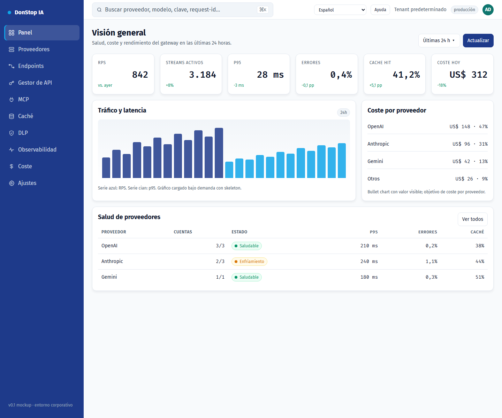

# Panel

## Qué hace

Muestra la salud del gateway, el tráfico, el coste y el estado de los proveedores en las últimas 24 horas.

## Cuándo usarla

Use esta pantalla cuando necesite inspeccionar, configurar u operar esta parte del gateway.

## Paso a paso

1. Abra **Panel** desde la barra lateral.
2. Revise los indicadores y la tabla principal.
3. Use las acciones descritas abajo; los cambios se aplican de inmediato.
4. Revise la salud de los proveedores y los incidentes antes de abrir una traza detallada.

## Campos y acciones

| Campo o acción | Etiqueta o acción visible en esta pantalla. |
|---|---|
| Claves activas | Etiqueta o acción visible en esta pantalla. |
| Solicitudes 24 h | Etiqueta o acción visible en esta pantalla. |
| Coste 24 h | Etiqueta o acción visible en esta pantalla. |
| Por caducar | Etiqueta o acción visible en esta pantalla. |
| Salud de proveedores | Etiqueta o acción visible en esta pantalla. |

## Errores y estados comunes

- Si los datos no cargan, vuelva a intentarlo. Si persiste, revise el gateway y los proveedores.
- Si una acción está deshabilitada, confirme su rol y el ámbito del tenant.
- Los estados vacíos son normales antes de la primera solicitud; siga la llamada a la acción.

## Guías relacionadas

- [Proveedores](providers.md)
- [Observabilidad](observability.md)
- [Coste](cost.md)

> Captura de pantalla de Panel en Español.
