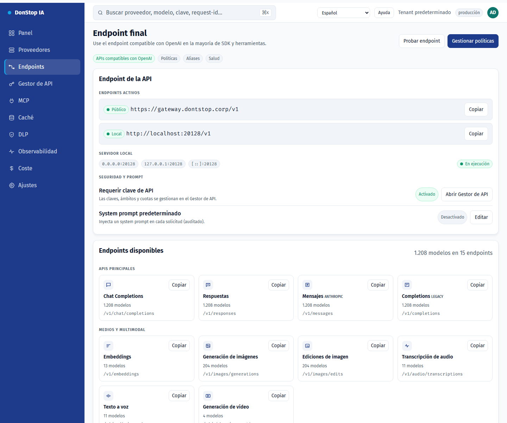

# Endpoints

## Qué hace

Muestra el endpoint final de la API, URLs pública y local, rutas disponibles, alias para CLI y el system prompt opcional.

## Cuándo usarla

Use esta pantalla cuando necesite inspeccionar, configurar u operar esta parte del gateway.

## Paso a paso

1. Abra **Endpoints** desde la barra lateral.
2. Revise los indicadores y la tabla principal.
3. Use las acciones descritas abajo; los cambios se aplican de inmediato.
4. Copie la URL pública o local y use los alias para CLI; no se ofrecen túneles.

## Campos y acciones

| Campo o acción | Etiqueta o acción visible en esta pantalla. |
|---|---|
| URL base | Etiqueta o acción visible en esta pantalla. |
| Público | Etiqueta o acción visible en esta pantalla. |
| Local | Etiqueta o acción visible en esta pantalla. |
| Endpoints disponibles | Etiqueta o acción visible en esta pantalla. |
| Alias para CLIs | Etiqueta o acción visible en esta pantalla. |

## Errores y estados comunes

- Si los datos no cargan, vuelva a intentarlo. Si persiste, revise el gateway y los proveedores.
- Si una acción está deshabilitada, confirme su rol y el ámbito del tenant.
- Los estados vacíos son normales antes de la primera solicitud; siga la llamada a la acción.

## Guías relacionadas

- [Gestor de API](api-manager.md)
- [Proveedores](providers.md)
- [MCP](mcp.md)

> Captura de pantalla de Endpoints en Español.
