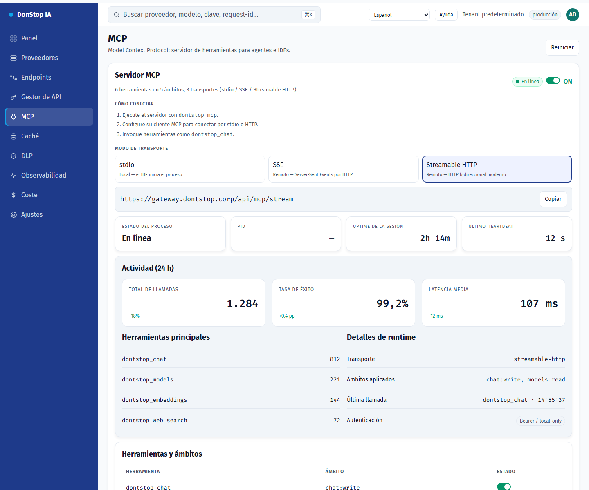

# MCP

## Qué hace

Controla el servidor MCP: activación global, transporte, estado, actividad y herramientas expuestas.

## Cuándo usarla

Use esta pantalla cuando necesite inspeccionar, configurar u operar esta parte del gateway.

## Paso a paso

1. Abra **MCP** desde la barra lateral.
2. Revise los indicadores y la tabla principal.
3. Use las acciones descritas abajo; los cambios se aplican de inmediato.
4. Active el servidor, elija un transporte y copie el comando o la URL.

## Campos y acciones

| Campo o acción | Etiqueta o acción visible en esta pantalla. |
|---|---|
| Servidor MCP | Etiqueta o acción visible en esta pantalla. |
| Modo de transporte | Etiqueta o acción visible en esta pantalla. |
| Actividad (24 h) | Etiqueta o acción visible en esta pantalla. |
| Herramientas y ámbitos | Etiqueta o acción visible en esta pantalla. |
| Reiniciar | Etiqueta o acción visible en esta pantalla. |

## Errores y estados comunes

- Si los datos no cargan, vuelva a intentarlo. Si persiste, revise el gateway y los proveedores.
- Si una acción está deshabilitada, confirme su rol y el ámbito del tenant.
- Los estados vacíos son normales antes de la primera solicitud; siga la llamada a la acción.

## Guías relacionadas

- [Gestor de API](api-manager.md)
- [Endpoints](endpoints.md)
- [Ajustes](settings.md)

> Captura de pantalla de MCP en Español.
