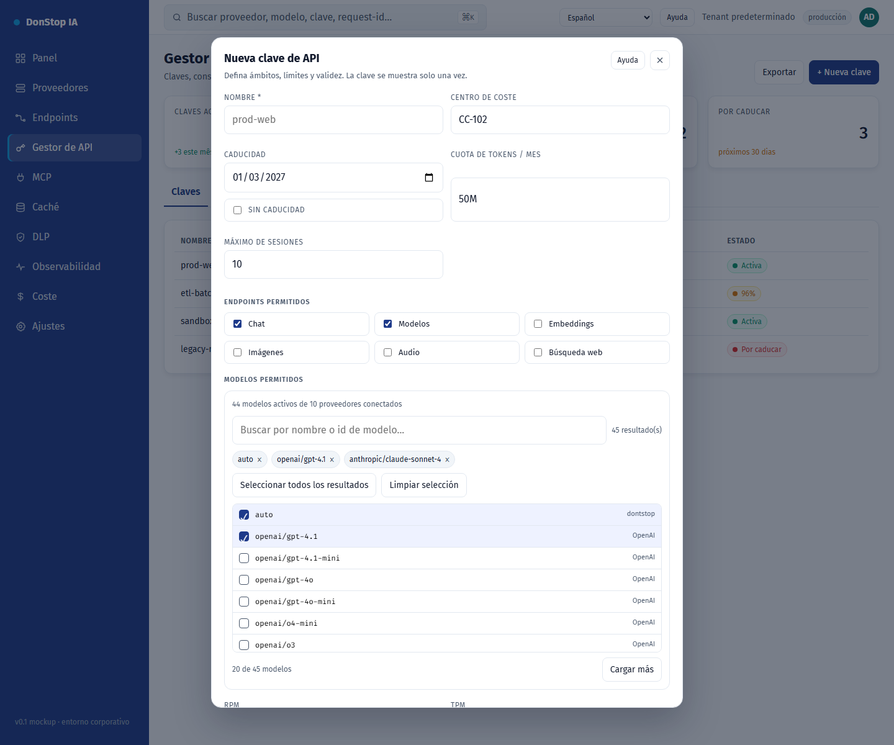

# Nueva clave de API

## Qué hace

Crea una clave de API con ámbitos, restricciones de modelo, cuotas, caducidad y límites de IP/sesión.

## Cuándo usarla

Use esta pantalla cuando necesite inspeccionar, configurar u operar esta parte del gateway.

## Paso a paso

1. Abra **Nueva clave de API** desde la barra lateral.
2. Revise los indicadores y la tabla principal.
3. Use las acciones descritas abajo; los cambios se aplican de inmediato.
4. Complete los campos, seleccione modelos, cree la clave y cópiela una sola vez.

## Campos y acciones

| Campo o acción | Etiqueta o acción visible en esta pantalla. |
|---|---|
| Nombre * | Etiqueta o acción visible en esta pantalla. |
| Centro de coste | Etiqueta o acción visible en esta pantalla. |
| Caducidad | Etiqueta o acción visible en esta pantalla. |
| Cuota de tokens / mes | Etiqueta o acción visible en esta pantalla. |
| Endpoints permitidos | Etiqueta o acción visible en esta pantalla. |
| Modelos permitidos | Etiqueta o acción visible en esta pantalla. |

## Errores y estados comunes

- Si los datos no cargan, vuelva a intentarlo. Si persiste, revise el gateway y los proveedores.
- Si una acción está deshabilitada, confirme su rol y el ámbito del tenant.
- Los estados vacíos son normales antes de la primera solicitud; siga la llamada a la acción.

## Guías relacionadas

- [Gestor de API](api-manager.md)
- [Endpoints](endpoints.md)
- [Coste](cost.md)

> Captura de pantalla de Nueva clave de API en Español.
