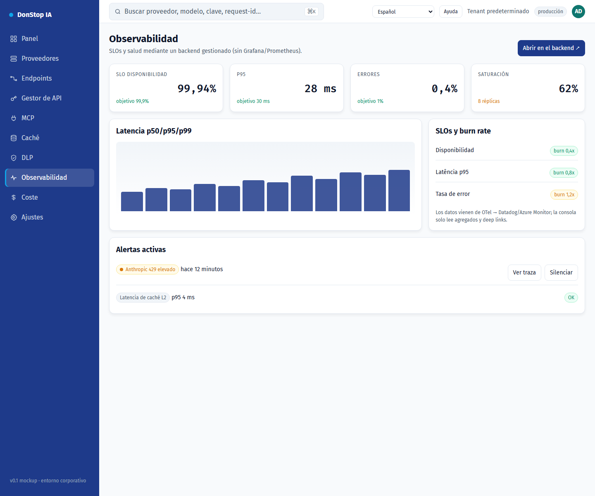

# Observabilidad

## Qué hace

Muestra SLOs, disponibilidad, alertas, tráfico y latencia, con deep links al backend gestionado.

## Cuándo usarla

Use esta pantalla cuando necesite inspeccionar, configurar u operar esta parte del gateway.

## Paso a paso

1. Abra **Observabilidad** desde la barra lateral.
2. Revise los indicadores y la tabla principal.
3. Use las acciones descritas abajo; los cambios se aplican de inmediato.
4. Use los deep links para abrir trazas y detalles de SLO en el backend gestionado.

## Campos y acciones

| Campo o acción | Etiqueta o acción visible en esta pantalla. |
|---|---|
| Disponibilidad | Etiqueta o acción visible en esta pantalla. |
| SLOs y burn rate | Etiqueta o acción visible en esta pantalla. |
| Alertas activas | Etiqueta o acción visible en esta pantalla. |
| Tráfico y latencia | Etiqueta o acción visible en esta pantalla. |
| Abrir en el backend ↗ | Etiqueta o acción visible en esta pantalla. |

## Errores y estados comunes

- Si los datos no cargan, vuelva a intentarlo. Si persiste, revise el gateway y los proveedores.
- Si una acción está deshabilitada, confirme su rol y el ámbito del tenant.
- Los estados vacíos son normales antes de la primera solicitud; siga la llamada a la acción.

## Guías relacionadas

- [Panel](dashboard.md)
- [DLP](dlp.md)
- [Coste](cost.md)

> Captura de pantalla de Observabilidad en Español.
