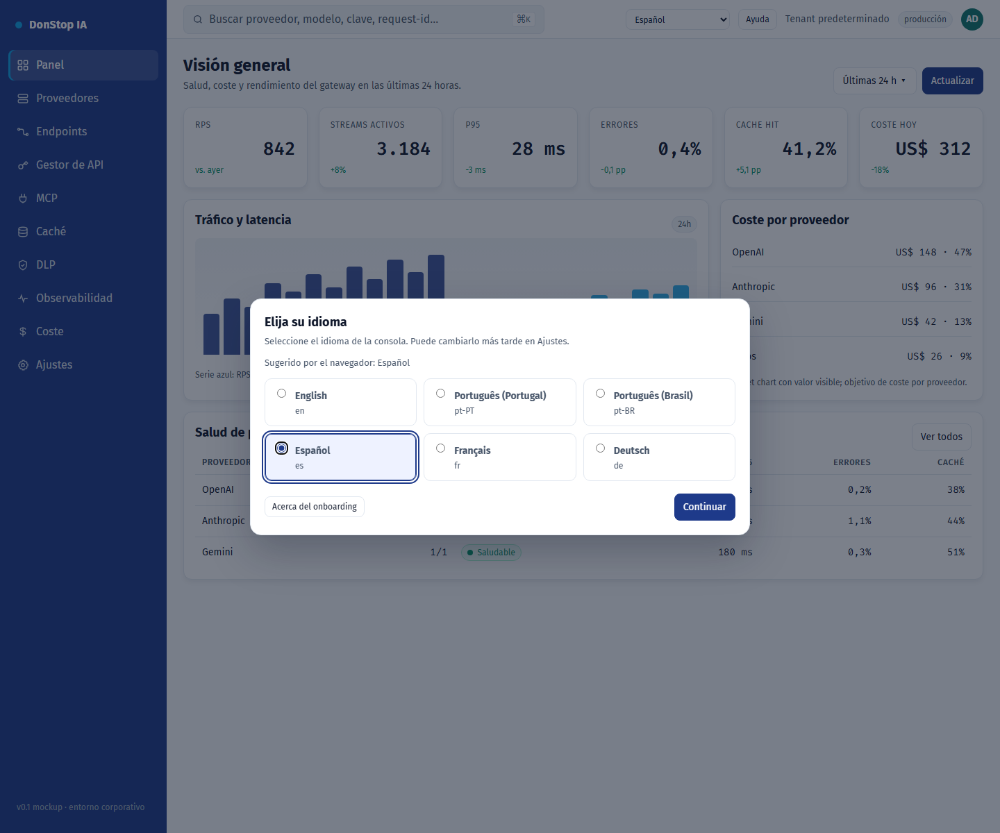

# Onboarding

## Qué hace

Aparece en el primer acceso para elegir el idioma de la interfaz, preseleccionado por el navegador.

## Cuándo usarla

Use esta pantalla cuando necesite inspeccionar, configurar u operar esta parte del gateway.

## Paso a paso

1. Abra **Onboarding** desde la barra lateral.
2. Revise los indicadores y la tabla principal.
3. Use las acciones descritas abajo; los cambios se aplican de inmediato.
4. Elija el idioma sugerido u otro y seleccione Continuar.

## Campos y acciones

| Campo o acción | Etiqueta o acción visible en esta pantalla. |
|---|---|
| Idioma de la interfaz | Etiqueta o acción visible en esta pantalla. |
| Sugerido por el navegador: {locale} | Etiqueta o acción visible en esta pantalla. |
| Continuar | Etiqueta o acción visible en esta pantalla. |
| Acerca del onboarding | Etiqueta o acción visible en esta pantalla. |

## Errores y estados comunes

- Si los datos no cargan, vuelva a intentarlo. Si persiste, revise el gateway y los proveedores.
- Si una acción está deshabilitada, confirme su rol y el ámbito del tenant.
- Los estados vacíos son normales antes de la primera solicitud; siga la llamada a la acción.

## Guías relacionadas

- [Ajustes](settings.md)
- [Panel](dashboard.md)
- [Gestor de API](api-manager.md)

> Captura de pantalla de Onboarding en Español.
