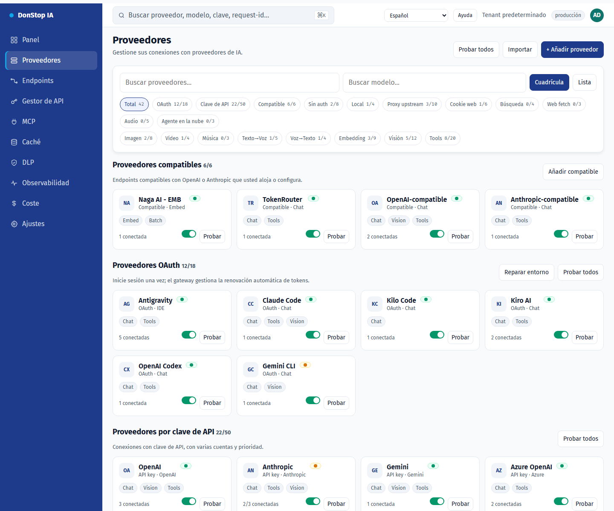
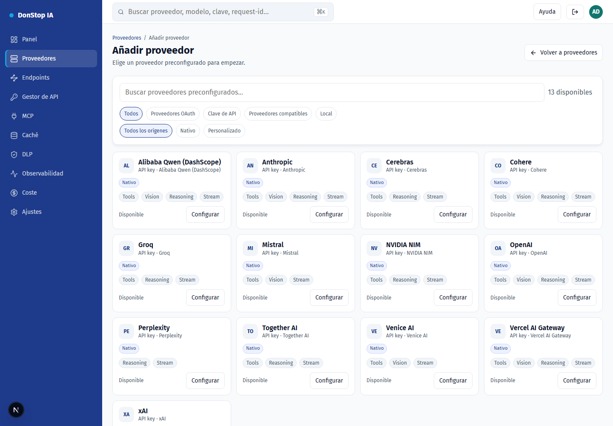
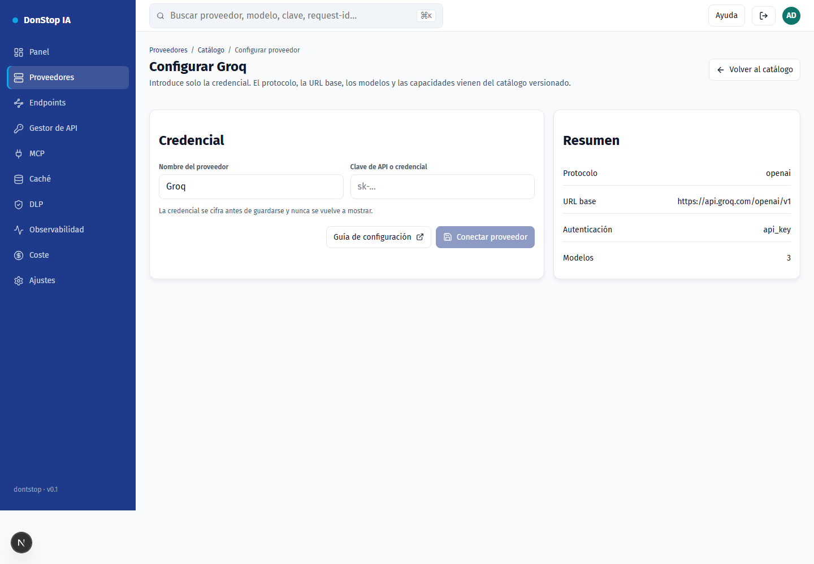
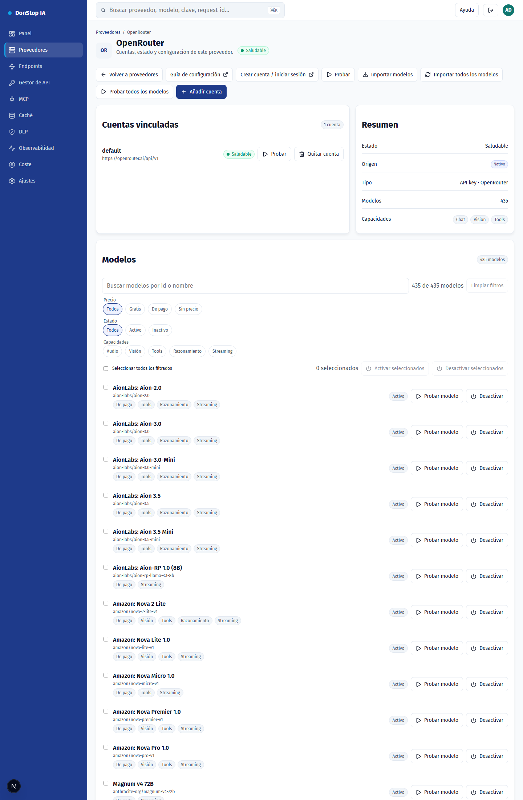

# Configuración de proveedores

Cada proveedor ya está en el catálogo versionado: protocolo, URL base, modelos y capacidades. Solo proporcionas la credencial.

## Cómo configurar

1. Abre Proveedores y elige Añadir proveedor (o la tarjeta del proveedor en el catálogo).
2. Selecciona el proveedor y pulsa Configurar.
3. Crea la API key en la consola del proveedor (enlace abajo).
4. Pega la clave en el campo Credencial y confirma.
5. El proveedor pasa a la lista de configurados; pruébalo e importa modelos si hace falta.

## Paso a paso

## Proveedores compatibles

| Provider | Auth | Base URL |
|---|---|---|
| Alibaba Qwen (DashScope) | API key | https://dashscope-intl.aliyuncs.com/compatible-mode/v1 |
| Anthropic | API key | https://api.anthropic.com |
| Cerebras | API key | https://api.cerebras.ai/v1 |
| Cohere | API key | https://api.cohere.com/compatibility/v1 |
| Groq | API key | https://api.groq.com/openai/v1 |
| Mistral | API key | https://api.mistral.ai/v1 |
| NVIDIA NIM | API key | https://integrate.api.nvidia.com/v1 |
| OpenAI | API key | https://api.openai.com/v1 |
| OpenRouter | API key | https://openrouter.ai/api/v1 |
| Perplexity | API key | https://api.perplexity.ai |
| Together AI | API key | https://api.together.xyz/v1 |
| Venice AI | API key | https://api.venice.ai/api/v1 |
| Vercel AI Gateway | API key | https://ai-gateway.vercel.sh/v1 |
| xAI | API key | https://api.x.ai/v1 |

## Alibaba Qwen (DashScope)

- Auth: API key
- Base URL: https://dashscope-intl.aliyuncs.com/compatible-mode/v1
- Crie a chave no Alibaba Cloud Model Studio (DashScope) e use o endpoint internacional.

## Anthropic

- Auth: API key
- Base URL: https://api.anthropic.com
- O gateway envia x-api-key e anthropic-version; não inclua esses headers manualmente.

## Cerebras

- Auth: API key
- Base URL: https://api.cerebras.ai/v1
- Compatível com OpenAI; use a chave do console da Cerebras.

## Cohere

- Auth: API key
- Base URL: https://api.cohere.com/compatibility/v1
- Use o endpoint de compatibilidade (/compatibility) e a chave do dashboard da Cohere.

## Groq

- Auth: API key
- Base URL: https://api.groq.com/openai/v1
- Compatível com OpenAI; a chave é criada no console da Groq.

## Mistral

- Auth: API key
- Base URL: https://api.mistral.ai/v1
- Compatível com OpenAI; use a chave do console da Mistral.

## NVIDIA NIM

- Auth: API key
- Base URL: https://integrate.api.nvidia.com/v1
- O endpoint de modelos é público; a credencial é exigida nas inferências.

## OpenAI

- Auth: API key
- Base URL: https://api.openai.com/v1
- Use uma chave de projeto. A organizaão/projeto não são enviados pelo gateway.

## OpenRouter

- Auth: API key
- Base URL: https://openrouter.ai/api/v1
- Importe modelos pelo botão Importar modelos ou use o modelo auto.

## Perplexity

- Auth: API key
- Base URL: https://api.perplexity.ai
- Perplexity não expõe /models: o teste e a importação de modelos ficam indisponíveis; o chat funciona.

## Together AI

- Auth: API key
- Base URL: https://api.together.xyz/v1
- Compatível com OpenAI; use a chave em api.together.ai.

## Venice AI

- Auth: API key
- Base URL: https://api.venice.ai/api/v1
- Compatível com OpenAI; a chave é criada em Settings > API.

## Vercel AI Gateway

- Auth: API key
- Base URL: https://ai-gateway.vercel.sh/v1
- Os IDs de modelo são namespaced (ex.: openai/gpt-4.1).

## xAI

- Auth: API key
- Base URL: https://api.x.ai/v1
- Use a chave do console da xAI; o gateway usa o endpoint de chat.

## Filtros y acciones en lote

- Filtra por precio (gratis/de pago/sin precio), capacidades (audio, visión, tools, reasoning, streaming), estado o texto.
- Selecciona todos los modelos filtrados y actívalos o desactívalos a la vez; la app confirma la cantidad e informa cada fallo.
- Los filtros usan metadatos del proveedor; los modelos sin metadatos se muestran como "sin metadatos" y no se infieren por el nombre.
## Modelos

- **Sincronizar modelos** importa todo lo que anuncia el proveedor y conserva el estado activo/inactivo de los modelos existentes.
- **Probar modelo** envía una petición mínima para validar la credencial y la disponibilidad.
- **Activar/Desactivar** define si el modelo aparece en `/v1/models` y recibe tráfico.
- **Probar todos los modelos** pone en cola todos los modelos configurados y ejecuta las pruebas en segundo plano, uno a la vez.
- **Importar todos los modelos** registra todo lo que anuncia el proveedor con un clic.

## Campos

| Field | Description |
|---|---|
| Credencial | API key creada en la consola del proveedor. Se cifra antes de guardarse. |
| Nombre del proveedor | Etiqueta opcional para esta instancia. |
| URL base | Sustitución opcional; vacío usa el valor del catálogo. |

## Errores habituales

- 401: clave inválida o caducada. Crea otra e inténtalo de nuevo.
- 402: la cuenta del proveedor no tiene crédito.
- 429: límite de tasa del proveedor. Espera el cooldown.
- Proveedor fuera del catálogo: aún no tiene adaptador en la puerta de enlace.
