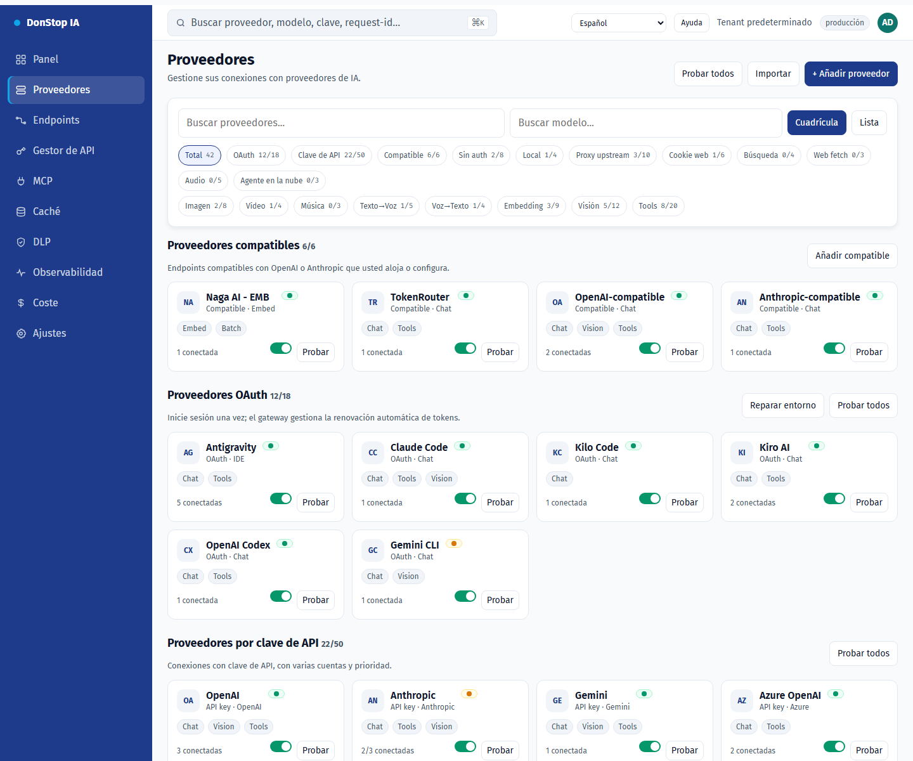

# Proveedores

## Qué hace

Lista proveedores de IA, cuentas, estado de conexión y modelos disponibles, con vistas de cuadrícula/lista y pruebas de conexión.

## Cuándo usarla

Use esta pantalla cuando necesite inspeccionar, configurar u operar esta parte del gateway.

## Paso a paso

1. Abra **Proveedores** desde la barra lateral.
2. Revise los indicadores y la tabla principal.
3. Use las acciones descritas abajo; los cambios se aplican de inmediato.
4. Use Cuadrícula/Lista, filtre por autenticación o capacidad y pruebe el proveedor antes de activarlo.

## Campos y acciones

| Campo o acción | Etiqueta o acción visible en esta pantalla. |
|---|---|
| + Añadir proveedor | Etiqueta o acción visible en esta pantalla. |
| Cuadrícula | Etiqueta o acción visible en esta pantalla. |
| Lista | Etiqueta o acción visible en esta pantalla. |
| Probar | Etiqueta o acción visible en esta pantalla. |
| Estado | Etiqueta o acción visible en esta pantalla. |

## Errores y estados comunes

- Si los datos no cargan, vuelva a intentarlo. Si persiste, revise el gateway y los proveedores.
- Si una acción está deshabilitada, confirme su rol y el ámbito del tenant.
- Los estados vacíos son normales antes de la primera solicitud; siga la llamada a la acción.

## Guías relacionadas

- [Endpoints](endpoints.md)
- [Panel](dashboard.md)
- [Coste](cost.md)

> Captura de pantalla de Proveedores en Español.
