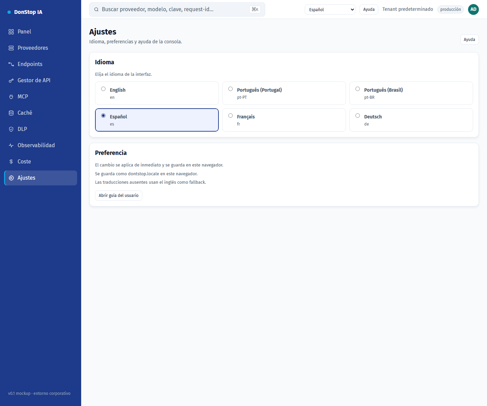

# Ajustes

## Qué hace

Permite cambiar el idioma de la interfaz y revisar dónde se guarda la preferencia.

## Cuándo usarla

Use esta pantalla cuando necesite inspeccionar, configurar u operar esta parte del gateway.

## Paso a paso

1. Abra **Ajustes** desde la barra lateral.
2. Revise los indicadores y la tabla principal.
3. Use las acciones descritas abajo; los cambios se aplican de inmediato.
4. Elija un idioma; la interfaz se actualiza de inmediato y la elección se guarda.

## Campos y acciones

| Campo o acción | Etiqueta o acción visible en esta pantalla. |
|---|---|
| Idioma | Etiqueta o acción visible en esta pantalla. |
| Preferencia | Etiqueta o acción visible en esta pantalla. |
| Se guarda como dontstop.locale en este navegador. | Etiqueta o acción visible en esta pantalla. |
| Las traducciones ausentes usan el inglés como fallback. | Etiqueta o acción visible en esta pantalla. |
| Abrir guía del usuario | Etiqueta o acción visible en esta pantalla. |

## Errores y estados comunes

- Si los datos no cargan, vuelva a intentarlo. Si persiste, revise el gateway y los proveedores.
- Si una acción está deshabilitada, confirme su rol y el ámbito del tenant.
- Los estados vacíos son normales antes de la primera solicitud; siga la llamada a la acción.

## Guías relacionadas

- [Onboarding](onboarding.md)
- [Gestor de API](api-manager.md)
- [MCP](mcp.md)

> Captura de pantalla de Ajustes en Español.
