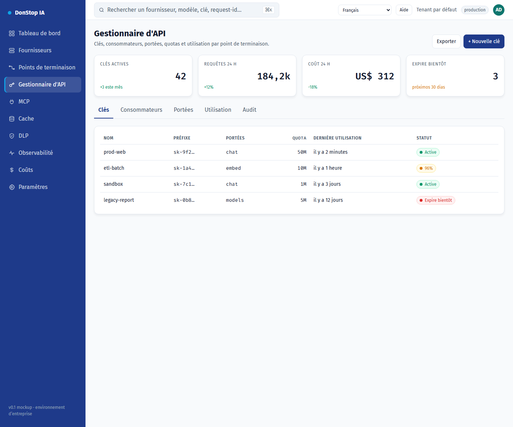

# Gestionnaire d'API

## Ce que fait cet écran

Gère les clés d’API, les portées, les quotas, les limites de débit, l’expiration et l’usage par endpoint.

## Quand l’utiliser

Utilisez cet écran pour inspecter, configurer ou exploiter cette partie de la passerelle.

## Étape par étape

1. Ouvrez **Gestionnaire d'API** depuis la barre latérale.
2. Vérifiez les indicateurs et le tableau principal.
3. Utilisez les actions décrites ci-dessous ; les changements s’appliquent immédiatement.
4. Ouvrez une clé pour vérifier les portées et l’usage, ou utilisez + Nouvelle clé pour en créer une.

## Champs et actions

| Champ ou action | Libellé ou action visible sur cet écran. |
|---|---|
| + Nouvelle clé | Libellé ou action visible sur cet écran. |
| Clés | Libellé ou action visible sur cet écran. |
| Portées | Libellé ou action visible sur cet écran. |
| Quota | Libellé ou action visible sur cet écran. |
| Dernière utilisation | Libellé ou action visible sur cet écran. |
| Statut | Libellé ou action visible sur cet écran. |

## Erreurs et états courants

- Si les données ne se chargent pas, réessayez. Si le problème persiste, vérifiez la passerelle et les fournisseurs.
- Si une action est désactivée, confirmez votre rôle et le périmètre du tenant.
- Les états vides sont normaux avant la première requête ; suivez l’appel à l’action.

## Guides associés

- [Nouvelle clé d'API](new-api-key.md)
- [Points de terminaison](endpoints.md)
- [Coûts](cost.md)

> Capture d’écran de Gestionnaire d'API en Français.
