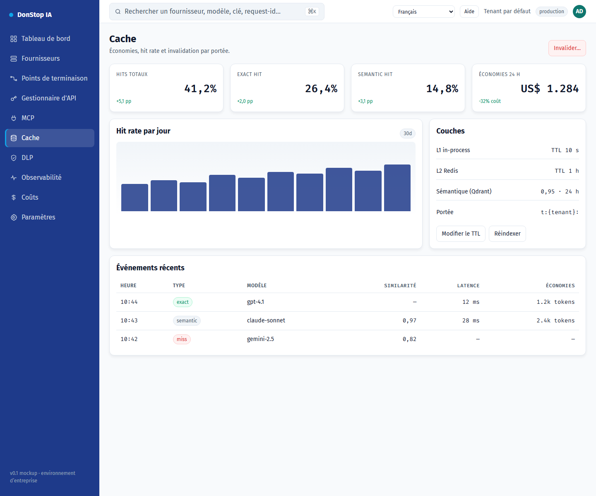

# Cache

## Ce que fait cet écran

Affiche les couches de cache exact et sémantique, le hit rate, les économies et l’invalidation.

## Quand l’utiliser

Utilisez cet écran pour inspecter, configurer ou exploiter cette partie de la passerelle.

## Étape par étape

1. Ouvrez **Cache** depuis la barre latérale.
2. Vérifiez les indicateurs et le tableau principal.
3. Utilisez les actions décrites ci-dessous ; les changements s’appliquent immédiatement.
4. Vérifiez le hit rate et les économies, puis invalidez par modèle, fournisseur ou tenant si nécessaire.

## Champs et actions

| Champ ou action | Libellé ou action visible sur cet écran. |
|---|---|
| Cache hit | Libellé ou action visible sur cet écran. |
| Économies 24 h | Libellé ou action visible sur cet écran. |
| Couches | Libellé ou action visible sur cet écran. |
| Événements récents | Libellé ou action visible sur cet écran. |
| Invalider… | Libellé ou action visible sur cet écran. |

## Erreurs et états courants

- Si les données ne se chargent pas, réessayez. Si le problème persiste, vérifiez la passerelle et les fournisseurs.
- Si une action est désactivée, confirmez votre rôle et le périmètre du tenant.
- Les états vides sont normaux avant la première requête ; suivez l’appel à l’action.

## Guides associés

- [Coûts](cost.md)
- [Observabilité](observability.md)
- [DLP](dlp.md)

> Capture d’écran de Cache en Français.
