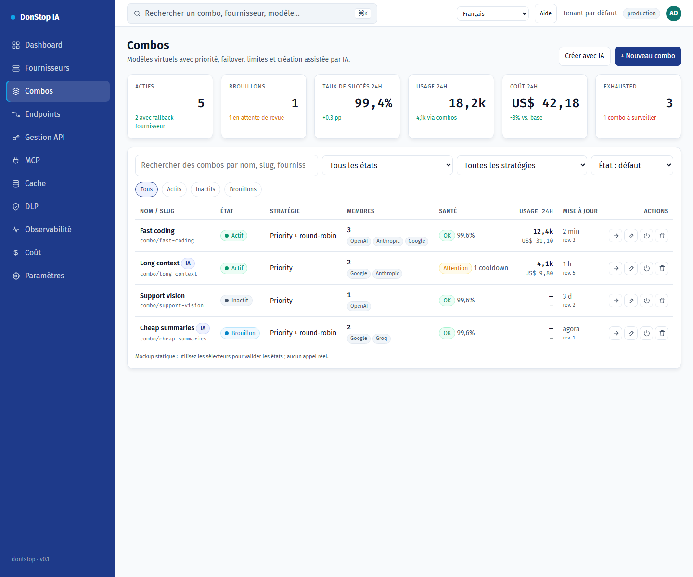

# Combos

## Ce que fait cet écran

Crée et exploite des modèles virtuels composés de modèles de fournisseurs, avec priorité, failover, limites et brouillon assisté par IA.

## Quand l’utiliser

Utilisez cet écran pour inspecter, configurer ou exploiter cette partie de la passerelle.

## Étape par étape

1. Ouvrez **Combos** depuis la barre latérale.
2. Vérifiez les indicateurs et le tableau principal.
3. Utilisez les actions décrites ci-dessous ; les changements s’appliquent immédiatement.
4. Créez manuellement ou avec l’IA, révisez les membres et avertissements, validez, puis enregistrez et activez explicitement.

## Champs et actions

| Champ ou action | Libellé ou action visible sur cet écran. |
|---|---|
| Statut | Libellé ou action visible sur cet écran. |
| Modifier | Libellé ou action visible sur cet écran. |
| Tester | Libellé ou action visible sur cet écran. |
| Fermer | Libellé ou action visible sur cet écran. |

## Erreurs et états courants

- Si les données ne se chargent pas, réessayez. Si le problème persiste, vérifiez la passerelle et les fournisseurs.
- Si une action est désactivée, confirmez votre rôle et le périmètre du tenant.
- Les états vides sont normaux avant la première requête ; suivez l’appel à l’action.

## Guides associés

- [Fournisseurs](providers.md)
- [Points de terminaison](endpoints.md)
- [Coûts](cost.md)

> Capture d’écran de Combos en Français.
